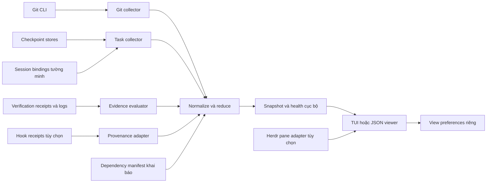
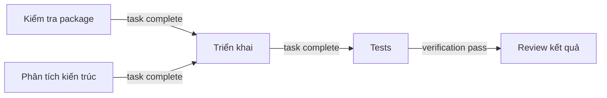

# Kế hoạch triển khai Dreamy Local Dashboard

Ngày lập: **23/10/2026**. Trạng thái: **đề xuất, chưa triển khai**.

Baseline đã đối chiếu: commit `507b3f3ee0a3869800dc1546af40d6b31ff4dd9a`, `toolkit.json` và `package.json` cùng ghi **`0.1.0-alpha.4`**. Maturity của evolution vẫn là `experimental-local`; native runtime verification và semantic quality là `not-established`. Những mô tả phiên bản cũ trong tài liệu evolution không thay thế canonical registry.

Phạm vi lần viết này: tạo một plan Markdown. Các command, schema, đường dẫn module và hành vi dashboard dưới đây là **contract dự kiến**, trừ những mục đánh dấu **đã quan sát**. Việc có plan không chứng minh feature đã chạy, không cài Herdr và không cho phép tự chạy thêm model.

## 1. Kết quả cần đạt

Xây một màn hình chạy cục bộ giúp người dùng trả lời ngay:

1. Repository có những worktree và branch nào? Worktree nào có thay đổi chưa commit?
2. Session/task nào liên quan tới từng worktree? Dữ liệu liên kết đến từ đâu?
3. Công việc đang active, bị blocked, bị cancelled hay đã được báo complete?
4. Check nào pass, fail, stale, degraded hoặc chưa chạy? Có đủ bằng chứng cho phiên bản source hiện tại không?
5. Màn hình còn kết nối với producer hay đang hiển thị snapshot cũ?

Ưu tiên triển khai: **Git/worktree → task và verification → viewer và khôi phục → pane Herdr tùy chọn → DAG khai báo**. Điều phối agent là một initiative tiếp theo, có phạm vi và budget riêng.

Dashboard chỉ tổng hợp dữ liệu có sẵn và trạng thái do adapter cung cấp. Refresh, render, restore và cập nhật badge không gọi model, không tạo prompt phụ và không đưa toàn bộ dashboard vào context của agent.

### 1.1. Các quyết định nền

| Quyết định | Contract dự kiến |
|---|---|
| Giao diện đầu tiên | TUI trong terminal; có JSON để debug và tích hợp |
| Runtime | Dùng Node ESM hiện có, giữ engine `>=20` nếu kiểm thử cho phép |
| Dependency | MVP ưu tiên Node built-in; chưa thêm React, Electron, Rust daemon hoặc terminal framework |
| Nguồn Git | Đọc bằng Git CLI với argv cố định, không parse output dành cho con người |
| Nguồn task | Đọc checkpoint hiện có; thêm liên kết session một cách tương thích |
| Nguồn verification | Receipt, fingerprint và log hash hiện có |
| Hoạt động agent | Chỉ hiện khi có nguồn xác nhận; mặc định `unknown` |
| Quyền của viewer | Đọc snapshot; chỉ ghi lựa chọn giao diện của chính view |
| Quyền của collector | Đọc nguồn đã chọn, ghi cache dashboard do nó sở hữu |
| Pane | Herdr là adapter tùy chọn, không phải dependency bắt buộc |
| DAG | Chỉ vẽ cạnh đã khai báo; chưa có scheduler |
| Thao tác Git | MVP chỉ quan sát; create/remove/checkout/merge nằm ngoài phạm vi |

## 2. Hiện trạng đã kiểm tra

### 2.1. Sự thật từ repository Dreamy

| Thành phần đã quan sát | Bằng chứng | Hệ quả thiết kế |
|---|---|---|
| CLI Node ESM; dependencies hiện tại là Ajv và ajv-formats | [`package.json`](../../package.json) | Mở rộng CLI hiện có, không xây ứng dụng riêng ngay |
| Các nhóm `context`, `hooks`, `lessons`, `skills`, `task`, `rollout` được route sang evolution CLI | [`src/cli.js`](../../src/cli.js), [`src/evolution-cli.mjs`](../../src/evolution-cli.mjs) | Dashboard cần command router riêng và tích hợp entrypoint |
| Checkpoint ở `.dreamy/checkpoints/<session-key>.json` | [`src/verification-plan.mjs`](../../src/verification-plan.mjs) | Có nguồn task cục bộ để đọc ngay |
| `sessionKey()` là 32 ký tự đầu của SHA-256 session ID; nội dung checkpoint không lưu native session ID | [`src/lib/local-data.mjs`](../../src/lib/local-data.mjs) | Không suy ngược native session ID từ tên file |
| Mỗi session có một checkpoint hiện hành; task mới ghi đè checkpoint session đó | [`writeCheckpoint()`](../../src/verification-plan.mjs) | Không hứa có lịch sử task đầy đủ từ dữ liệu cũ |
| Trạng thái checkpoint v1 là `active`, `blocked`, `cancelled`, `complete` | [`task-checkpoint.schema.json`](../../schemas/task-checkpoint.schema.json) | Giữ nguyên ý nghĩa trạng thái, thêm projection riêng |
| Writer bổ sung source fingerprint, required commands và timestamp | [`writeCheckpoint()`](../../src/verification-plan.mjs) | Dùng metadata thực tế; schema input không mô tả hết stored record |
| Receipt có source/verification fingerprint, platform, Node version, log hash và `inputsUnchanged` | [`verification-receipt.schema.json`](../../schemas/verification-receipt.schema.json) | Badge pass phải dựa eligibility, không chỉ đọc `status` |
| `evidenceFor()` chỉ trả receipt pass còn hợp lệ | [`src/verification-plan.mjs`](../../src/verification-plan.mjs) | Muốn hiện fail/degraded/stale phải đọc thêm receipt; tách eligibility evaluator dùng chung |
| Receipt v1 không có session/worktree binding tường minh | [`runVerification()`](../../src/verification-plan.mjs) | Không tự nhận receipt là bằng chứng riêng của một session khi task ID trùng |
| Hook receipt là opt-in, nằm ở `.dreamy/hook-receipts/`; file được ghi đè theo session và event type | [`src/hooks/runner.mjs`](../../src/hooks/runner.mjs) | Không coi đây là event log đầy đủ hoặc heartbeat |
| Hook receipt ghi `source: native-or-explicit-invocation` | [`src/hooks/runner.mjs`](../../src/hooks/runner.mjs) | Receipt đơn lẻ không chứng minh native delivery hoặc agent đang chạy |
| Hook checkpoint handler cập nhật timestamp/lifecycle; Interrupt có thể đánh dấu cancelled | [`src/hooks/handlers/checkpoint.mjs`](../../src/hooks/handlers/checkpoint.mjs) | Không suy thời điểm bắt đầu task hay completion từ `updatedAt` |
| Helper hiện có hỗ trợ bounded read, atomic write, lock và kiểm tra symlink | [`src/lib/local-data.mjs`](../../src/lib/local-data.mjs) | Tái sử dụng sau khi xét giới hạn kích thước và semantics lock |
| Rollout snapshot có probe native và ghi dữ liệu theo ngày | [`src/rollout-snapshot.mjs`](../../src/rollout-snapshot.mjs) | Không gọi lại rollout/probe mỗi lần refresh dashboard |
| Repo chưa có dashboard module/schema/router | Cây `src/`, `schemas/`, route CLI tại baseline | Các phần tương ứng trong plan là việc mới |

`commandsFor()` hiện là mapping check tối thiểu theo file. Command ID `validate` chạy `node src/cli.js validate`; nó **không tương đương** toàn bộ `npm run validate` hoặc `npm test`. UI phải nêu command/scope thực tế, không đổi tên badge thành “full CI passed”.

### 2.2. Tách loại thông tin

| Loại | Ví dụ | Cách ghi nhận |
|---|---|---|
| Observed fact | Checkpoint hiện chỉ có bốn trạng thái | Gắn file/commit đã đọc |
| Intended contract | TUI render snapshot và không chạy test | Viết thành acceptance criterion cho implementation |
| Unresolved hypothesis | Poll 5 giây đủ mượt với 10 worktree | Đưa vào performance trial, chưa coi là kết quả |

Không nâng maturity hoặc sửa version chỉ vì plan được viết xong. Trước khi implementation bắt đầu, đối chiếu lại HEAD, registry và working tree để cập nhật baseline nếu đã thay đổi.

## 3. Bài học upstream và giới hạn áp dụng

| Nguồn | Quan sát/phạm vi đối chiếu | Áp dụng vào Dreamy |
|---|---|---|
| [Herdr worktree schema, pin `5bd900d`](https://github.com/herdrdev/herdr/blob/5bd900d88c80d95f5b145397e45bbeea398b8165/src/api/schema/worktrees.rs) | Khai báo list/create/open/remove và metadata worktree | Học mô hình workspace; Git CLI vẫn là nguồn MVP |
| [oh-my-codex README](https://github.com/Yeachan-Heo/oh-my-codex/blob/main/README.md) | Đối chiếu README tại thời điểm viết, có workflow theo worktree và state local | Tham khảo trải nghiệm; chưa dùng API nội bộ hoặc phụ thuộc runtime OMX |

Worktree schema nêu trên đã được đọc qua GitHub connector trong lần lập plan. Không chạy upstream code. README OMX là nguồn động, chưa pin full commit; nếu triển khai adapter OMX sau này phải pin lại source và license. Các khẳng định chi tiết từ khảo sát người dùng chưa đối chiếu lại được giữ ở vai trò đầu vào nghiên cứu.

## 4. Phạm vi theo phiên bản

### 4.1. MVP — dashboard dùng được độc lập

- Liệt kê tất cả worktree thuộc repository được chọn, gồm main checkout, detached, locked, missing/prunable.
- Hiện branch, HEAD rút gọn, staged/unstaged/untracked/conflicted và thời điểm Git được đọc thành công.
- Đọc checkpoint/receipt từng worktree; hiển thị session key rút gọn khi thiếu native binding.
- Hiện task state, objective, next action, required checks và lý do check chưa đủ điều kiện.
- TUI, JSON snapshot, chế độ đọc snapshot độc lập và khôi phục lựa chọn view.
- Hiện rõ `unknown`, `unavailable`, `disconnected`, `stale`, `ambiguous` khi phù hợp.
- Không gọi model; không cần Herdr, tmux, Codex event bus hoặc Unity Editor để dùng phần Git/task.

### 4.2. Sau MVP

| Mốc | Thêm gì | Điều kiện bắt đầu |
|---|---|---|
| Pane adapter | Mở/đóng/focus viewer qua Herdr, gắn đúng pane nguồn | MVP đạt, xác minh Herdr CLI/protocol và đường quoting thực tế |
| DAG viewer | Hiện graph từ dependency khai báo, vẫn có task list fallback | Task identity/provenance ổn định, schema graph được chốt |
| Runtime adapter | Trạng thái running/idle/tool từ nguồn runtime được chứng minh | Có API/event public hoặc adapter được pin và acceptance thật |
| Orchestration | Retry/cancel/checkpoint và quản lý agent theo workflow | Proposal riêng về ownership, budget, authorization và lifecycle |

### 4.3. Ngoài phạm vi initiative này

Không triển khai background LLM observer, tự chọn model, đọc reasoning/token stream, memory embedding, remote telemetry, cloud sync, web hosting, Git mutation hay tự tiếp tục công việc khi viewer mở lại. Không tự sửa `/home/tutrinh/.codex/config.toml`, bật hooks/trust, cài Herdr hoặc thay global runtime.

## 5. Trải nghiệm màn hình

### 5.1. Bố cục TUI

```text
Dreamy · repo: dreamy-codex-toolkit       producer: connected
Git: 2s ago     task store: 1s ago       runtime activity: unavailable

WORKTREE / BRANCH                 GIT             TASK             CHECKS
> toolkit / feature/dashboard    S0 U2 ?1 !0      active           1/2 eligible
  toolkit-fix / fix/pack         S1 U0 ?0 !0      complete         fail
  toolkit-review / detached      clean           no checkpoint    unknown

Task: dashboard-mvp     Session: a81f… (checkpoint key; native ID unknown)
Objective: Hiển thị branch/worktree và verification
Next: Chạy kiểm tra phần collector
Agent activity: unknown            Task state: active
validate: pass · current inputs    unit: not-run
Evidence: task-scoped              Source: local checkpoint + receipts

[Tab] Worktrees/Tasks/Checks  [Enter] Chi tiết  [Space] Thu gọn
[/] Lọc  [r] Refresh  [q] Đóng viewer
```

`S/U/?/!` lần lượt là số đường dẫn staged, unstaged, untracked và conflicted. Một đường dẫn có thể có cả staged lẫn unstaged; không cộng chúng thành số file duy nhất. Count conflicted được tính riêng và có legend.

Pane hẹp dưới 80 cột chuyển sang card nhiều dòng; không làm mất trạng thái, lý do blocked hay trạng thái freshness. Chuỗi tiếng Việt, emoji hoặc branch dài không được làm lệch cột; nếu MVP chưa xử lý display width đầy đủ, dùng bố cục không căn cột cho chuỗi đó và ghi giới hạn kiểm thử.

### 5.2. Danh sách worktree

- Pin worktree đang xem trước; sau đó ưu tiên conflict, blocked, failed checks, active; thứ tự ổn định để không nhảy selection.
- Cho phép lọc branch/path/task/status; không hiển thị phần trăm tiến độ nếu thiếu số task hoàn chỉnh.
- Một worktree có nhiều session/task; summary hiện số lượng và trạng thái đáng chú ý, Enter mở tất cả.
- Worktree chưa có Dreamy vẫn hiện Git và `no checkpoint`; không ép cài toolkit vào từng worktree.
- File path khó hiển thị được escape; copy path giữ giá trị gốc thông qua thao tác được hỗ trợ, không thực thi chuỗi đó.

### 5.3. Ba trạng thái độc lập

| Trục | Các giá trị dự kiến | Điều kiện |
|---|---|---|
| Task | `active`, `blocked`, `cancelled`, `complete`, `unknown` | Từ checkpoint hoặc task source xác định |
| Agent activity | `running`, `idle`, `tool`, `unknown`, `unavailable` | Chỉ từ adapter có provenance; Git/process existence không đủ |
| Verification | `pass`, `fail`, `not-run`, `degraded`, `stale`, `unknown`, `ambiguous` | Từ receipt và eligibility evaluator |

Ví dụ bắt buộc: `idle / active / not-run`, `unknown / complete / fail`, `running / active / stale`. Không đổi `idle` thành `complete` và không hiển thị `complete` thành “verified” tự động.

### 5.4. Quy tắc “complete + verified”

Chỉ hiện badge này khi đồng thời có:

1. Task source báo `complete` cho đúng task occurrence.
2. Tập required commands được biết rõ và gắn với source/task hiện tại.
3. Mỗi required command có receipt hợp lệ, xác định được phạm vi liên kết.
4. Fingerprint source và verification, runtime/platform, log integrity và `inputsUnchanged` đáp ứng evaluator dùng chung.
5. Việc đọc nguồn và đánh giá eligibility của lượt quan sát hiện tại hoàn tất, không có ambiguity hoặc lỗi freshness.

Nếu thiếu điều kiện: hiện `complete · verification pending/failed/stale/unknown` cùng lý do. Một failure mới hơn không được bị che bởi receipt pass cũ cùng phạm vi; evaluator phải xác định attempt mới nhất tương thích. Khi không có ordering đáng tin cậy, hiện conflict/ambiguous thay vì tự chọn pass. Đây là chính sách projection mới cần test, không giả định `evidenceFor()` đã xử lý.

## 6. Kiến trúc và ownership



Collector không import viewer. Viewer không gọi Git, test runner, native model API hoặc task mutation. Herdr adapter chỉ quản lý presentation pane; đóng pane không cancel task. Các nguồn checkpoint/receipt tiếp tục do subsystem hiện tại sở hữu; dashboard không sửa chúng để “sửa” trạng thái hiển thị.

### 6.1. Các module dự kiến

```text
src/dashboard-cli.mjs
src/dashboard/
  git.mjs                 # discovery + porcelain parsers
  stores.mjs              # bounded checkpoint/receipt readers
  identity.mjs            # repo/worktree/session/task keys
  bindings.mjs            # explicit links; compatibility with legacy data
  normalize.mjs           # source records -> display model
  snapshot.mjs            # schema, revision, serialization
  collector.mjs           # polls, queues, coalesce, partial failures
  health.mjs              # source freshness, producer lease/heartbeat
  viewer.mjs              # terminal lifecycle + input handling
  render.mjs              # pure text/layout functions
  preferences.mjs         # per-view selection/folding/filter state
  adapters/herdr.mjs      # later, optional
  graph.mjs               # later, declared DAG validation/projection
schemas/dashboard-snapshot.schema.json
schemas/dashboard-binding.schema.json
schemas/dashboard-view.schema.json
schemas/dashboard-graph.schema.json   # later
tests/unit/dashboard-*.test.mjs
tests/fixtures/dashboard/
scripts/dashboard-acceptance-lab.mjs
docs/dashboard.md
```

Tách eligibility thuần sang module dùng chung, ví dụ `src/verification-eligibility.mjs`, nếu review cho thấy cần thiết. Giữ public exports hiện có của `verification-plan.mjs` tương thích. Không sao chép một evaluator gần giống vào dashboard vì sẽ lệch chính sách về sau.

### 6.2. Những file hiện có cần cập nhật khi triển khai

| File | Thay đổi dự kiến | Gate |
|---|---|---|
| `src/cli.js` | Route `dashboard` sang parser riêng | Không làm hỏng parser install/update/evolution |
| `src/verification-plan.mjs` | Tái sử dụng evaluator, hỗ trợ binding nếu cần | Unit/lessons/Stop regressions pass |
| `src/evolution-cli.mjs` | Chỉ nối binding cho task writer nếu cần | Không đổi nghĩa command đã có |
| `src/hooks/install.mjs` | Chỉ xét khi có thêm dependency trong staged runtime | Kiểm tra file-copy closure trước khi chạm hook runtime |
| `scripts/validate.mjs`, `toolkit.json` | Đăng ký schema/capability đúng convention | Registry vẫn canonical; maturity theo evidence |
| `package.json` | Package assets, script lab nếu cần | Packed CLI chạy offline, giữ engine đã khai báo |
| Docs/README | Hướng dẫn dùng và trạng thái hỗ trợ | Command examples trùng implementation |

MVP ưu tiên không thêm writer vào hook path. Nếu refactor verification làm hook runner cần module mới, phải cập nhật staging và test installed runtime; test trong checkout không đủ.

## 7. Thu thập Git và định danh

### 7.1. Các lệnh đọc dự kiến

Thực thi bằng `spawn`/`execFile`, argv array, `shell: false`, timeout và output limit. Áp dụng `GIT_OPTIONAL_LOCKS=0`, vô hiệu fsmonitor khi đọc để tránh chạy helper từ cấu hình repository; không tự override `safe.directory` hoặc trust repository.

```text
git -C <target> rev-parse --path-format=absolute --git-common-dir
git -C <target> rev-parse --path-format=absolute --git-dir
git -C <target> worktree list --porcelain -z
git -C <worktree> -c core.fsmonitor=false status --porcelain=v2 -z --branch --untracked-files=normal
```

P0 xác minh minimum Git version cho các option trên. Git thiếu option thì báo unsupported với exact version/reason; chỉ thêm fallback parser khi có fixture và test riêng. Không thay bằng parse `git status` dạng human-readable.

Parser phải đọc NUL records bằng Buffer, phân biệt rename có hai đường dẫn, unmerged và filenames có newline/tab/space. Không `split('\n')` cho path records. Summary chỉ cần counts; không đọc diff hoặc file content để đếm thay đổi. Không gọi `fetch` để tính ahead/behind; thông tin upstream nếu có chỉ phản ánh local refs.

Mỗi worktree đọc độc lập. Worktree mất mount, locked, prunable, bare, unborn branch hoặc bị xóa giữa poll phải hiện trạng thái riêng; một lỗi không làm mất những worktree còn đọc được. Không chạy `git worktree prune` hoặc remove để xử lý lỗi discovery.

### 7.2. Identity dự kiến

| Key | Cách tạo | Điều cần tránh |
|---|---|---|
| `repoId` | Hash canonical Git common directory trên máy hiện tại | Không dùng remote URL vì repo có thể không remote hoặc trùng remote |
| `worktreeId` | Hash `repoId` + canonical Git administrative directory | Không chỉ dùng branch; detached và đổi branch vẫn cùng worktree |
| `sessionKey` | Giữ hàm `sessionKey()` hiện có khi biết native ID | Không hash lại checkpoint filename; không suy ngược ID |
| `taskKey` | Worktree + session key + task ID + occurrence ID khi đã có | Không coi `taskId` là unique toàn repository |
| `viewKey` | Repo/worktree scope + viewer instance hoặc pane binding | Không để hai pane ghi đè mọi preference của nhau |

Identity local, không dùng làm định danh portable/cross-machine. Nếu Git metadata được tạo lại hoặc worktree bị remove/recreate, phải xác định generation mới hoặc đánh dấu liên kết cũ uncertain; không tái gắn session chỉ vì đường dẫn/branch trùng.

### 7.3. Discovery và ranh giới đọc

`--target` xác định repository và nơi lưu cache. Worktree cùng repository có thể nằm ngoài thư mục target; chỉ đọc các root Git đã liệt kê và vượt qua kiểm tra canonical path/quyền truy cập. Mỗi root là một boundary riêng cho `.dreamy/`; không nới `inside()` để tùy ý thoát root. Nếu môi trường chặn root ngoài workspace, giữ entry và reason `unavailable`.

Không quét home, toàn ổ đĩa, sibling repository hoặc toàn bộ Codex sessions. Project không có Git trả lỗi rõ; project có Git nhưng không có Dreamy vẫn dùng được bảng worktree.

## 8. Liên kết task, session và evidence

### 8.1. Đọc dữ liệu cũ

1. Đọc checkpoint tại từng worktree; filename cho biết checkpoint key, không phải native ID hiển thị được.
2. Normalize input schema và các metadata writer thực tế bổ sung; reject malformed/oversized record theo từng file.
3. Native ID không biết thì hiện `session <key-prefix> · native ID unknown`.
4. Receipt liên kết bằng store root, task ID, tập file và fingerprints. Giữ nhãn `task-scoped` cho receipt v1.
5. Hai checkpoint cùng task ID/scope mà chưa phân biệt occurrence: hiện ambiguity. Không dùng receipt chung để làm cả hai session “complete + verified”.
6. Không có checkpoint: hiện `no checkpoint`, không suy ra task từ branch hoặc commit message.

### 8.2. Binding tương thích cho dữ liệu mới

Đề xuất sidecar dưới `.dreamy/dashboard/bindings/<session-key>.json`, không đổi checkpoint v1 ngay trong MVP. Binding gồm worktree ID, checkpoint key, native ID nếu được cấp tường minh, display label, source/provenance, task occurrence và timestamp.

Binding thuộc worktree chứa checkpoint tương ứng. `session link --worktree` phải kiểm tra worktree nằm trong discovery của repository rồi ghi sidecar tại root đó; collector chỉ đọc binding từng root, không tạo binding thay người dùng. Cache tổng hợp và preferences vẫn thuộc `--target` của dashboard. Nếu quyền filesystem không cho ghi worktree được chọn, command link báo unavailable thay vì lưu một liên kết khác scope.

Occurrence được tạo khi bắt đầu task mới; việc cập nhật cùng task giữ occurrence. Nếu writer chưa có tín hiệu phân biệt một lần chạy mới cùng ID, đánh dấu `legacy/ambiguous`, không tự dùng timestamp làm run ID. Một task chạy lại phải có task ID mới hoặc explicit occurrence mới.

Writer verification có thể ghi liên kết receipt ID → occurrence qua một sidecar index. Hợp đồng này chỉ chứng minh liên kết khi writer nhận đúng session/occurrence; nếu caller không cung cấp thì tiếp tục lưu task-scoped receipt. Crash giữa receipt và index tạo receipt unbound, không tạo false positive. Không sửa nội dung receipt cũ hay điền native ID suy đoán.

Một session có thể được liên kết thủ công bằng command dự kiến; đây là metadata do người dùng khai báo, không phải chứng cứ native runtime. Collector chỉ đọc binding, không tự link một phiên Codex đang mở từ tên terminal.

### 8.3. Eligibility và trạng thái receipt

Evaluator dùng chung cần trả hai phần: `recordedStatus` và `eligibility {status, reasons}`. Receipt ghi pass vẫn có thể hiện `stale` nếu source/checker/log/runtime đã đổi.

Tách kiểm tra integrity/eligibility của từng receipt khỏi policy chọn attempt cho UI. Các caller hiện có như `evidenceFor()`, Stop và lessons giữ contract hiện hành; dashboard áp policy latest-attempt một cách tường minh trên cùng evaluator. Thay policy của caller cũ, nếu cần, phải là quyết định riêng kèm regression review, không âm thầm gộp vào refactor.

- Kiểm tra đúng store/worktree, task/occurrence khi có binding, files và fingerprints.
- Xác minh log tồn tại và hash khớp trước khi tính receipt đủ điều kiện.
- Runtime/platform mismatch phải hiện reason cụ thể; không âm thầm bỏ requirement để có badge xanh.
- Thiếu receipt là `not-run` hoặc `unknown` theo khả năng nguồn; không coi là pass.
- Tập requirement rỗng/thiếu metadata là unknown, không dùng quy tắc “0/0 pass”.
- Eligibility pending hoặc đọc bị chặn không giữ badge pass hiện hành; có thể hiện lịch sử pass kèm `not revalidated`.
- Dashboard không chạy lại validate/unit/pack/unity để làm mới badge.

`verificationFingerprint()` có thể hash nhiều file của toolkit. Không gọi đồng bộ cho mọi receipt mỗi 250 ms. Dùng hàng đợi bounded, dedupe theo input set, ưu tiên worktree đang chọn; thay đổi source/receipt làm invalidation trước rồi mới re-evaluate. Cache mtime hoặc Git clean không thay cho kiểm tra content hash. Khi hết deadline, hiển thị pending/degraded và giữ lần đánh giá cuối để truy vết.

Mọi kết luận freshness chỉ có hiệu lực tại `evaluatedAt` của sample. UI không gọi đó là đảm bảo source không thể đổi sau thời điểm đọc.

## 9. Snapshot, health và view state

### 9.1. Phân chia lưu trữ

```text
<target>/.dreamy/dashboard/
  state.json                  # normalized snapshot, generated cache
  health.json                 # producer heartbeat + source poll health
  collector.lock              # single-producer ownership
  bindings/<session-key>.json # explicit metadata; giữ khi clear cache
  views/<view-key>.json        # filter/selection/folding/closed preference
  history/                    # optional bounded observed history, sau MVP
```

`state.json` là dữ liệu dẫn xuất, không phải source of truth của task. `health.json` tách heartbeat khỏi nội dung snapshot để không ghi lại snapshot lớn khi không có thay đổi. Các file checkpoint, receipt, log, lesson, installer state tiếp tục ở vị trí cũ.

Giới hạn mặc định dự kiến: record nguồn 256 KiB theo helper hiện có; snapshot tối đa 2 MiB qua reader chuyên biệt; tối đa 100 worktree, 1.000 checkpoint và 5.000 receipt metadata mỗi collection. Quá giới hạn phải có `truncated`/reason và số liệu đã đọc; không báo “toàn bộ đều pass”. Mỗi vòng đọc có concurrency limit, deadline và output cap riêng.

Chưa giữ lịch sử đầy đủ trong MVP. Snapshot chỉ khôi phục trạng thái đã nhìn thấy gần nhất. Nếu thêm history, ghi rõ “observed history”, giới hạn 7 ngày/10 MiB cho **cache do dashboard tạo**, không prune checkpoint/receipt/lesson hoặc binding người dùng.

### 9.2. Ví dụ snapshot projection dự kiến

```json
{
  "schemaVersion": 1,
  "kind": "dreamy-dashboard-snapshot",
  "revision": 12,
  "generatedAt": "2026-10-23T08:00:00.000Z",
  "repo": { "id": "repo-example", "label": "dreamy-codex-toolkit" },
  "capabilities": {
    "git": "available",
    "checkpoints": "available",
    "verification": "available",
    "nativeActivity": "unavailable",
    "dag": "unavailable"
  },
  "worktrees": [
    {
      "id": "wt-example",
      "branch": "feature/dashboard",
      "git": { "staged": 0, "unstaged": 2, "untracked": 1, "conflicted": 0 },
      "taskKeys": ["task-example"]
    }
  ],
  "tasks": [
    {
      "key": "task-example",
      "taskId": "dashboard-mvp",
      "worktreeId": "wt-example",
      "sessionKey": "checkpoint-key-example",
      "taskState": "active",
      "activity": "unknown",
      "verification": { "summary": "not-run", "required": ["validate", "unit"] },
      "provenance": { "source": "checkpoint-v1", "binding": "legacy" }
    }
  ],
  "diagnostics": [],
  "truncated": false
}
```

ID trong ví dụ chỉ minh họa, chưa phải regex của schema cuối. Schema implementation phải chốt loại ID, enums, limits, required fields và reject unsupported future versions. Không nhúng raw log, command output hoặc transcript vào snapshot.

### 9.3. Ghi an toàn và recovery

- Một collector giữ lock cho target; nhiều viewer được đọc cùng snapshot. Collector thứ hai báo `already running` với cách dùng viewer.
- Writer atomic temp/rename; reader lỗi giữ last-known-good và diagnostic, không thay bằng empty pass.
- Lock chứa PID, start nonce và owner metadata; không chỉ dựa PID có tồn tại. Không auto kill process hoặc tự xóa lock chưa xác định chủ.
- Sau crash, recovery chỉ tiếp quản khi chứng minh producer cũ đã dừng; nếu không chứng minh được, báo busy và hướng dẫn kiểm tra owner.
- Permission, symlink và size checks áp dụng cả temp, lock, health và view state. Mode 0700/0600 khi OS hỗ trợ; không coi POSIX mode là ACL guarantee trên Windows.
- Windows sharing/rename failure cần bounded retry; giữ bản tốt trước đó và lỗi gốc, cleanup chỉ temp do chính writer tạo.

## 10. Polling, freshness và lifecycle

### 10.1. Chu kỳ mặc định dự kiến

| Hoạt động | Mặc định ban đầu | Nguyên tắc |
|---|---|---|
| Git worktree/status poll | 5 giây | 15 giây khi idle; `r` yêu cầu refresh có rate limit |
| Checkpoint/receipt discovery | 2 giây | Scan metadata bounded; watcher chỉ là gợi ý |
| Event coalesce khi có adapter | 250 ms | Áp dụng cho event, không chạy full Git scan mỗi event |
| Health heartbeat | 5 giây | Ghi file nhỏ; có last-success/last-error từng source |
| Viewer repaint | Khi revision, input hoặc clock label đổi | Không clear toàn terminal liên tục |
| Producer disconnected | Quá 15 giây không heartbeat hợp lệ | Dùng clock injection khi test; restart có generation mới |
| Source stale | Quá 30 giây không đọc nguồn thành công | Hiện stale theo source, không gộp thành task blocked |

Đây là cấu hình đề xuất phải đo ở P3, không phải performance đã đạt. Tuổi checkpoint không đồng nghĩa source stale: checkpoint cũ nhưng vừa đọc thành công vẫn là task record cũ có nguồn đọc được. Ngược lại, heartbeat mới không chứng minh Git hoặc verification vừa được thu thập thành công.

Clock live dùng monotonic để tính timeout; timestamp persist dùng UTC ISO-8601. Nếu clock lùi/nhảy hoặc snapshot có timestamp tương lai bất thường, báo freshness uncertain. UI có thể render giờ local; evidence giữ UTC.

### 10.2. Bounded work và fallback

- Không chạy hai poll cùng loại cho cùng worktree đồng thời; một lượt đang chậm thì giữ pending và gộp yêu cầu mới.
- Giới hạn Git subprocess ban đầu là 2; evidence hashing hàng đợi riêng để input TUI không bị khóa.
- Timeout Git ban đầu 3 giây/worktree, configurable có cap; timeout không biến thành `clean`.
- Full hash không xong trong budget thì verification pending; đo trước khi tăng budget.
- Watcher lỗi/mất event vẫn có periodic reconciliation. Filesystem network/removable dùng poll fallback.
- Snapshot chỉ ghi khi semantic state đổi; heartbeat/last successful poll ghi riêng. Flush cuối khi shutdown trong deadline, không trì hoãn thoát vô hạn.
- Bỏ qua cache dashboard khi tính summary thay đổi do dashboard tự sinh; nếu có lọc path phải hiện số entry bị lọc và cho xem Git raw summary. Không sửa `.gitignore` của consumer tự động.

### 10.3. Đóng và mở lại

1. `q` thoát viewer, khôi phục cursor/raw mode/alternate screen của terminal.
2. Nếu viewer và collector cùng process, process dừng poll rồi flush; không cancel task.
3. Viewer trong pane riêng thoát không bắt collector/shared task dừng.
4. Mở lại đọc snapshot ngay, gắn disconnected/stale đến khi producer xác nhận source mới.
5. Giữ filter, selection và thu gọn/mở rộng nếu item còn tồn tại; item mất thì chọn fallback ổn định.
6. `closedByUser` chặn auto-reopen pane từ event. Chỉ explicit open mới xóa preference này.
7. Không tự resume task, retry command hoặc mở lại model session.

## 11. CLI dự kiến

**Các command trong mục này chưa tồn tại tại baseline.** Parser phải reject unknown flags và không âm thầm coi dashboard flags là installer/evolution options.

```bash
# Một lần collect, trả JSON ra stdout; không ghi snapshot mặc định.
dreamy-kit dashboard snapshot --target /path/to/repo --json

# Collector + TUI trong terminal hiện tại; ghi cache phục vụ restore.
dreamy-kit dashboard watch --target /path/to/repo

# Headless producer; stdout là từng snapshot JSON một dòng khi state đổi.
dreamy-kit dashboard watch --target /path/to/repo --format json

# Viewer đọc cache độc lập, không tự chạy Git hoặc start producer.
dreamy-kit dashboard view --target /path/to/repo
dreamy-kit dashboard view --target /path/to/repo --once --json

# Chẩn đoán capability/data paths; không gọi native probe/model.
dreamy-kit dashboard doctor --target /path/to/repo --json

# Binding metadata tường minh, không chứng nhận native runtime.
dreamy-kit dashboard session link --target /path/to/repo \
  --worktree /path/to/worktree --session <native-session-id> --label dev

# Sau MVP: thao tác pane presentation qua Herdr.
dreamy-kit dashboard pane open --target /path/to/repo --adapter herdr
dreamy-kit dashboard pane status --target /path/to/repo --adapter herdr --json
dreamy-kit dashboard pane close --target /path/to/repo --adapter herdr
```

Quy ước exit code: `0` cho thao tác hoàn tất với các capability bắt buộc khả dụng; `1` cho invalid input/internal failure; `2` cho partial/unavailable/degraded. Task fail được hiển thị trong payload, không làm command collector crash. `watch` có source tùy chọn unavailable vẫn hoạt động; khi thoát, JSON/report nêu rõ completeness, không dùng exit 0 để khẳng định tất cả task pass.

Non-TTY không bật raw mode hoặc escape sequence. JSON và diagnostics tách stdout/stderr. `snapshot` không tạo `.dreamy` nếu không được yêu cầu persist. `view` khi chưa có snapshot hiện empty state rõ, không tự tạo collector.

## 12. Pane Herdr tùy chọn

### 12.1. Adapter contract

Adapter chỉ cần các thao tác tương đương `detect`, `openViewer`, `findOwnedPane`, `focusSource`, `closeOwnedPane`. Đây là interface nội bộ dự kiến, chưa phải tên lệnh/API Herdr đã xác minh.

- P4 pin version/protocol, đọc pane CLI/schema đang cài và thử command thật trước khi chốt mapping.
- Dùng binary được resolve rõ, truyền argv array; nếu API nhận shell command, dùng builder có test riêng cho POSIX/PowerShell, không nối input thành command tùy ý.
- Ghi owner token + source pane + repo scope + viewer generation; không nhận diện pane chỉ bằng title giống nhau.
- Mở explicit một lần, không cướp focus; mở lại tìm pane còn tồn tại trước khi tạo mới.
- Source pane không biết hoặc Herdr không có: báo unavailable và hướng dẫn chạy TUI độc lập.
- Cleanup chỉ đóng pane dashboard do adapter sở hữu; không đóng terminal Codex, workspace hoặc worktree.
- Detach không đồng nghĩa task tiếp tục được Dreamy bảo đảm. Chỉ báo những gì Herdr/runtime thực sự xác nhận.
- Parent/child session không được cùng nhận quyền điều khiển một pane; binding xác định một owner.

### 12.2. Gate thực tế

Phải thử stock Herdr trên ít nhất một OS thực: open, update, resize, source focus, `q`, restore disconnected snapshot, repeated open và close-by-user. Mock CLI pass chỉ chứng minh adapter logic. Windows/macOS chưa thử phải ghi unverified; không kế thừa tuyên bố tương thích của upstream.

## 13. DAG khai báo sau MVP

Graph chỉ là một cách xem cùng task data, không thay source of truth hoặc điều phối chạy task.

Manifest dự kiến gồm `schemaVersion`, `workflowId`, `runId`, `nodes` và `edges`. Node tham chiếu task occurrence hoặc explicit external node ID. Edge có `from`, `to`, `condition` với ít nhất hai loại: task báo complete và verification đủ điều kiện. Điều kiện do author khai báo, không suy từ vị trí node.



- Task đơn giản hoặc không có edge dùng danh sách mặc định.
- Reject duplicate node/edge không hợp lệ, cycle, self-edge, cross-run reference và missing endpoint.
- Missing task source hiện unresolved; không coi node đó đã xong hoặc dependency đã thỏa.
- Graph invalid vẫn cho xem task list và diagnostics; không hiển thị readiness suy ra từ graph lỗi.
- Thể hiện blocked reason từ task source riêng với dependency chưa thỏa.
- Chỉ tính counters trên tập node được khai báo đầy đủ, hiện denominator; không gọi đó là phần trăm effort hoặc chất lượng.
- Render ổn định, giới hạn 100 node/200 edge ban đầu; graph lớn chuyển sang bảng dependency, không treo terminal.
- “Ready theo dependency” chỉ là projection. Nó không cấp quyền spawn agent hoặc chạy command.

## 14. Backlog triển khai chi tiết

Mỗi phase là một patch/PR review được; owner dưới đây là **vai trò trách nhiệm**, không yêu cầu chạy nhiều agent. Triển khai mặc định tuần tự, chỉ delegation khi được yêu cầu riêng.

### P0 — Chốt contract và fixture baseline

**Owner:** maintainer/architect. **Ước lượng:** 0,5–1 ngày.

- [ ] Đọc lại registry, CLI routing, stored checkpoint/receipt thực tế, installer/hook staging và tests.
- [ ] Ghi compatibility Git/Node/OS tối thiểu và các option Git được hỗ trợ.
- [ ] Chốt enums task/activity/verification/freshness, provenance và exit codes.
- [ ] Chốt identity, legacy/occurrence ambiguity và receipt precedence policy.
- [ ] Tạo fixture sanitized: hai worktree, nhiều session, task ID trùng, source đổi, receipt fail/stale/malformed.
- [ ] Đăng ký snapshot/binding/view schema, dùng Ajv convention hiện tại.
- [ ] Kiểm tra schema read limit không mâu thuẫn snapshot cap.

**Nghiệm thu:** schema fixtures được validate; negative fixtures bị reject đúng reason; `npm test` pass; không đổi maturity sang supported/native.

### P1 — Git collector và JSON snapshot

**Owner:** CLI developer. **Ước lượng:** 1,5–2 ngày. **Phụ thuộc:** P0.

- [ ] Thêm dashboard router và parser strict riêng.
- [ ] Implement discovery/common-dir/git-dir/worktree parser với NUL records.
- [ ] Collect status counts bằng porcelain v2, bounded subprocess, optional locks off/fsmonitor disabled.
- [ ] Normalize detached/unborn/bare/locked/prunable/missing states.
- [ ] Implement `dashboard snapshot --json` không persist mặc định.
- [ ] Đọc worktree lỗi độc lập và giữ diagnostic per source.
- [ ] Test paths có space, apostrophe, newline trên OS hỗ trợ; Windows path/drive handling riêng.

**Nghiệm thu:** repo fixture thật có ít nhất ba worktree được đếm chính xác; thay đổi file hiện ở snapshot tiếp theo; không tạo/sửa Git refs, index, global config hoặc source bytes. Chụp before/after refs/index/config để kiểm chứng phạm vi đọc.

### P2 — Task, bindings và verification projection

**Owner:** evidence/CLI developer. **Ước lượng:** 2–3 ngày. **Phụ thuộc:** P1.

- [ ] Implement bounded readers từng worktree, malformed record không làm hỏng toàn snapshot.
- [ ] Hiện legacy checkpoint key và native ID unknown một cách trung thực.
- [ ] Tách evaluator dùng chung; giữ behavior callers cũ bằng regression tests.
- [ ] Thêm recorded status/eligibility reasons, latest compatible attempt/conflict policy.
- [ ] Dedupe fingerprint work, queue hashing ngoài input loop.
- [ ] Thêm explicit session link và task occurrence binding tối thiểu; receipt không bound vẫn task-scoped.
- [ ] Xử lý task mới thay checkpoint và ID dùng lại mà không bịa history.
- [ ] Test false-positive completion: complete + missing check, stale source, modified log, wrong runtime, duplicate task ID.

**Nghiệm thu:** không fixture thiếu/không hợp lệ nào hiện complete + verified; idle/unknown không đổi task state; Stop/lessons hiện có không regression. Nếu đụng staged runtime, installed hook smoke cũng phải pass.

### P3 — TUI, producer, recovery và MVP acceptance

**Owner:** CLI/UI developer và tester. **Ước lượng:** 2–3 ngày. **Phụ thuộc:** P2.

- [ ] Implement collector scheduling, heartbeat/source health, lease và atomic snapshots.
- [ ] Implement TUI và JSON watch cùng normalized model.
- [ ] Implement cache-only viewer, keyboard/filter/folding/selection và non-TTY behavior.
- [ ] Implement stale/disconnected/uncertain clock, last-known-good fallback.
- [ ] Khôi phục terminal state khi `q`, Ctrl-C, SIGTERM và exception.
- [ ] Viết acceptance lab tạo repository/worktrees cách ly và fixture checkpoint/receipt.
- [ ] Chạy performance trial, crash/restart và hai viewer đọc một producer.
- [ ] Cập nhật docs, registry status experimental và package smoke.

**Nghiệm thu:** MVP độc lập dùng được khi không có Herdr/Codex hooks; restore không chạy task; đo zero dashboard model calls; `npm test`, relevant pack smoke và lab pass trên môi trường công bố.

**Điểm dừng có giá trị:** có thể release MVP experimental sau P3 mà không chờ Herdr/DAG. Nếu nguồn runtime chưa có, activity tiếp tục unknown/unavailable.

### P4 — Herdr pane adapter opt-in

**Owner:** integration developer/tester. **Ước lượng:** 1,5–2,5 ngày. **Phụ thuộc:** MVP được nghiệm thu.

- [ ] Pin source/version/protocol/OS và kiểm tra license nếu tái sử dụng code.
- [ ] Implement pane detection/open/status/close, owner identity và no-focus-steal.
- [ ] Lưu closed-by-user, repeated-open idempotence và recovery stale pane.
- [ ] Test command construction POSIX/PowerShell; unsupported shell báo rõ.
- [ ] Chạy stock Herdr live trial và lưu evidence riêng fixture/live.

**Nghiệm thu:** mở đúng một pane; đóng pane không tác động task/source terminal; event mới không mở lại pane đã đóng; fallback TUI luôn còn dùng được.

### P5 — Declared DAG viewer

**Owner:** workflow/UI developer. **Ước lượng:** 2–3 ngày. **Phụ thuộc:** P2/P3; có thể triển khai không cần P4.

- [ ] Chốt graph schema và explicit completion/verification edge condition.
- [ ] Implement cycle/reference validation, deterministic layout và dependency table fallback.
- [ ] Thêm view switch Tasks/DAG dùng cùng selection/provenance.
- [ ] Test graph split/merge, missing task, blocked external dependency, invalid cycle và large graph.
- [ ] Demo synthetic workflow bằng local fixtures; nếu có real workflow, báo riêng provenance.

**Nghiệm thu:** chỉ cạnh khai báo được vẽ; invalid graph không tạo readiness/complete sai; không có scheduler hoặc agent spawn phát sinh từ render.

### P6 — Quyết định có cần runtime/orchestration hay không

**Owner:** maintainer. **Ước lượng:** review sau ít nhất một tuần dùng thật.

- [ ] Thu phản hồi: người dùng còn phải mở bao nhiêu terminal để biết task nào bị chặn?
- [ ] Đếm unknown activity/binding cases gây trở ngại thật, không chỉ thiếu trường cho đẹp.
- [ ] Nếu cần runtime adapter, lập proposal pin API/version và native trial riêng.
- [ ] Nếu cần orchestration, viết plan riêng về task authority, cancel/retry, worktree mutation và model budget.
- [ ] Nếu MVP đã giải quyết nhu cầu, giữ scope và không thêm runtime layer.

## 15. Ma trận kiểm thử và bằng chứng

### 15.1. Unit/integration bắt buộc

| ID | Tình huống | Kết quả cần chứng minh |
|---|---|---|
| G01 | Main + linked + detached worktree | Đúng count/branch/identity, không gộp theo branch |
| G02 | Staged, unstaged, untracked, conflict, rename | Parser NUL đúng; count không nhầm rename path |
| G03 | Filename newline/tab/space/apostrophe | Render escape an toàn; không shell expansion |
| G04 | Git unavailable, timeout, safe.directory error | Reason riêng; không fake clean hoặc sửa trust |
| G05 | Missing/prunable/locked/bare/unborn | UI vẫn dùng được; không prune/remove |
| T01 | Không có `.dreamy` hoặc checkpoint | Git vẫn hiện, task unknown/no checkpoint |
| T02 | Checkpoint legacy và task ID trùng | Native ID unknown; ambiguity không được green |
| T03 | Complete nhưng receipt thiếu/fail/not-run | Task complete riêng, verification không đạt |
| T04 | Source/checker/log/platform/Node đổi | Pass cũ mất eligibility với reason đúng |
| T05 | Active checkpoint cũ nhưng vừa đọc được | Không suy agent dead hoặc task complete từ age |
| T06 | Receipt mới fail, receipt cũ pass | Không che failure bằng pass cũ; ordering ambiguity được nêu |
| T07 | Receipt/index ghi dở hoặc checkpoint bị thay | Không gắn nhầm occurrence; giữ limitation |
| S01 | JSON hỏng, oversized, symlink/path escape | Partial diagnostic, không đọc vượt boundary |
| S02 | Hai collector, crash giữa write, lock PID reuse | Không double-writer hoặc phá snapshot tốt |
| S03 | Future schema, rollback reader cũ | Báo unsupported; không overwrite dữ liệu không hiểu |
| U01 | Resize, narrow terminal, Unicode, non-TTY | Output đọc được, JSON sạch, không raw mode sai |
| U02 | Quit/interrupt/exception | Terminal được khôi phục, task không bị cancel |
| U03 | Restart, missing selection, folding/filter | Preference phục hồi, fallback ổn định |
| U04 | Producer chết, source fail, clock jump | Disconnected/stale đúng trục, không fake freshness |
| Z01 | Snapshot/watch/view/restore | Không import/call model client, không native model turn |
| Z02 | Source chứa command/ANSI/secret-like text | Không thực thi; strip control/redact display fields |
| H01 | Herdr repeated open/focus/q/closed-by-user | Chỉ pane sở hữu bị tác động; không auto-reopen |
| D01 | Split/merge/cycle/unresolved dependencies | Đúng graph khai báo, invalid graph fallback list |

### 15.2. Acceptance lab cách ly

Lab tạo thư mục mới dưới `/tmp` hoặc output do operator chọn, từ chối ghi đè output đã có. Tạo local Git repository không remote, ba worktree, source fixtures và checkpoint/receipt fixtures. Tách source writer invocation với receipt fixture để báo đúng provenance.

Không cài toolkit vào game thật, không dùng global Codex sessions/config và không tạo model session để chứng minh dashboard. Các source fixtures được đánh dấu synthetic. Verification thực chỉ chạy command cố định trong target phù hợp; Unity-shaped fixture không được báo Unity compile pass.

Artifact dự kiến gồm report JSON, normalized snapshot, diagnostic summary, timing samples, command/exit code, source commit/dirty flag và hashes liên quan. Screenshot/TUI recording chỉ hỗ trợ review giao diện, không thay eligibility checks.

### 15.3. Lệnh validation khi implementation có đủ file

```bash
node --test tests/unit/dashboard-git.test.mjs
node --test tests/unit/dashboard-evidence.test.mjs
node --test tests/unit/dashboard-viewer.test.mjs
node scripts/dashboard-acceptance-lab.mjs --output /tmp/dreamy-dashboard-lab-new
npm test
npm run pack:smoke
```

Ba test filename và lab command là dự kiến, chỉ chạy sau khi được tạo. Nếu đổi tên phải cập nhật docs/script cùng patch. Herdr live trial là command/procedure riêng ghi đúng binary/version/OS; không gắn pass giả vào `npm test` khi thiếu Herdr.

## 16. Performance và chi phí

### 16.1. Budget đề xuất cần đo

| Chỉ số | Target ban đầu | Cách đo |
|---|---|---|
| Model/API calls do dashboard | **0** | Audit dependency/call graph và spy executable/tool invocations trong lab |
| Model-visible payload tự phát | **0 byte** | Dashboard không đăng ký context injection; hook regressions kiểm tra riêng |
| Poll chồng lấn cùng source/worktree | **0** | Fake clock, delayed subprocess fixtures |
| Checkpoint update đến render | p95 ≤3 giây ở fixture nhỏ | Timestamp producer/receipt/render, không tính model latency |
| Git update đến render | p95 ≤7 giây ở poll 5 giây | Real repo trial, ghi cold/warm và filesystem |
| Snapshot data writes không thay đổi | **0** sau initial collect | Theo dõi writes 60 giây idle; heartbeat tính riêng |
| Event coalesce | Tối đa khoảng 4 snapshot writes/giây lúc burst | Fake event stream; không mất terminal state cuối |
| Idle collector CPU | Target ≤1% một core ở fixture 5 worktree | 60 giây trial, ghi OS/hardware và chu kỳ poll |
| Collector + viewer RSS | Target ≤100 MiB tổng ở fixture nhỏ | Ghi peak/steady; hash worker tính vào tổng |
| Dữ liệu chưa kiểm tra vì budget | Luôn có diagnostic | Large repo trial, không tự bỏ requirement |

Các target không phải release claim trước khi đo. Trial mở rộng: 1/5/10/50 worktree, 0/100/1.000 checkpoint, 0/1.000/5.000 receipt; chạy cả filesystem local và một môi trường chậm nếu có. Mỗi workload ghi số file được hash và cold/warm cache; không áp ngưỡng nhỏ cho Unity repo lớn mà che pending work.

### 16.2. Tuyên bố tiết kiệm token

Có thể khẳng định phần dashboard không chủ động tạo model call sau khi audit/test chứng minh. Chưa thể nói “giảm X% token” hoặc “agent làm tốt hơn” chỉ vì TUI chạy được. Muốn đo hiệu quả workflow cần trial có baseline, task tương đương, usage tổng và budget được duyệt riêng theo benchmark hiện có.

## 17. An toàn dữ liệu, privacy và ownership

- Chỉ giữ metadata cần xem công việc; không đọc transcript, reasoning, raw prompt hoặc tool argument stream.
- Objective/next action, branch/path/label là dữ liệu không tin cậy: sanitize/redact và escape terminal control, gồm OSC/control sequences; helper sanitize hiện có cần được review vì chưa chắc bao phủ mọi terminal escape.
- Không lưu raw git diff, secret file content, credential URL hoặc absolute private paths trong public evidence. Local snapshot có thể chứa path phục vụ navigation, export mặc định phải redact.
- Không phục vụ HTTP/network endpoint, không telemetry và không gọi package update check khi refresh.
- Viewer không thực thi command được ghi trong checkpoint, receipt, lesson hoặc graph.
- Không tự enable hook receipts/native trust để lấy thêm dữ liệu; thiếu nguồn thì hiển thị thiếu nguồn.
- Snapshot/cache clear không xóa binding, preferences hoặc nguồn task/evidence. Uninstall phải có ownership test trước khi thêm bất kỳ cleanup nào.
- Code giữ giấy phép/provenance nếu có tái sử dụng upstream; mặc định viết adapter từ contract đã inspect, không copy cả runtime.

## 18. Rollout, compatibility và rollback

### 18.1. Rollout

| Đợt | Scope | Điều kiện vào | Điều phải quan sát |
|---|---|---|---|
| R0 | JSON snapshot trong lab | P1 checks pass | Parser, bounded reads, không source mutation |
| R1 | MVP TUI opt-in trên toolkit repo | P2/P3/lab/pack pass | False-green, stale/freshness, CPU/I/O |
| R2 | Một repository consumer đã chọn | Người dùng chủ động chạy command | Git large repo, missing Dreamy stores, quyền worktree |
| R3 | Herdr pane opt-in | P4 live trial pass | Focus, restore, ownership, close preference |
| R4 | DAG opt-in | P5 graph tests pass | Độ hữu ích thực tế, không suy dependency |

Không tự thêm dashboard vào global Codex startup/status line. Không tự mở pane từ hook sau install/update. Registry chỉ ghi experimental và phạm vi OS/runtime có evidence; stable cần quá trình nghiệm thu riêng.

### 18.2. Compatibility

- Checkpoint/receipt v1 tiếp tục đọc được; sidecar mới là additive và không sửa nguồn cũ.
- Reader schema mới không overwrite future-version snapshot; hiển thị unsupported hoặc explicit reset generated cache.
- Giữ installers/state v1/v2 hiện có; không phát minh migration installer vì thêm viewer.
- Packed CLI phải chứa đủ dashboard modules/schemas và chạy khi không có `.research`, checkout source hoặc upstream repo.
- Node/Git/OS support được công bố theo matrix chạy thực. Engine `>=20` chỉ giữ nếu mọi dependency/API mới đúng và tests matrix pass.
- Hook runtime được stage riêng: nếu có import thay đổi phải test consumer được cài, không chỉ checkout.

### 18.3. Rollback

1. Dừng `watch` hoặc đóng viewer/pane do dashboard sở hữu.
2. Quay lại CLI cũ; checkpoint, receipt và lesson vẫn dùng được vì không migrate phá dữ liệu.
3. Generated cache có thể bỏ qua hoặc reset bằng thao tác explicit, không xóa binding/preferences/source stores tự động.
4. Nếu pane adapter regression, tắt adapter và dùng TUI; task và worktree không cần rollback.
5. Nếu evaluator refactor regression, revert phần đó cùng tests xác nhận behavior cũ; không “sửa” bằng cách hạ chuẩn pass.

## 19. Rủi ro và giả thuyết còn mở

| ID | Rủi ro/giả thuyết | Signal | Cách xử lý hoặc điều kiện dừng |
|---|---|---|---|
| R01 | Thiếu native activity dễ làm UI trông trống | Nhiều `unknown` | Giữ đúng trạng thái; chỉ mở runtime adapter khi có nhu cầu thật |
| R02 | Cùng task ID bị gắn nhầm receipt | Duplicate fixtures tạo green sai | Chặn release P2, bắt buộc occurrence/provenance rõ |
| R03 | Full fingerprint quá nặng trên repo lớn | Input lag, CPU cao, queue dài | Async queue/invalidation, pending rõ; chưa nâng poll rate |
| R04 | Receipt fail mới bị che bởi pass cũ | Case T06 fail | Chốt attempt ordering/conflict policy trước MVP |
| R05 | Snapshot cũ trông như live | Producer chết nhưng badge connected | Health tách riêng và clock/restart tests bắt buộc |
| R06 | Herdr/protocol drift | Probe/open không khớp source pin | Adapter unavailable; TUI độc lập |
| R07 | Git paths/quyền khác OS | Parser hoặc canonicalization lỗi | Real Windows/Linux tests, unknown thay vì fallback đoán |
| R08 | Dashboard tự làm Git dirty | Cache xuất hiện untracked | Bỏ cache khỏi summary có công khai filter; không tự sửa ignore |
| R09 | Lock/atomic write trên Windows | Sharing error, stale lock | Bounded retry, giữ last-good, không kill owner |
| R10 | TUI Unicode/control sequence | Cột lệch hoặc terminal bị điều khiển | Width-aware fallback và sanitize terminal-specific |
| H01 | Polling thay event bus đủ cho MVP | Người dùng thấy update quá chậm | Đo p95 trước khi thêm runtime integration |
| H02 | Worktree dashboard giảm thời gian kiểm tra trạng thái | Người dùng vẫn phải mở nhiều terminal | Trial tác vụ thực sau MVP, không suy từ screenshot |
| H03 | DAG hữu ích hơn list cho task phức tạp | Graph gây khó đọc | Giữ list mặc định, DAG tùy chọn và có cap |

### 19.1. Quyết định đã có và điểm phải xác minh

Đã chọn: TUI trước, data local, Node hiện có, read-only Git, không model observer, không native stream patch, Herdr/DAG sau MVP. Không cần chặn viết P0/P1 để hỏi lại các lựa chọn này.

Còn phải xác minh trong implementation: Git minimum version, footprint hashing, exact Herdr CLI/protocol/shell, provenance runtime nếu bổ sung, task occurrence writer contract và scope latest-attempt policy. Không tự coi khảo sát upstream là bằng chứng runtime trên máy người dùng.

## 20. Lịch dự kiến và definition of done

### 20.1. Lịch cho một người thực hiện

| Mốc | Thời lượng lũy kế ước lượng | Deliverable |
|---|---|---|
| M0 | Ngày 1 | Contract/schema/fixture baseline |
| M1 | Ngày 2–3 | Git snapshot JSON dùng được |
| M2 | Ngày 4–6 | Task/evidence trung thực, binding tối thiểu |
| M3 | Ngày 6–9 | MVP TUI, restore, lab và pack checks |
| M4 | Thêm 2–3 ngày | Herdr pane adapter đã thử trên môi trường công bố |
| M5 | Thêm 2–3 ngày | Declared DAG và dependency table |
| M6 | Một tuần sử dụng opt-in | Quyết định có mở rộng runtime/orchestration |

Ước lượng không phải deadline cam kết. Windows/live Herdr hoặc repo lớn có thể cần thêm thời gian. MVP có thể hoàn tất và được dùng trước M4/M5.

### 20.2. Definition of done của MVP

- [ ] Một command mở dashboard thấy đúng branch/worktree và dirty summary của repo được chọn.
- [ ] Không có Dreamy store hoặc native events vẫn dùng được phần Git.
- [ ] Nhiều session/task được hiển thị với provenance; thiếu ID được ghi unknown.
- [ ] Task state, agent activity, verification và source freshness là các trục độc lập.
- [ ] Không có false “complete + verified” từ receipt stale, thiếu, ambiguous hoặc sai integrity.
- [ ] Restore hiện snapshot đúng nhãn và không chạy lại task/model.
- [ ] Cache, health, preferences và nguồn task/evidence có ownership riêng.
- [ ] Zero dashboard model calls và zero tự phát context injection có kiểm chứng.
- [ ] Relevant unit/lab tests, `npm test`, pack smoke và supported matrix pass hoặc có exact unavailable reason; môi trường chưa chạy không được công bố supported.
- [ ] Review diff/status, giữ unrelated changes; không sửa global config hoặc game assets.
- [ ] Docs/CLI/schema/registry cùng contract, có hướng dẫn đóng và rollback.
- [ ] Maturity/semantic/native claims không vượt evidence thực tế.

### 20.3. Checkpoint khi làm qua nhiều phiên

Mỗi phiên implementation ghi phase/task đang làm, files thay đổi, next action, test command/exit code, source commit/dirty flag và giới hạn chưa kiểm chứng. Dùng `dreamy-kit task checkpoint` khi phù hợp và lessons cho failure lặp đã xác minh; dashboard không thay subsystem checkpoint hiện có.

Không đánh dấu P0–P6 complete chỉ vì checklist đã được viết. Báo cáo implementation cần có artifact của chính phase đó.

## 21. Kiểm chứng của lần lập plan

Lần này chỉ đọc source Dreamy và các file upstream nêu ở mục 3, rồi tạo tài liệu này. Không triển khai dashboard, không thay config global, không cài Herdr, không chạy Unity/native model trial.

Các kiểm tra dưới đây chỉ xác nhận tình trạng repository với plan mới, không chứng minh dashboard hoặc adapter đã hoạt động.

| Kiểm tra | Kết quả |
|---|---|
| Đối chiếu canonical registry và source ownership | Đã đọc tại baseline ghi đầu tài liệu |
| Validation tài liệu và relative links | 17 local links đều trỏ tới file tồn tại; 18 code fences cân bằng; whitespace check không có diagnostic |
| `npm test` | Pass: 77 tests đạt, 0 fail, 1 PowerShell test skip trên Linux; validate/schema/83 skills/acceptance/context budget đạt |
| Dashboard/Herdr/DAG implementation acceptance | Chưa chạy; các feature chưa được triển khai |

Lệnh thực tế: `PATH=/home/tutrinh/.nvm/versions/node/v24.19.0/bin:$PATH npm test`. Lần đầu validation bị sandbox chặn harness subprocess bằng `EPERM`; chạy lại cùng command với quyền thực thi subprocess phù hợp đã exit 0. Log cục bộ: `/tmp/dreamy-dashboard-plan-npm-test-20261023.log` (tạm thời, không phải durable release evidence).

Working tree trước khi viết có `.research/` chưa tracked; giữ nguyên thư mục đó. Thay đổi được tạo cho yêu cầu này chỉ là file plan này; không đánh dấu bất kỳ phase implementation nào hoàn tất.
