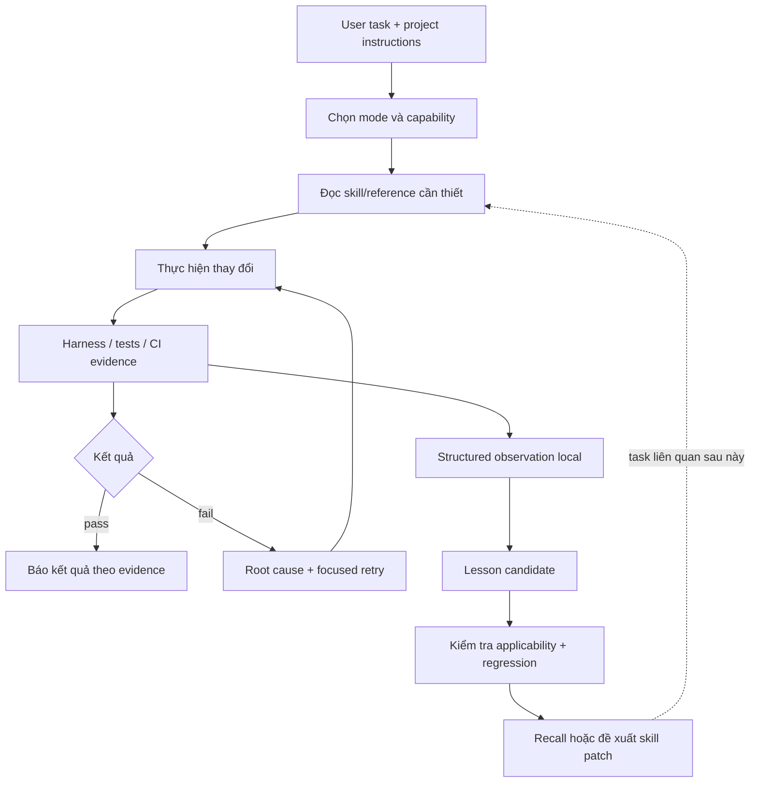

# Kế hoạch tiến hóa Dreamy Codex Toolkit từ ECC, Superpowers và OmO

Ngày nghiên cứu: **22/10/2026, Asia/Bangkok**. Baseline Dreamy: **`0.1.0-alpha.3`**, commit **`21d4af56e5a757b2700d46909d279b07d9db099d`**.

Trạng thái tài liệu: **research + implementation plan**. Các thay đổi CI, hook, memory, CLI và skill bên dưới là đề xuất chưa triển khai. Tài liệu này không nâng maturity hoặc đánh dấu phase sản phẩm đã hoàn thành.

Theo dõi triển khai sau nghiên cứu: [implementation evidence](../toolkit-evolution-implementation.md). Không đồng nhất code đã viết với native/semantic/rollout gates đã đạt.

Mục tiêu: làm toolkit đáng tin hơn, ít tốn context hơn, có hook thực sự chạy được, biết giữ lại bài học có bằng chứng và cải thiện skill bằng một vòng lặp kiểm chứng được.

## Mục lục

1. [Kết luận và thứ tự đầu tư](#1-kết-luận-và-thứ-tự-đầu-tư)
2. [Phương pháp, phạm vi và độ tin cậy](#2-phương-pháp-phạm-vi-và-độ-tin-cậy)
3. [Baseline toolkit hiện tại](#3-baseline-toolkit-hiện-tại)
4. [Điều tra CI GitHub](#4-điều-tra-ci-github)
5. [ECC: điểm mạnh và cách chuyển hóa](#5-ecc-điểm-mạnh-và-cách-chuyển-hóa)
6. [Superpowers: điểm mạnh và cách chuyển hóa](#6-superpowers-điểm-mạnh-và-cách-chuyển-hóa)
7. [OmO: điểm mạnh và cách chuyển hóa](#7-omo-điểm-mạnh-và-cách-chuyển-hóa)
8. [Ma trận quyết định tích hợp](#8-ma-trận-quyết-định-tích-hợp)
9. [Kiến trúc đích và ownership](#9-kiến-trúc-đích-và-ownership)
10. [Ngân sách token và context](#10-ngân-sách-token-và-context)
11. [Thiết kế hook](#11-thiết-kế-hook)
12. [Vòng học từ lỗi](#12-vòng-học-từ-lỗi)
13. [Tự tạo và cải tiến skill](#13-tự-tạo-và-cải-tiến-skill)
14. [Workflow thực thi và tiếp tục công việc](#14-workflow-thực-thi-và-tiếp-tục-công-việc)
15. [Thiết kế CI/CD đích](#15-thiết-kế-cicd-đích)
16. [Hợp đồng dữ liệu và CLI](#16-hợp-đồng-dữ-liệu-và-cli)
17. [Backlog triển khai chi tiết](#17-backlog-triển-khai-chi-tiết)
18. [Test và acceptance matrix](#18-test-và-acceptance-matrix)
19. [Benchmark và tiêu chí tiếp tục đầu tư](#19-benchmark-và-tiêu-chí-tiếp-tục-đầu-tư)
20. [Migration, rollout và rollback](#20-migration-rollout-và-rollback)
21. [Rủi ro, giả thuyết và việc hoãn](#21-rủi-ro-giả-thuyết-và-việc-hoãn)
22. [Lịch thực hiện và điều kiện hoàn tất](#22-lịch-thực-hiện-và-điều-kiện-hoàn-tất)
23. [Nguồn truy vết](#23-nguồn-truy-vết)
24. [Bằng chứng kiểm tra của lần nghiên cứu này](#24-bằng-chứng-kiểm-tra-của-lần-nghiên-cứu-này)

## 1. Kết luận và thứ tự đầu tư

**Nên tích hợp các cơ chế nhỏ có thể đo hiệu quả; không cài nguyên ba framework vào Dreamy.** Chúng cung cấp các bài học khác nhau:

| Nguồn | Điều đáng học nhất | Áp dụng cho Dreamy | Chi phí cần tránh |
|---|---|---|---|
| ECC | Hook có profile, observation có phạm vi, kinh nghiệm nguyên tử, bộ test vận hành | Dispatcher gọn, project lessons, promotion có gate | Observer LLM chạy thường trực, quá nhiều hook, bootstrap phức tạp |
| Superpowers | Root-cause debugging, task có kiểm chứng, skill được thử bằng tình huống | Workflow theo độ phức tạp, acceptance rõ, regression scenario | Bắt mọi việc qua quy trình dài, nạp skill chỉ vì gần giống từ khóa |
| OmO | Context budget, dedupe, continuation có trạng thái, evidence receipt | Bộ giới hạn output, checkpoint, bằng chứng gắn đúng task | Hệ điều phối nhiều agent, runtime/daemon lớn, vòng tiếp tục vô hạn |

Ưu tiên thực hiện:

1. **P0 — sửa CI thật sự:** Linux packaging, Windows test discovery, release evidence mới, giữ log của mọi matrix leg.
2. **P1 — đo rồi giảm context:** baseline token, giảm nội dung lặp, chọn đúng skill/reference, output ngắn có artifact.
3. **P1 — hook tối thiểu:** native capability probe, profile, dispatcher, lifecycle an toàn, integration smoke trên runtime thực.
4. **P2 — học từ lỗi bằng dữ liệu:** observation có cấu trúc, lesson theo project, recall có giới hạn, không thêm API call mặc định.
5. **P2 — skill evolution:** sửa skill hiện có trước, sinh candidate khi đủ lý do, eval trước khi kích hoạt.
6. **P3 — tăng tự động hóa có điều kiện:** chỉ thêm scheduling, semantic retrieval hoặc agent phụ khi benchmark chứng minh giá trị và môi trường cho phép.

Đề xuất đầu tư ban đầu: khoảng **2–3 tuần kỹ thuật** cho CI, budget, hooks MVP và lessons MVP; **4–6 tuần** nếu gồm migration đầy đủ, pilot skill evolution và quan sát rollout. Đây là ước lượng cho một người thực hiện tuần tự, không phải cam kết lịch hay yêu cầu dùng nhiều agent.

Điều kiện dừng mở rộng: CI chưa xanh, chất lượng giảm, có critical safety regression, token vượt ngân sách hoặc hook chưa được xác nhận chạy trong runtime mục tiêu.

## 2. Phương pháp, phạm vi và độ tin cậy

### 2.1. Phân loại mọi nhận định

| Nhãn | Nghĩa | Ví dụ |
|---|---|---|
| **OBSERVED** | Đọc trực tiếp mã nguồn hoặc artifact tại snapshot ghi rõ | `pack-smoke.mjs` gọi `npm.cmd` trên Linux |
| **EXECUTED** | Đã chạy lệnh và xem exit/output trong lần nghiên cứu này | `npm test`: 32 pass, 1 skip trên Linux/Node 24 |
| **PROPOSED** | Hợp đồng/thiết kế sẽ xây dựng | `dreamy-kit hooks doctor` |
| **HYPOTHESIS** | Suy luận cần thử nghiệm | Lessons giúp giảm tỷ lệ lặp lại lỗi |
| **UNKNOWN** | Chưa có bằng chứng đủ | Hooks của Dreamy chạy ổn trên mọi Codex surface |

Các command, schema và đường dẫn ở phần kiến trúc/backlog đều là **PROPOSED** trừ khi ghi rõ hiện có. Không dùng sự tồn tại của file để suy ra tính đúng của hành vi.

### 2.2. Snapshot upstream đã đọc

| Repo | Nhánh mặc định quan sát | Full commit đã tải | Thời gian commit UTC | Nguồn |
|---|---|---|---|---|
| ECC | `main` | `90606c8315ee09cafc303515c5f33024db6b9882` | `2026-10-20T21:28:23Z` | [Snapshot ECC](https://github.com/affaan-m/ECC/tree/90606c8315ee09cafc303515c5f33024db6b9882) |
| Superpowers | `main` | `2ce8aa15d05bd57213e6f746f953aafb7ded7a8b` | `2026-10-21T21:00:49Z` | [Snapshot Superpowers](https://github.com/obra/superpowers/tree/2ce8aa15d05bd57213e6f746f953aafb7ded7a8b) |
| OmO | `dev` | `06949e1eb617faf7eb81f3ddd9d959408e3f1892` | `2026-10-22T01:02:19Z` | [Snapshot OmO](https://github.com/code-yeongyu/oh-my-openagent/tree/06949e1eb617faf7eb81f3ddd9d959408e3f1892) |

Đọc source, hook definitions, implementation, test có liên quan, config, CI và license. **Không chạy installer, hook hoặc code của ba upstream.** README giúp định vị; source quyết định nhận định về cơ chế.

OmO snapshot này đã là monorepo `packages/*` với tích hợp Codex riêng; không dùng các mô tả cũ về `src/hooks/*` để quyết định kiến trúc hiện tại. Nhánh `dev` không đồng nghĩa bản stable đã phát hành; pilot sau này phải chọn release/snapshot mục tiêu riêng.

### 2.3. Phạm vi lần làm việc này

- Sản phẩm bàn giao: **một file plan này**, kèm phân tích và nguồn truy vết.
- Không thay CI/code/version/catalog của toolkit trong lượt lập kế hoạch.
- Không thay global Codex config hoặc tự kích hoạt hook.
- Không tạo API claim mới cho package Dreamy; không chỉnh Unity scene/prefab/asset.
- Không có Unity consumer project ở repository root; các package API vẫn phải kiểm chứng manifest/lock/source của consumer khi triển khai việc Unity thực tế.
- `.research/` là dữ liệu có sẵn ngoài tracking, được giữ nguyên. Source nghiên cứu mới nằm ở thư mục tạm, không trộn vào đó.

## 3. Baseline toolkit hiện tại

### 3.1. Những gì đã có và nên giữ

| Thành phần | OBSERVED | Giá trị cần giữ |
|---|---|---|
| Canonical registry | `toolkit.json`, version `0.1.0-alpha.3`, status `alpha` | Một nguồn version/status/maturity; không thêm registry song song |
| Catalog | 83 skills, 50 rules, 9 module entries | Độ phủ domain đã đáng kể; không cần tăng số skill làm mục tiêu |
| Installer | Module closure, lựa chọn skills theo package, global/project, managed block/hash, v1→v2 migration | Ownership và bảo toàn nội dung người dùng |
| Harness | `harness/dreamy-harness`, JSON evidence, Unity operations biết trả degraded | Không đánh đồng thiếu Unity với pass |
| Evaluation | Catalog validation tách khỏi semantic quality | Không dùng keyword pass làm chất lượng agent |
| Benchmark | `scripts/benchmark.mjs`, usage parsing, source provenance, release policy | Mở rộng runner hiện có; tránh xây hệ benchmark mới |
| Compatibility | Registry, drift report, source ledger | Mọi lesson/API claim phụ thuộc version |
| Roles | Có `dreamy-skill-author`, debugger, tester, reviewer, package maintainer | Dùng capability hiện có; không cần tạo thêm vai trò cho mỗi bước |
| Senior rules | Ownership, pragmatic DRY, KISS, YAGNI, verify-before-done | Tự cải thiện phải làm giảm lỗi, không sinh kiến trúc thừa |

### 3.2. Baseline context định lượng

Đo trực tiếp các file trong `skills/index.json`:

- 83 `SKILL.md`: **355.989 byte**, tổng khoảng **48.292 từ phân cách bằng whitespace**.
- File lớn nhất: `unity-ui-reskin`, **6.282 byte**.
- `templates/AGENTS.managed.md`: **992 byte**.
- `dreamy-kit list --target global --preset dreamy-project --resolved`: **38 skills**, **13 agent files**, **5 modules**.

Đây là **kích thước source/cài đặt**, không phải số token runtime. Body skill thường nạp theo nhu cầu; metadata của nhiều skill vẫn có thể làm discovery tốn context. Không được lấy tổng byte của 83 skill rồi báo là token tiêu thụ mỗi turn.

### 3.3. Khoảng trống cụ thể

1. Chưa thấy hook dispatcher, hook profile hoặc hook install lifecycle của Dreamy trong các đường code đã inspect.
2. Chưa có observation/lesson store và recall policy riêng.
3. Chưa có budget gate cho tổng context do toolkit thêm vào.
4. `validate-skills.mjs` áp nhiều heading cố định; `validate-acceptance.mjs` dùng ngưỡng tối thiểu 700 ký tự cho indexed skill. Đây là kiểm tra hình thức, có thể khuyến khích viết dài mà chưa chứng minh usefulness.
5. `templates/AGENTS.managed.md` liệt kê agent cố định; ví dụ `core` không cài mọi agent được nhắc. Nên render theo resolved install để tránh quảng bá capability không có.
6. Global `dreamy-project` cho phép mọi package skill của preset; thuận tiện nhưng metadata khá rộng. Đo discovery rồi mới quyết định thay đổi default.
7. `writeJson` trong CLI hiện ghi trực tiếp; khi thêm concurrent hook state không nên dùng nguyên cách này cho dữ liệu cần transaction/locking.
8. `purge` hiện dọn state directory; dữ liệu học của người dùng phải có owner và đường dẫn tách riêng trước khi triển khai.

Không kết luận các khoảng trống này đều cần framework mới. Ví dụ đơn giản hóa vài rule và tái sử dụng harness có thể đủ cho giai đoạn đầu.

## 4. Điều tra CI GitHub

### 4.1. Bằng chứng từ GitHub

GitHub Actions API trả về **8 workflow runs gần nhất đều `failure`** tại thời điểm đọc. Điều này xác nhận chuỗi lỗi gần đây, không chứng minh mọi run trong toàn bộ lịch sử đều thất bại.

Run được phân tích sâu: [CI 39718972033](https://github.com/Dreamy-Game-Foundation/dreamy-codex-toolkit/actions/runs/39718972033), head `21d4af56e5a757b2700d46909d279b07d9db099d`.

| Matrix leg | Job | Bằng chứng | Phân loại |
|---|---|---|---|
| Ubuntu, Node 22 | [119627762754](https://github.com/Dreamy-Game-Foundation/dreamy-codex-toolkit/actions/runs/39718972033/job/119627762754) | `npm pack smoke` fail; log có `spawnSync npm.cmd ENOENT` | Root cause đã xác minh |
| Windows, Node 20 | [119627762521](https://github.com/Dreamy-Game-Foundation/dreamy-codex-toolkit/actions/runs/39718972033/job/119627762521) | Step `Test` có `Could not find '...\tests\unit\*.test.mjs'` | Root cause đã xác minh; job tổng bị cancel bởi fail-fast |
| Ubuntu, Node 20 | `119627762758` | Step `npm pack smoke` failure; job tổng cancelled | Cùng lớp lỗi đóng gói; chưa đọc raw log riêng |
| Windows, Node 22 | `119627762675` | Cancelled bởi matrix fail-fast | Chưa đủ bằng chứng về kết quả test/pack |

Run trước [33712294701](https://github.com/Dreamy-Game-Foundation/dreamy-codex-toolkit/actions/runs/33712294701) cũng fail tại bước Linux `npm pack smoke` theo job metadata. Chỉ raw logs của hai job trong bảng đầu được tải và đọc chi tiết.

### 4.2. P0-A: Linux gọi tên executable Windows

**OBSERVED:** `scripts/pack-smoke.mjs` gọi `execTool("npm.cmd", ...)` cho cả `pack` và `install`. Nhánh non-Windows của `execTool` dùng nguyên tên executable.

**Root cause:** Linux không có executable `npm.cmd`; script chưa đổi command theo platform. Test unit hiện không phát hiện vì `npm test` không chạy pack smoke.

**Fix dự kiến:** tạo helper chuyên cho npm invocation, ưu tiên gọi Node với npm CLI entrypoint đã resolve hợp lệ; hoặc chọn `npm` trên POSIX và Windows invocation có test quoting riêng. Không dùng một shell wrapper tổng quát cho mọi command.

**Acceptance:** cùng smoke script pack/install/validate thành công trên Linux và Windows; thử đường dẫn có space; không đổi môi trường cài global của người dùng.

### 4.3. P0-B: Windows test discovery phụ thuộc shell glob

**OBSERVED:** cả `test` và `test:node` dùng `node --test tests/unit/*.test.mjs`. Log Windows Node 20 giữ nguyên wildcard trong đường dẫn.

**Root cause:** cách mở rộng glob khác nhau giữa shell/platform/Node line. Linux pass không chứng minh Windows chạy được test.

**Fix dự kiến:** `scripts/test-unit.mjs` đọc danh sách `tests/unit/*.test.mjs` bằng `fs`, sort, rồi gọi `process.execPath` với `['--test', ...absoluteFiles]`, `shell:false`, kế thừa stdio và propagate exit/signal. Runner nhận filter file/name khi cần, không chấp nhận arbitrary shell command.

**Acceptance:** Windows Node 20 thực sự discover đủ test, không chỉ return 0 khi không có file; PowerShell installer test không bị skip trên Windows.

### 4.4. P0-C: Release gate chấp nhận artifact cũ

**OBSERVED:** workflow chạy `release:check` trước `pack:smoke`; repository đã track `release/npm-pack-smoke.json`, nội dung còn ghi tarball **`0.1.0-alpha.2`**. `release-check.mjs` chỉ kiểm tra file này tồn tại.

**Kết luận chính xác:** đây là lỗi freshness/ordering tiềm ẩn đã được source chứng minh; **không phải step gây run Linux hiện tại fail**. Report cũ làm release gate pass rồi pack smoke mới fail.

**Fix dự kiến:** generated reports đi vào artifact directory riêng của run; pack smoke chạy trước release check; report phải gắn version, source fingerprint, run identity, tarball hash và kết quả packed CLI. Gate không lấy committed report làm bằng chứng cho current run.

**Acceptance:** stale report alpha.2, report từ commit khác, tarball khác và report thiếu field đều bị từ chối trên alpha.3.

### 4.5. P1: CI khó chẩn đoán và làm việc lặp

- `npm run validate` chạy trước `npm test`, trong khi `npm test` gọi validate lại.
- Matrix đang có fail-fast mặc định, làm mất kết quả các leg khác khi một leg fail.
- Không thấy upload artifact failure/summary dành riêng cho test/pack evidence.
- Cần phân biệt warning deprecation của GitHub Action runtime với lỗi npm/Node của project. Không suy từ warning Node 20 của action rằng root cause là package engines.
- Log `npm ci` có cảnh báo dependency vulnerability; cần một task triage riêng theo advisory hiện hành, không chạy `npm audit fix` tự động trong lượt sửa CI.
- `compatibility:fetch` hiện tạo snapshot từ registry đã commit, đặt `upstreamFetchPerformed:false`; tên `refresh` không có nghĩa CI vừa kiểm source package mới nhất qua mạng.

### 4.6. Reproduction local

`npm test` trên Linux/Node `v24.19.0` đã pass: 33 tests, 32 pass, 1 Windows-only skip. Đây không thay thế matrix Windows/Node 20/22.

Lần đầu chạy trong sandbox bị `EPERM` khi gọi child process; validator catch rồi parse stdout rỗng thành `Unexpected end of JSON input`. Rerun với quyền chạy subprocess đã pass. Cần cải thiện diagnostic này để báo đúng spawn failure, không nhầm thành JSON contract failure.

## 5. ECC: điểm mạnh và cách chuyển hóa

Nguồn chi tiết: [E1–E7 ở mục 23](#23-nguồn-truy-vết).

### 5.1. Điểm mạnh quan sát được

**Hook control rõ:** `hook-flags.js` phân profile `minimal/standard/strict`, có cờ tắt chung và disable từng hook. Người dùng có thể điều chỉnh một cơ chế mà không sửa mọi script.

**Giảm process overhead:** `run-with-flags.js` ưu tiên gọi module có `run()`, chờ async handler, giữ deadline, xử lý stdin bị cắt và chú ý flush output. Bài học tốt nhất là runtime contract cần được test ở cả failure path, không chỉ happy path.

**Context index được chuẩn bị ở local:** `context-routing-index.js` tạo routing index khi managed state generation chưa có index hiện hành; hook bình thường không cần gửi catalog đầy đủ cho model.

**Kinh nghiệm nguyên tử có scope:** continuous-learning-v2 mô tả instinct một trigger/một hành động, có evidence/confidence và phạm vi project. Cấu trúc này dễ recall có chọn lọc hơn nhật ký dài theo session.

**CI biết thu nhỏ matrix theo thứ thực sự thay đổi:** workflow có lane full và lane tập trung vào package-manager behavior, thay vì nhân toàn bộ axes. Dreamy có thể học tư duy giảm việc lặp, không cần sao chép matrix lớn.

### 5.2. Điểm cần phản biện

1. `continuous-learning-v2/SKILL.md` có claim quan sát qua hooks “100% reliable”. Đây là claim tài liệu, chưa phải bảo đảm runtime: crash, event không được hỗ trợ, trust chưa cấp, truncated stdin đều có thể làm mất observation.
2. `config.json` của observer ở snapshot đang `enabled:false`. Không suy rằng clone repo là đã có observer tự học đang chạy.
3. `evaluate-session.js` chỉ kiểm session đủ dài rồi log lời nhắc evaluate/save; bản script đã đọc không tự gọi model và không tự tạo skill. Phải tách “phát tín hiệu cần học” khỏi “đã trích xuất lesson đúng”.
4. Native Codex `hooks/codex-hooks.json` được ghi là bootstrap `SessionStart`; không mặc định toàn bộ Claude hook catalog của ECC đã được chuyển sang Codex.
5. Các runner/compatibility layers nhiều nhánh và shell bridge có maintenance cost. Dreamy đang thuần Node nhỏ nên không nên mang cả lớp đó vào.
6. Hook capture raw prompt/tool I/O, dù có scrub, vẫn tạo retention/context risk và tốn disk. Dreamy nên thu structured failure facts trước.

### 5.3. Chuyển hóa cho Dreamy

| Cơ chế ECC | Giữ ý tưởng | Thay đổi cần thiết |
|---|---|---|
| Hook profile | Có | Chỉ 3 profile, 4–5 handler đầu tiên |
| Runtime dispatcher | Có | ESM, explicit handler map, không suy export qua regex source |
| Deadline/stdin/output guard | Có | Giới hạn byte rõ; Unicode-safe; test crash/overflow |
| Instinct/project scope | Có | Lesson có trạng thái, reproduction và applicability; không gọi score là xác suất đúng |
| Observer background | Hoãn | Dùng current agent ở task boundary, không daemon mặc định |
| Session narrative memory | Thu hẹp | Checkpoint ≤ vài dòng và artifact path; không inject toàn transcript |
| Routing index | Có | Generate từ installed selection, có hash invalidation, không load mọi body |

## 6. Superpowers: điểm mạnh và cách chuyển hóa

Nguồn chi tiết: [S1–S7 ở mục 23](#23-nguồn-truy-vết).

### 6.1. Điểm mạnh quan sát được

**Systematic debugging:** điều tra root cause, tái hiện, so sánh thay đổi và thu evidence ở boundary. Rất phù hợp với lỗi CI hiện tại: Windows discovery và Linux packaging là hai nguyên nhân, không phải một “CI broken” chung chung.

**Writing plans cụ thể:** task có file, interface, từng bước kiểm chứng và deliverable review được. Đây là giá trị cần giữ cho Dreamy plan; đặc biệt khi người thực hiện không có lịch sử cuộc trò chuyện.

**Verification-before-completion:** chỉ claim điều evidence hỗ trợ; lint pass không đồng nghĩa build pass; subtask report không thay cho inspect diff/test output.

**Writing-skills bằng tình huống:** skill cần thay đổi hành vi trên một lỗi có thật; test tình huống baseline và sau khi sửa giúp tránh tạo thêm prose vô ích.

**Có size test cho entrypoint:** test giới hạn body skill và khuyến khích chuyển nội dung thỉnh thoảng mới dùng sang references. Ngưỡng upstream phục vụ runtime của họ, không phải ngân sách mặc định để Dreamy chép lại.

### 6.2. Điểm cần phản biện

1. `using-superpowers` bắt invoke skill ngay cả khi chỉ có xác suất liên quan rất nhỏ. Với 83 skill Dreamy và các skill cài global khác, chiến lược này dễ làm discovery/read thừa.
2. Hook session-start đọc và inject đầy đủ `using-superpowers`. Nếu Dreamy đã có managed `AGENTS.md`, thêm một bootstrap dài dễ lặp instruction.
3. Không phải task nào cũng cần brainstorming, tài liệu thiết kế, reviewer và red-green nhiều vòng. Sửa một link hoặc đổi prose là ví dụ không nên chịu chi phí đó.
4. Workflow subagent-driven phù hợp task lớn có boundary; không phải default chi phí thấp, và phụ thuộc chính sách agent của từng phiên.
5. Bắt kiểm lại mọi command trong mỗi lời đáp có thể tạo việc lặp không cần thiết khi scope/input chưa thay đổi. Dreamy nên dùng evidence freshness theo inputs, không theo số lần phát biểu.

### 6.3. Chuyển hóa cho Dreamy

- Tích hợp root-cause flow vào debugger và `rules/core/root-cause-first.md`, tránh skill mới trùng ý.
- Tích hợp task contract vào `dreamy-plan` và template plan hiện có.
- Giữ verify-before-done với evidence hash gắn inputs; không bắt chạy toàn suite sau mỗi edit.
- Dùng behavioral regression khi thêm learned skill; ordinary docs edit chỉ cần validation phù hợp.
- Tạo work modes `quick/standard/deep` để quy trình tỉ lệ với công việc.
- Không import unconditional “invoke skill before any answer” hoặc “mọi task cần agent phụ”.

## 7. OmO: điểm mạnh và cách chuyển hóa

Nguồn chi tiết: [O1–O8 ở mục 23](#23-nguồn-truy-vết).

### 7.1. Điểm mạnh quan sát được

**Budget là dữ liệu thực thi:** `rules` component có budget theo event; rules engine có giới hạn từng rule và tổng output. Không chỉ nhắc model “hãy ngắn”.

**Recall biết không nhắc lại:** memory recall có surfaced ledger theo session, hash và cache stat-gated. Selector có số item tối đa và loại path đã xuất hiện, giúp tránh cùng memory được nạp ở mọi prompt/tool call.

**Continuation đọc trạng thái thật:** Codex continuation hook kiểm trạng thái kế hoạch còn việc; có xử lý `stop_hook_active`, blocker và context pressure. Giá trị cần học là tiếp tục dựa vào task state thay vì chỉ prompt “đừng dừng”.

**Evidence receipt và retry cap:** executor verification hook kiểm vị trí receipt, realpath, symlink, file trống/cũ và attempt count. Đây là bài học rõ về không tin text “done” từ worker.

**CI classification có fallback:** workflow đọc changed paths và khi không có diff tin cậy thì chạy kiểm tra rộng. Tối ưu CI phải giữ lối về kiểm tra đầy đủ.

### 7.2. Điểm cần phản biện

1. Monorepo/runtime gồm nhiều package, native backend, LSP, memory và orchestration. Dreamy không cần runtime mới để sửa ba lỗi CI và quản lý vài lesson.
2. Continuation là thêm lượt model, không phải compute miễn phí. Một Stop hook viết sai có thể làm tổng token tăng mạnh dù mỗi message rất ngắn.
3. Một số receipt checks là filesystem/age checks; file dài đủ và mới không tự chứng minh command đã pass. Dreamy nên dùng structured harness result + content/input hashes.
4. Heuristic đọc transcript tìm context-pressure marker không phải API ổn định. Không chọn whole-transcript scan làm dependency chính.
5. Hardcoded model context limits trong source là dữ liệu upstream; không sử dụng như thông số chính thức của model cho Dreamy.
6. `truncator.ts` có rule được miễn cắt; do đó ngưỡng tổng không tuyệt đối cho mọi input. Dreamy nên dành riêng ngân sách safety nhỏ, không mở ngoại lệ không giới hạn.
7. Tính scope/trust của hook installer phải được kiểm theo runtime chính thức; không sao chép thao tác tạo trusted hash vào user config.

### 7.3. Ranh giới license và provenance

**OBSERVED tại snapshot:** ECC và Superpowers có license MIT; `LICENSE.md` của OmO chứa **Sustainable Use License** và quy định về third-party portions. Không coi toàn bộ OmO là mã MIT có thể nhập thẳng vào toolkit MIT.

Hướng thực hiện: học cơ chế ở mức concept, tự viết implementation nhỏ theo hợp đồng Dreamy, giữ source attribution. Nếu muốn tái sử dụng đoạn code/file thực tế, kiểm license của đúng file/package và điều kiện phân phối trước; không chỉ nhìn root package name.

### 7.4. Chuyển hóa cho Dreamy

- Per-event byte/context budget, loại output thành summary + artifact.
- Recall top-k, content hash và dedupe theo session/context epoch.
- Task checkpoint có requirement/evidence/next-step.
- Stop verification chỉ nhắc tiếp tục tối đa một lần cho input fingerprint chưa có evidence, không chủ động đẻ goal mới.
- Structured evidence thay receipt dựa vào plain text/path marker.
- Không import orchestration/runtime/daemon/model routing của OmO.

## 8. Ma trận quyết định tích hợp

Tác động token dưới đây là **dự kiến**, cần benchmark; “0 LLM” nghĩa handler không gọi model, không có nghĩa nội dung output không tốn token khi model đọc.

| ID | Cơ chế | Nguồn | Quyết định | Ưu tiên | Chi phí token dự kiến | Điều kiện chứng minh |
|---|---|---|---|---|---|---|
| D01 | Cross-platform command/test runner | Dreamy CI evidence | Làm ngay | P0 | 0 LLM | Windows và Linux matrix xanh |
| D02 | Fresh release evidence | Superpowers + Dreamy gap | Làm ngay | P0 | 0 LLM | Stale/cross-commit report bị reject |
| D03 | Hook profiles/kill switch | ECC | Nhận có chọn lọc | P1 | 0 LLM trong handler | Tắt theo profile/ID có test |
| D04 | Single dispatcher/explicit handler map | ECC | Tự viết gọn | P1 | 0 LLM | Nhiều handler không thêm process con |
| D05 | Token ledger/context budget | OmO | Nhận | P1 | Output ngắn | Usage có provenance, cap deterministic |
| D06 | Skill/reference selection | Cả ba | Nhận | P1 | Giảm nếu route chính xác | Precision/recall và task success không giảm |
| D07 | Root-cause + scoped verification | Superpowers | Hợp nhất vào rule/role có sẵn | P1 | Có thể giảm retry | Hai lỗi CI có regression độc lập |
| D08 | Project-scoped atomic lessons | ECC | Nhận | P2 | Recall tối đa 2 lesson | Không cross-project contamination |
| D09 | Recall dedupe/content hash | OmO | Nhận bản đơn giản | P2 | Giảm nhắc lại | Không phát lại khi content chưa đổi |
| D10 | Self-generated skill candidate | ECC + Superpowers | Nhận có quality gate | P2 | Chỉ tại task boundary | Candidate có ablation/regression |
| D11 | Checkpoint/continuation | OmO | Nhận có trần | P2 | Tối đa 1 continuation mặc định | Không loop, không vượt user stop |
| D12 | LLM observer thường trực | ECC | Hoãn | P3 | Có recurring cost | Chỉ xét nếu structured lessons không đủ |
| D13 | Multi-model routing/agent swarm | OmO | Không default | P3 | Dễ tăng mạnh | Chỉ khi user/policy cho phép và task lớn |
| D14 | 1% skill activation rule | Superpowers | Không nhập | — | Làm rộng context | Không phù hợp mục tiêu token |
| D15 | Tự đổi global policy/trust/model config | Một số automation patterns | Không nhập | — | Không liên quan lợi ích chính | Vượt phạm vi tự cải thiện toolkit |
| D16 | Vector DB/memory daemon | OmO rộng hơn | Hoãn | P3 | Infra + retrieval cost | Corpus lớn và lexical recall thất bại có số liệu |

## 9. Kiến trúc đích và ownership

### 9.1. Một vòng thực thi nhỏ



Học từ lỗi là một nhánh của vòng thực thi; không là điều kiện bắt buộc để mọi task kết thúc. Không để lỗi ghi lesson chặn công việc chính.

### 9.2. Ownership dự kiến

| Thành phần | Owner | Được làm | Không được làm |
|---|---|---|---|
| Registry | `toolkit.json`, existing indices | Version, maturity, module/content declarations | Auto nâng maturity vì generated tests pass |
| Execution decision | Agent đang xử lý task | Chọn mode, đọc nguồn, sửa trong scope | Để hook diễn giải lại mục tiêu người dùng |
| Hook adapter | `src/hooks/codex-adapter.mjs` | Decode/encode native event | Chứa toàn bộ policy/domain knowledge |
| Hook dispatcher | `src/hooks/dispatcher.mjs` | Budget, dedupe, chạy handler theo thứ tự nội bộ | Gọi LLM hoặc chạy shell command từ lesson |
| Verification | Existing harness + evidence helpers | Chạy/ghi output và input fingerprint | Đánh dấu pass khi thiếu tool |
| Lesson store | User-owned data directory | Lưu facts/candidate/status | Ghi đè managed rules/skills ngay khi capture |
| Skill evolution | Existing skill author capability + CLI | Sinh diff, validation, evaluation | Tự kích hoạt candidate chưa kiểm chứng |
| Installer | Existing install/update/uninstall | Cài runtime/config mình sở hữu | Xóa user knowledge theo purge hiện tại |

### 9.3. Layout dự kiến

```text
src/
  cli.js                         # Giữ entrypoint; thêm command dispatch nhỏ
  hooks/
    dispatcher.mjs               # Pure routing + handler execution
    codex-adapter.mjs            # Native input/output contract
    policy.mjs                   # Profile, deadlines, output budgets
    handlers/
      session-context.mjs
      tool-observation.mjs
      checkpoint.mjs
      verify-stop.mjs
  knowledge/
    store.mjs                    # Atomic local records; no model calls
    eligibility.mjs              # Scope/version/conflict/expiry
    recall.mjs                   # Lexical top-k + dedupe
  context-budget.mjs             # Byte accounting + token provenance
  verification-plan.mjs          # Change -> relevant verification commands
scripts/
  test-unit.mjs
  validate-context-budget.mjs
  hook-smoke.mjs
hooks/
  catalog.json                   # Toolkit-owned handler catalog
  profiles.json
schemas/
  hook-policy.schema.json
  hook-observation.schema.json
  lesson.schema.json
  skill-candidate.schema.json
  context-budget.schema.json
  pack-report.schema.json
  task-checkpoint.schema.json
```

Không tạo tất cả file ngay từ đầu. Mỗi backlog item chỉ tạo phần nó dùng. Nếu hai helper rất nhỏ và cùng owner, giữ chung đến khi có lý do tách.

### 9.4. Tách dữ liệu người dùng khỏi install state

- `.dreamy-codex/install-state.json`: managed install state hiện có; tương lai thêm ownership của hook files.
- `.dreamy/knowledge/`: project-local observations, candidates và approved lessons; không bị uninstall/purge installer xóa.
- `.dreamy/checkpoints/`: task state; có thể xóa riêng bằng command dữ liệu.
- `DREAMY_DATA_HOME`: override đường dẫn user-data global. Default theo OS; không repurpose `$HOME` hoặc `$CODEX_HOME` trong script.
- Chia sẻ lesson vào repo phải là thao tác riêng tạo diff review được; runtime data mặc định được ignore.

Project identity: hash của remote đã loại credentials + stable workspace identity; worktree giữ chung project scope nhưng checkpoint/dedupe riêng theo session/worktree. Không có remote thì hash canonical root. Không tự sync giữa máy.

## 10. Ngân sách token và context

### 10.1. Định nghĩa chi phí cần đo

```text
T_task = runtime instructions + discovered metadata + loaded skills/references
       + tool output + recall + generated output + reasoning + retries

T_overhead = phần tăng thêm so với cùng task/model/tools không bật capability mới

Cost_per_success = tổng chi phí của tất cả trial / số trial thực sự thành công
```

Usage của model có thể là cumulative hoặc per-turn tùy adapter; adapter phải ghi rõ. Không cộng hai loại rồi double count. Cached input báo riêng; nếu tính tiền, dùng giá có provenance tại ngày chạy. Không hardcode giá hoặc context window theo README của upstream.

Nếu không có measured usage: ghi `tokens:null`, `measurement:"unavailable"`, vẫn ghi byte/word nhưng không công bố tiết kiệm token. Không mặc định byte/4 là tokenizer đúng cho tiếng Việt.

### 10.2. Ngân sách thiết kế ban đầu

Các trần token là **target cần đo bằng tokenizer/usage đã xác minh**; trần byte là deterministic fallback. Byte cap được áp trước và không bị token estimate cho phép vượt qua.

| Loại nội dung toolkit thêm | Target | Byte hard cap ban đầu | Quy tắc |
|---|---:|---:|---|
| Managed bootstrap instructions | ≤ 400 token | 1.600 byte | Render agent/capability thật; hiện 992 byte |
| SessionStart mới | ≤ 150 token | 600 byte | Chỉ summary status/path cần thiết, empty nếu không có thông tin mới |
| Tool hook happy path | 0 visible token | 0 byte stdout | Metrics nằm local |
| Tool hook warning | ≤ 100 token | 400 byte | Dedupe cùng fingerprint |
| Recall mỗi lần | ≤ 250 token | 1.000 byte tổng | Tối đa 2 lesson; bỏ nếu relevance thấp |
| Checkpoint replay | ≤ 200 token | 800 byte | Scope, current task, pending check, evidence path |
| Stop continuation reason | ≤ 120 token | 480 byte | Tối đa 1 lần/input fingerprint |
| Skill entrypoint mới | Ưu tiên 300–800 token | 5.000 byte | Ngoại lệ phải có lý do, không ép skill cũ mất nội dung quan trọng |
| Context mới do hook/recall trong task nhỏ | ≤ 500 token/task | 2.000 byte/task | Tổng cap, không chỉ cap từng handler |

Byte budget gồm text thực sự gửi model; JSON envelope/native runtime overhead ghi riêng khi đo được. Nếu tiếng Việt chạm cap trước token target, dùng summary ngắn hơn và artifact path; không bỏ dở câu hay JSON.

### 10.3. Chọn đúng nội dung

1. Metadata ngắn chỉ nói trigger và scope; không copy workflow vào description.
2. Chọn một skill chính; thêm skill khác khi có domain boundary thật, không do keyword trùng.
3. Chỉ đọc reference phục vụ quyết định tiếp theo. Ví dụ UI reskin không mặc định đọc mọi Unity rendering guide.
4. Một invariant chỉ có một canonical owner. Agent prompt/skill chỉ link và nhắc invariant nếu dễ sai tại boundary đó.
5. Dùng command deterministic cho path/hash/manifest parsing thay vì nhờ model phân tích lại JSON dài.
6. Tool result trả summary + counts + artifact path; full log giữ local có retention.
7. Không nạp plan nghiên cứu dài này vào bootstrap hoặc skill body; chỉ mở section khi thực hiện backlog.

### 10.4. Không tối ưu bằng cách mất correctness

- Không cắt phần safety invariant ở giữa câu. Reserve một phần nhỏ cho invariant, giảm optional lesson/reference trước.
- Không dùng warning cap để che build error; full artifact phải tồn tại và command exit vẫn truyền đúng.
- Giữ current model của phiên; toolkit không tự đổi model/reasoning.
- Không gọi agent phụ mặc định. Khi user/policy cho phép, chỉ delegate task có ownership độc lập và tính tổng usage mọi agent.
- Không thay đổi preset người dùng chọn để đạt benchmark đẹp. `dreamy-full` vẫn phải giữ ý nghĩa “full”.

### 10.5. Context lint cần kiểm

- Body/description byte, duplicate paragraph, missing reference, unreachable reference.
- Bootstrap không quảng bá agent chưa cài.
- Tổng output của dispatcher sau khi gộp handler.
- Metadata growth so baseline; cảnh báo nếu thêm skill nhưng không có negative routing case.
- Budget exceptions có owner/reason/expiry; không có whitelist vô hạn cho prompt dài.

## 11. Thiết kế hook

### 11.1. Capability hiện hành và giới hạn bằng chứng

Tài liệu Codex hiện có native hooks, nhưng phải kiểm đúng version/surface. Hook không managed cần trust; nhiều nguồn có thể cùng chạy. Matcher của Stop bị bỏ qua; shell/unified exec dùng tên Bash; transcript format không ổn định; PostToolUse không hoàn tác side effect. Đây là các ràng buộc adapter, không phải bằng chứng Dreamy hooks đã chạy. Xem [OpenAI Hooks](https://learn.chatgpt.com/docs/hooks).

Tài liệu plugin tách việc cài package khỏi trust hook và phụ thuộc surface. Chỉ chọn packaging sau khi smoke test target; không import nguyên Claude schema rồi báo Codex-compatible. Xem [OpenAI plugin packaging](https://developers.openai.com/plugins/build/plugins).

Local CLI quan sát là `codex-cli 0.163.0`; lần này chỉ đọc version, **chưa chạy lifecycle smoke**.

### 11.2. Capability report dự kiến

```json
{
  "schemaVersion": 1,
  "runtime": "codex",
  "version": "0.163.0",
  "surface": "cli",
  "configuration": "detected",
  "trust": "unknown",
  "events": {
    "SessionStart": "not-probed",
    "PostToolUse": "not-probed",
    "Stop": "not-probed"
  },
  "operational": false,
  "fallback": "explicit-cli"
}
```

Các giá trị minh họa này **không phải runtime probe result của lượt nghiên cứu**. `operational:true` chỉ sau khi native event phát thật và handler tạo receipt mong đợi. Parse config thành công chưa đủ.

### 11.3. Profile dự kiến

| Profile | Handler | Mục đích | Gọi LLM |
|---|---|---|---|
| `off` | Không chạy | Rollback/không hỗ trợ runtime | Không |
| `minimal` | Session context gọn, record verification outcome/checkpoint khi có event thích hợp | Profile opt-in khuyến nghị cho pilot | Không |
| `standard` | Minimal + lesson lookup theo relevance + verify-stop | Công việc có nhiều thay đổi | Không trong handler |
| `strict` | Standard + pre-mutation guard cho đường tool đã kiểm chứng | Unity serialized-risk hoặc release task | Không trong handler |

Disable một hook ID phải độc lập profile. Tắt hook không được tắt harness/CI safety gate. Các tên profile là config Dreamy, không tự nhận là config native Codex.

### 11.4. Handler catalog MVP

| ID | Native event đề xuất | Trigger nội bộ | Output | Error policy |
|---|---|---|---|---|
| H01 `session-context` | SessionStart | Workspace/capability/checkpoint thay đổi | ≤600 byte; thường empty | Fail-open + local diagnostic |
| H02 `tool-observation` | PostToolUse | Failed command hoặc verification receipt | 0 stdout | Fail-open; không log raw input |
| H03 `checkpoint` | PreCompact; Interrupt khi có hỗ trợ | Có task state mới | Ghi file; replay qua H01 theo budget | Best effort, không cản user interrupt |
| H04 `verify-stop` | Stop | Task có mutation và thiếu evidence theo plan | JSON continuation reason ≤480 byte | Tối đa 1 continuation; sau đó report degraded |
| H05 `serialized-risk` | PreToolUse | Tool input cho thấy xóa/đổi serialized asset trong covered path | Native decision + reason ngắn | Deny khi policy đã bật và xác định rõ mutation không hợp lệ |

H05 chỉ xây sau khi H01–H04 ổn định. Không thể coi regex shell là firewall bao phủ mọi cách sửa file; harness/post-diff kiểm invariant vẫn cần.

### 11.5. Dispatcher contract

```text
stdin JSON/native event
 -> kiểm byte + parse + schema
 -> normalize tool/event/root/session identity
 -> tải config đã resolve
 -> lọc profile + handler ID + scope
 -> chạy explicit handler map theo order trong một process
 -> dedupe + tổng output budget
 -> encode native JSON
 -> ghi metrics local
```

Một process có thể gọi nhiều function handler, không fork thêm Node cho từng handler. Không quét source để đoán export. Handler là pure function khi có thể; I/O qua dependency nhỏ để test bằng fixture.

Các hook của ứng dụng/plugin khác có thể chạy song song và không chịu ordering nội bộ Dreamy. Do đó H01 không được phụ thuộc hook khác tạo file trước; mỗi handler phải tự xử lý missing state.

### 11.6. Timeout, overflow và failure policy

| Tình huống | Hành vi yêu cầu |
|---|---|
| Ordinary event/input không liên quan | Return empty output, không scan cả repo |
| JSON malformed/unknown field | Không crash; diagnostic có bounded detail; không echo raw stdin |
| Input quá lớn | Advisory handler skip; guard đã chọn strict policy báo không inspect đủ, không parse JSON cụt |
| Handler timeout | Dừng handler, ghi timeout; advisory fail-open; enforcement path báo rõ thiếu check |
| Unicode/long path | Giới hạn theo byte, không cắt code point/JSON escape |
| Disk full/readonly | Task chính tiếp tục với state degraded; không claim observation saved |
| Concurrent sessions | Event immutable theo ID hoặc append có lock; state update atomic |
| Callback/flush error | Không emit JSON nửa chừng; stdout chỉ cho protocol, diagnostics sang stderr |
| Handler không tồn tại | Config invalid → doctor báo; không silently operational=true |
| Unknown runtime/surface | Không install active native hook; explicit CLI fallback |

Mục tiêu latency ở pilot: no-op p95 ≤100 ms POSIX, ≤200 ms Windows; ordinary event p95 ≤250 ms; SessionStart p95 ≤500 ms. Đây là target, phải đo cold/warm và storage local/network riêng. Safety scans/Unity compile chạy qua harness, không trong hot hook path.

### 11.7. Trust và installer lifecycle

1. Inspect config hiện tại và render diff cho đúng hook definition.
2. Native trust do runtime/user xử lý; installer không tự ghi trusted hash hoặc dùng bypass flag.
3. Hook command chứa đường dẫn Node/runtime resolved có quoting; Windows command được sinh riêng nếu cần.
4. Nếu `.codex/hooks.json` hiện có thuộc người dùng, ưu tiên merge theo owned entries có backup/hash; nếu runtime không hỗ trợ cách merge an toàn đã kiểm chứng, xuất config fragment và ghi `not-installed`.
5. Update chỉ sửa entries mình sở hữu; uninstall chỉ bỏ các entries đó.
6. Check source hash của installed runner/config để phát hiện drift; không auto “repair” file đã bị user chỉnh.
7. Sau config update: native smoke, doctor, log event và output; không đánh dấu verified bằng unit fixture.

### 11.8. Chống loop ở Stop

- Chỉ tác động task đang có verification plan; không tạo task mới từ cuối câu trả lời.
- Nếu user stop/cancel/đổi scope: checkpoint và nhường quyền ngay.
- Nếu `stop_hook_active`, budget hết hoặc cùng fingerprint đã nhắc: không continuation thêm.
- Thiếu tool/credential/license hoặc lỗi hạ tầng không thể sửa trong scope: ghi degraded + command/reason; không retry vô hạn.
- Hook không suy “xong” từ từ khóa của assistant. Đọc task state và evidence inventory.
- Không gọi `create_goal`, đổi goal status, hoặc tăng token budget từ hook.

## 12. Vòng học từ lỗi

### 12.1. Định nghĩa tự học trong toolkit

“Tự học” ở đây là **cải thiện tri thức và workflow bên ngoài model**: lưu error signature, nguyên nhân, cách kiểm chứng, điều kiện áp dụng, rồi recall hoặc đề xuất sửa skill. Không phải thay model weights, tự tăng quyền hoặc có khả năng bảo đảm mọi lesson đều đúng.

### 12.2. Pipeline đề xuất

```text
Tool/harness failure
 -> structured observation
 -> nối với resolution evidence của cùng task
 -> rút lesson candidate
 -> dedupe + scope + version/conflict checks
 -> replay/regression
 -> approved lesson
 -> bounded recall
 -> nếu lặp nhiều và chưa có skill phù hợp: skill patch/candidate
```

Capture/dedupe/eligibility dùng code deterministic. Tổng hợp ngôn ngữ dùng agent đang làm task tại boundary nếu có đủ evidence và task cho phép; không gọi thêm LLM/API định kỳ.

### 12.3. Observation tối thiểu

```json
{
  "schemaVersion": 1,
  "id": "obs-ci-posix-npm-command-001",
  "projectId": "sha256:<workspace-id>",
  "taskId": "ci-linux-pack",
  "eventId": "<runtime-event-or-generated-id>",
  "observedAt": "<ISO-8601>",
  "sourceCommit": "<sha>",
  "scope": { "platform": "linux", "nodeMajor": 22 },
  "operation": "pack-smoke",
  "outcome": "fail",
  "signature": "spawnSync npm.cmd ENOENT",
  "artifact": { "path": "<relative-log>", "sha256": "<hash>" },
  "rawPromptCaptured": false,
  "rawToolInputCaptured": false
}
```

Chỉ lấy allowlisted field và sanitized excerpt có cap. Không lưu toàn command nếu có credential; command identity có thể là tên operation/argv đã loại secret. Redaction không thay thế data minimization.

### 12.4. Lesson contract

```json
{
  "schemaVersion": 1,
  "id": "ci-npm-command-by-platform",
  "status": "candidate",
  "scope": "project",
  "projectId": "sha256:<workspace-id>",
  "trigger": "Node script runs npm packaging commands across platforms",
  "action": "Resolve npm invocation per platform and verify both OS paths",
  "nonApplicability": ["A Windows-only script explicitly scoped to Windows"],
  "rootCause": "Windows executable name was passed unchanged on POSIX",
  "evidenceRefs": ["obs-ci-posix-npm-command-001", "<resolution-receipt>"],
  "applicability": { "platforms": ["linux", "win32"], "packages": [] },
  "verification": { "commandId": "pack-smoke", "status": "not-run" },
  "confidence": "unverified",
  "supersedes": [],
  "createdAt": "<ISO-8601>",
  "reviewAfter": "<ISO-8601>",
  "sourceHashes": ["<hash>"]
}
```

Ví dụ vẫn ở `candidate`: root cause quan sát được nhưng fix chưa chạy. Không gắn pass hoặc approved vào lesson chỉ vì lời giải nghe đúng.

### 12.5. State machine

| State | Điều kiện vào | Được recall? | Điều kiện ra |
|---|---|---|---|
| `candidate` | Có observation/reproduction | Không mặc định | Có resolution evidence và applicability |
| `verified-local` | Reproduction fail trước fix, relevant check pass sau fix | Chỉ project, relevance cao | Có independent confirmation hoặc policy review |
| `approved` | Đủ evidence, không conflict, policy cho phép | Có, trong budget | Version/source thay đổi hoặc bị phản chứng |
| `stale` | Source/version/expiry không còn match | Không tự inject | Reverify hoặc retire |
| `rejected` | Sai, trùng, quá riêng, thiếu evidence | Không | Chỉ phục hồi bằng evidence mới |
| `superseded` | Lesson khác thay thế có lý do | Không | Giữ provenance, không mất lịch sử |

Không auto nâng global chỉ vì cùng lỗi xảy ra hai lần trong cùng repo. Có thể đề xuất generalization khi thấy ít nhất hai project độc lập và compatibility tương ứng, nhưng vẫn cần review nội dung và negative cases.

### 12.6. Confidence có ý nghĩa thực tế

MVP dùng nhãn evidence thay số `0.9` dễ bị hiểu là xác suất đúng:

- `unverified`: mới thấy signature hoặc có hypothesis.
- `reproduced`: có fixture và behavior fail.
- `resolved`: có fix + relevant checks pass.
- `replicated`: được kiểm lại ở context độc lập tương thích.

Một lần user sửa preference có thể tạo project preference candidate, nhưng không được suy thành rule universal. User instructions hiện tại thắng lesson lưu trước đó.

### 12.7. Recall rẻ và có phạm vi

1. Filter project, status, platform/package/version trước khi rank.
2. Lexical matching từ error signature/path/domain; không embedding service trong MVP.
3. Chỉ lấy tối đa 2 lesson, tổng ≤1.000 byte, có ID và source link ngắn.
4. Không match thì im lặng; không “cần phải recall gì đó”.
5. Dedupe bằng lesson ID + content hash + context epoch. Nội dung đã có trong current context không inject lại.
6. Sau compact, replay checkpoint và lesson thật sự cần cho task còn dở; không phát lại mọi lesson của session.
7. Lesson source đổi hash thì revalidate; không chỉ cache bằng timestamp.

**Điểm gọi recall trong MVP:** khi task mới đã rõ scope hoặc đã thấy failure signature, agent dùng explicit `lessons recall` một lần theo workflow; H01 chỉ recall khi checkpoint đang resume đã cung cấp scope đủ rõ. H02 vẫn chỉ ghi observation và không inject lesson sau mọi tool call. Không thêm hook quét mọi prompt để tìm keyword trong MVP. Cách nối này phải được benchmark cả số tool call tăng thêm, tránh có bộ retrieval đúng nhưng không được workflow sử dụng.

### 12.8. Retention và kiểm soát dữ liệu

- Default raw transcript capture: **off**.
- Observation retention ban đầu: 14 ngày hoặc cap 10 MB/project; prune records không còn được lesson/evidence tham chiếu trước.
- Approved lesson giữ đến review/retire; số lượng recall độc lập số lượng records.
- Logs có thể bị xóa sớm theo policy; lesson mất evidence chuyển sang stale thay vì vẫn claim verified.
- Có commands list/show/forget/export; export tạo sanitized file, không upload tự động.
- Knowledge database read-only khi recall; dữ liệu recall là facts tham khảo, không trở thành developer instruction tự sinh có quyền override.

## 13. Tự tạo và cải tiến skill

### 13.1. Khi nào cần skill mới

Chỉ tạo candidate nếu có đủ ba điều:

1. Có workflow lặp hoặc failure class đáng tái sử dụng.
2. Skill hiện có không đáp ứng bằng một patch nhỏ.
3. Có cách kiểm chứng behavior và negative routing cases.

Nếu mechanical constraint được validator enforce tốt hơn, xây validator trước. Nếu một project chỉ có naming preference, giữ project lesson; không tạo global skill.

### 13.2. Thứ tự xử lý

```text
Tìm rule/skill đang sở hữu quyết định
 -> patch reference cụ thể nếu thiếu gotcha
 -> patch entrypoint nếu routing/decision thật sự thiếu
 -> tạo skill mới nếu có workflow độc lập
 -> merge/deprecate nếu phát hiện trùng
```

Mục tiêu là **ít skill đúng hơn**, không phải nhiều skill hơn. Dùng existing `dreamy_skill_author`; không thêm một hệ author agent thứ hai.

### 13.3. Candidate lifecycle

1. Tạo candidate trong `.dreamy/knowledge/skill-candidates/<id>/`, ngoài installed skill discovery path.
2. Ghi problem, source lesson, target owner, intended activation và exclusions.
3. Tìm duplication trong `skills/index.json` và module manifests.
4. Viết behavior cases trước khi claim candidate hiệu quả: ít nhất 2 positive, 2 near-miss negative, 1 conflict/scope case cho MVP.
5. Viết skill body ngắn; tách reference chỉ khi có nội dung conditional thật.
6. Chạy structural validation, links, metadata/budget lint.
7. Chạy semantic A/B với baseline trên cohort phù hợp nếu candidate thay behavior quan trọng.
8. Sửa một lần theo evidence; tối đa 2 revision cycles trong một task budget, còn lại ghi next action.
9. Promotion tạo reviewable diff vào repo/catalog/module; activation chỉ theo policy đã chọn.

Candidate được xem như dữ liệu chưa trusted. Không thực thi script candidate chỉ vì model vừa sinh ra; script đi qua review/test trong workspace trước khi package.

### 13.4. Skills có thể cần thêm hoặc hợp nhất

| Capability | Default đề xuất | Trigger | Deliverable | Lý do |
|---|---|---|---|---|
| CI triage | Thêm skill hẹp `toolkit-ci-triage` nếu debugger hiện tại chưa đủ | GitHub workflow/test/pack failure | Root cause theo job + focused fix + rerun evidence | Có failure class thật trong nghiên cứu |
| Hook diagnostics | Có thể gộp vào toolkit maintenance reference trước | Hook không fire, trust/config/schema mismatch | Capability report + event receipt | Không ép mọi Unity task đọc hook manual |
| Lesson curation | Workflow reference của skill author trước | Repeated verified failure / user yêu cầu nhớ | Candidate có scope/evidence | Tránh skill auto chạy mỗi turn |
| Skill evolution | Mở rộng existing `dreamy-skill-author` | Thêm/sửa skill từ lesson | Patch/candidate + regression | Đã có role và authoring docs |
| Context audit | CLI deterministic + maintenance guide | Context tăng/benchmark regression | Byte/usage comparison + suggested removal | Không cần thêm prompt dài chỉ để giảm prompt |

Không tạo cả năm skill ngay. Mỗi skill mới phải vượt decision check ở 13.1; tools/scripts có thể là giải pháp đủ.

### 13.5. Cập nhật chuẩn authoring hiện tại

- Giữ invariant `name`/description/verification/source-grounded.
- Thay mandatory heading count bằng 2 profile: `compact-workflow` và `domain-specialist`.
- `domain-specialist` vẫn phải có ownership/decision/failure modes, có thể đưa chi tiết dài sang reference.
- Bỏ ngưỡng “dài ≥700 ký tự” như thước đo chất lượng; thay bằng required semantic fields trong catalog + behavior cases.
- Không tự cắt các skill đang có trước khi pilot chứng minh không mất behavior.
- `scripts/validate-skills.mjs`, authoring docs, template và skill-author role phải thay cùng một contract, tránh validator nói khác hướng dẫn.

## 14. Workflow thực thi và tiếp tục công việc

### 14.1. Work modes

| Mode | Khi dùng | Planning | Skill/reference | Verification | Auto-learning |
|---|---|---|---|---|---|
| `quick` | Docs/link/metadata nhỏ, reversible | Short task note khi cần | 0–1 skill body | Smallest relevant validation | Capture relevant failure only |
| `standard` | Bug/feature có scope rõ | Steps + files + acceptance | 1 primary, thêm theo boundary | Focused test + required repo check | Candidate khi đã có resolution |
| `deep` | Installer migration, architecture, serialized asset risk, release | Full task contract/dependency plan | Theo ownership, không nạp cả catalog | Regression + integration/build cần thiết | Curate sau task boundary |

Đây là heuristic có thể override theo yêu cầu người dùng. Mode không tự thay permission, agent policy, model hoặc reasoning. Task nhỏ vẫn phải kiểm invariant liên quan.

### 14.2. Task contract tối thiểu

```text
task ID / objective / allowed files and side effects
observed inputs and source fingerprint
proposed implementation
acceptance checks and evidence expected
current status / next action / external blocker if any
```

Owner là trách nhiệm của capability/file; một agent có thể thực hiện toàn bộ. Plan không yêu cầu spawn subagent. Nếu phiên cho phép delegation, ownership phải độc lập và worker output phải được verify.

### 14.3. Evidence freshness

- Check chỉ còn fresh nếu relevant source/config/fixture/command identity chưa đổi.
- Tách `sourceFingerprint` của inputs khỏi output directory để generated report không làm self-invalidating.
- Unit pass không làm pack report pass; catalog validation không làm semantic benchmark pass.
- Không re-run toàn suite nhiều lần nếu chỉ sửa plan prose và check đã đủ; repo rule yêu cầu `npm test` vẫn được thực hiện trước phase completion.
- Khi check unavailable: record exact command và reason, trạng thái `degraded/not-run`, không tự đổi thành skip-success.

### 14.4. Checkpoint

Checkpoint chứa objective, current scope, completed requirement IDs, pending command, last evidence refs và next step. Không chứa transcript dài, internal reasoning hoặc secrets.

Resume phải inspect git diff/status và source fingerprint trước khi tin checkpoint. File đổi ngoài task làm evidence tương ứng stale, không xóa toàn bộ tiến độ.

## 15. Thiết kế CI/CD đích

### 15.1. Tách các loại kiểm tra

| Lane | Trigger | Nội dung | Có gọi model/Unity? |
|---|---|---|---|
| `validate` | Mọi PR/push | Schemas, catalog, links, compatibility snapshot, budget lint | Không |
| `unit` | Mọi PR/push thay runtime/installer/tests | Explicit test runner Linux/Windows | Không |
| `package` | CLI/scripts/manifests/skills thay đổi; release | Pack, isolated local install, packed CLI checks | Không |
| `release-evidence` | Sau package + eval artifacts | Freshness/version/hash + alpha/stable policy | Không |
| `hook-runtime-smoke` | Thay hooks/adapter; scheduled/manual target test | Real native lifecycle probe | Runtime-dependent; deterministic handler không LLM |
| `semantic-benchmark` | Manual/scheduled với budget đã cấp | A/B behavior cohort | Có; không chạy mọi PR |
| `unity-integration` | Khi có Unity runner/license/project fixture phù hợp | Compile/Console/tests theo scope | Có Unity; không giả pass khi thiếu |

MVP đầu tiên giữ matrix hiện có Linux/Windows × Node 20/22 để chứng minh hai lỗi được sửa. Quyết định support Node 20/24 là task maintenance riêng; không âm thầm bỏ Node 20 để né Windows glob bug. Nếu công bố Node `>=20`, cần xác định minor floor tương thích các API đang dùng.

### 15.2. Artifact dependency order

```text
npm ci
 -> validate + explicit unit runner
 -> deterministic eval + compatibility snapshot/report
 -> npm pack smoke -> report gắn tarball và source fingerprint
 -> release check dùng đúng các report của run
 -> upload artifact + summary (kể cả khi fail)
```

Khi tách jobs, report truyền qua upload/download artifact với run-specific identity; không dựa vào `release/*.json` đã commit sẵn. `release:check` có thể nhận `--artifacts-dir` nhưng giữ default local để migration có kiểm soát.

### 15.3. Cache và giảm việc lặp

- Cache npm theo lockfile hash; `npm ci` vẫn xác minh dependencies.
- Chỉ chạy validate một lần/lane: `npm test` giữ full contract cho local; CI dùng `npm run validate` + `npm run test:node`.
- Dùng concurrency group hủy PR run cũ; không hủy publish/release đang mutation.
- Trong giai đoạn chẩn đoán đặt `fail-fast:false`; sau ổn định vẫn ưu tiên lấy đủ platform evidence cho installer/hook code.
- Changed-path classifier chỉ dùng sau khi matrix xanh. Khi không xác định được diff, chạy full checks.
- Docs-only path vẫn qua lightweight validation; thay `toolkit.json`, schema, module/preset, scripts, hooks hoặc compatibility phải invalidate lanes phù hợp.
- Benchmark tốn model token không nằm required PR path mặc định.

### 15.4. Release correctness

Pack report dự kiến chứa `schemaVersion`, `status`, `toolkitVersion`, `packageVersion`, `sourceCommit`, `sourceFingerprint`, `runId`, `platform`, `nodeVersion`, `tarballSha256`, `packedCliChecks`, `startedAt/completedAt`.

Gate phải xác nhận report đúng source/run, không chỉ timestamp mới. Tarball hash được kiểm với artifact thực. Packed checks phải chạy trong isolated install root, không vô tình dùng source checkout qua relative path/import.

Giữ phân biệt alpha-package readiness và production readiness đã có. CI xanh không tự xóa Unity compatibility blocker hoặc benchmark thiếu.

### 15.5. Diagnostics

Summary mỗi job: OS/Node, command, exit code, failed phase, artifact links, source fingerprint. Upload logs khi fail với retention hợp lý, đã loại credential.

Không thêm bot tự push sửa lỗi CI trong MVP. Việc tự sửa có thể tạo local diff + kiểm chứng; commit/push/publish theo scope đã được user cấp, không do hook tự quyết.

## 16. Hợp đồng dữ liệu và CLI

### 16.1. Commands mới đề xuất

**Toàn bộ command trong bảng này chưa tồn tại ở baseline.** Chỉ thực hiện sau backlog tương ứng; CLI phải trả help rõ khi chưa hỗ trợ, không để tài liệu tạo cảm giác capability đã có.

| Command | Read/write | Kết quả |
|---|---|---|
| `dreamy-kit context report --json` | Read | Installed metadata/body bytes, known measured usage, provenance |
| `dreamy-kit hooks doctor --json` | Read | Definition/trust/runtime coverage, last smoke receipt |
| `dreamy-kit hooks configure --profile minimal --dry-run` | Read | Config diff và ownership plan |
| `dreamy-kit hooks configure --profile minimal` | Write owned config | Config rendered; trust/runtime verification còn riêng |
| `dreamy-kit hooks smoke --event SessionStart` | Controlled test | Receipt thật hoặc `not-run` với lý do |
| `dreamy-kit lessons list --scope project --json` | Read | Bounded list, status/applicability |
| `dreamy-kit lessons record --input <file>` | Write local data | Schema-valid observation/lesson candidate |
| `dreamy-kit lessons verify <id> --receipt <file>` | Write local data | Transition có evidence; không chạy command arbitrary từ record |
| `dreamy-kit lessons recall --query <text> --json` | Read + surfaced state | Top-k bounded eligible lessons |
| `dreamy-kit lessons forget <id>` | Write user data | Xóa/deactivate theo explicit operation |
| `dreamy-kit skills propose --lesson <id> --output <dir>` | Write candidate | Candidate manifest + target diff; no activation |
| `dreamy-kit skills promote <id> --dry-run` | Read | Promotion plan, checks và affected files |
| `dreamy-kit skills promote <id>` | Write within selected scope | Apply validated candidate theo policy |
| `dreamy-kit task checkpoint --input <file>` | Write local data | Checkpoint có schema, bounded summary |

Tên có thể rút gọn khi implement, nhưng phải chốt public interface trước viết fixtures/docs. Không thêm tất cả option vào `parseArgs` lớn nếu command group có parser nhỏ rõ hơn.

### 16.2. Exit semantics

- `0`: operation thành công hoặc no-op có ý nghĩa rõ trong JSON.
- `1`: input/config/operation failure.
- `2`: unavailable/degraded khi CLI/harness contract quy định; adapter native hook map riêng theo event.
- Không copy code `2` giữa harness và native hooks mà quên native có thể hiểu là block/continue.
- `status:"not-run"` đi kèm reason và không đủ điều kiện quality/release claim.

### 16.3. Schema và compatibility

- Mỗi record có `schemaVersion`, ID, scope, timestamps và provenance.
- Unknown future schema không bị parse như current; doctor báo unsupported.
- Hooks install state có thể cần v3; giữ reader/migration v1/v2 và fixture cũ.
- Schema của Dreamy không được trộn custom field vào native Codex hook output nếu chưa xác minh runtime chấp nhận.
- Enum/status của observations, lessons và evidence khác nhau; cần mapping rõ, không một field `pass` chung cho mọi tầng.

## 17. Backlog triển khai chi tiết

Mỗi task dưới đây có thể giao cho cùng một người/agent. Tên capability là ownership tham khảo, không yêu cầu delegation. Mỗi phase kết thúc bằng `npm test`, review diff/status và ghi command không chạy được nếu có.

### Phase 0 — Sửa CI và bảo toàn evidence

#### P0.1 — Portable test discovery

- **Owner:** toolkit maintainer/testing.
- **Files sửa:** `package.json`; **tạo:** `scripts/test-unit.mjs`; **test:** `tests/unit/test-runner.test.mjs` hoặc runner fixture riêng.
- **Phụ thuộc:** không.
- [ ] Tạo fixture có test pass, test fail và filename có space; pin behavior propagate status.
- [ ] Enumerate/sort file bằng `fs`, reject empty list nếu không có explicit allow-empty.
- [ ] Spawn `process.execPath`, `shell:false`, absolute file arguments.
- [ ] Cập nhật `test` và `test:node` dùng cùng runner; tránh test runner tự gọi lại vô hạn trong fixture.
- [ ] Chạy Linux local; chạy Windows Node 20/22 trong CI.
- **Acceptance:** đủ expected test count; failure không bị nuốt; Windows installer test thực sự chạy.
- **Focused check:** `node --test tests/unit/test-runner.test.mjs` sau khi file có thật; trước đó dùng explicit existing file để tái hiện contract.

#### P0.2 — Portable npm invocation và pack smoke

- **Owner:** build/package maintainer.
- **Files sửa:** `scripts/pack-smoke.mjs`; helper trong `scripts/lib/` nếu cần; test `tests/unit/pack-smoke.test.mjs`.
- **Phụ thuộc:** P0.1 để lấy đủ Windows result.
- [ ] Tạo regression xác nhận POSIX không nhận `npm.cmd`.
- [ ] Chọn cách resolve npm CLI entrypoint hoặc platform command, kiểm path quoting.
- [ ] Pack vào temp directory, install tarball vào prefix tách biệt, chạy packed CLI tại đó.
- [ ] Cleanup temp có `finally`; vẫn giữ diagnostic/artifact cần thiết khi fail.
- [ ] Test workspace/install path có space, nonzero pack/install/validate và executable missing.
- **Acceptance:** `npm run pack:smoke` pass trên Linux/Windows; file được validate là trong tarball.

#### P0.3 — Fresh package evidence

- **Owner:** release evidence.
- **Files sửa:** `scripts/pack-smoke.mjs`, `scripts/release-check.mjs`, `src/release-evidence.js`; **tạo:** `schemas/pack-report.schema.json`; sửa tests evidence-honesty.
- **Phụ thuộc:** P0.2.
- [ ] Schema report có version/source/run/tarball identity và per-check outcomes.
- [ ] Compute fingerprint từ canonical inputs, loại generated outputs/temp/runtime data.
- [ ] Release gate nhận artifact directory; không dùng file tracked cũ thay current evidence.
- [ ] Reject stale alpha.2, version mismatch, source hash mismatch, missing tarball và fabricated pass shape.
- [ ] Local dry run rõ khi tree dirty; không claim release-ready từ dirty input nếu policy cấm.
- **Acceptance:** report cũ hiện tại không thể làm pass cho current alpha.3; fresh report hợp lệ pass đúng scope alpha.

#### P0.4 — Reorder và diagnostics CI

- **Owner:** build engineer.
- **Files sửa:** `.github/workflows/ci.yml`, release docs; không thay support matrix âm thầm.
- **Phụ thuộc:** P0.1–P0.3.
- [ ] Dùng validate + test:node một lần/lane, pack trước release gate.
- [ ] `fail-fast:false`, explicit timeout và read permissions phù hợp.
- [ ] Upload current-run logs/reports và job summary bằng `always()` khi phù hợp.
- [ ] Không reuse report committed làm fresh artifact.
- [ ] Kiểm YAML/workflow và chạy đủ 4 matrix legs.
- **Acceptance:** một GitHub run mới tại exact fix commit có 4 legs pass; cancelled không tính pass.

#### P0.5 — Spawn failure diagnostics

- **Owner:** harness/testing.
- **Files sửa:** `scripts/validate-acceptance.mjs`, test helper liên quan.
- **Phụ thuộc:** không; merge cùng Phase 0 nếu scope nhỏ.
- [ ] Phân biệt `error.code`, status null, stdout empty, JSON parse error và expected harness degraded exit.
- [ ] Không JSON.parse empty stdout sau spawn failure.
- [ ] Fixture inject spawn failure, valid degraded JSON và malformed JSON.
- **Acceptance:** EPERM/ENOENT báo đúng operation và reason, không đổi thành pass.

### Phase 1 — Đo context và sửa discovery có bằng chứng

#### P1.1 — Context inventory và baseline artifact

- **Owner:** context/benchmark maintainer.
- **Files:** tạo `src/context-budget.mjs`, `scripts/validate-context-budget.mjs`, schema; tích hợp `scripts/benchmark.mjs`.
- **Phụ thuộc:** Phase 0.
- [ ] Đo metadata/body/reference bytes theo resolved install, không toàn repo mặc định.
- [ ] Giữ measured token usage và estimate fields tách nhau.
- [ ] Record source/model/runtime/fixture identity; usage thiếu là null.
- [ ] Capture 12 pilot tasks trước thay prompt; không cần chạy model cho deterministic inventory.
- **Acceptance:** report reproducible theo same source; không gán byte thành measured token.

#### P1.2 — Compact authoring profile và budget lint

- **Owner:** skill author/maintainer.
- **Files sửa:** `scripts/validate-skills.mjs`, `scripts/validate-acceptance.mjs`, `docs/skill-authoring.md`, `templates/skill/SKILL.md`, `agents/codex/dreamy-skill-author.toml`.
- **Phụ thuộc:** P1.1.
- [ ] Chốt compact/domain profile và mapping existing catalog.
- [ ] Thay length/heading proxy bằng contract checks; migration không làm existing skills invalid vô cớ.
- [ ] Lint description specificity, duplicate paragraphs, byte caps và reference resolution.
- [ ] Chọn 2 skill pilot cần giảm duplication; không rewrite cả 83 skill.
- **Acceptance:** body rút gọn giữ routing/decision/verification cases; metadata không kéo task unrelated.

#### P1.3 — Truthful bootstrap và optional lean selection

- **Owner:** installer/skill routing.
- **Files sửa:** `src/cli.js`, `templates/AGENTS.managed.md`, installer tests, module/preset nếu cần sau đo.
- **Phụ thuộc:** P1.1; P1.2 cho prompt refactor.
- [ ] Render installed agent/capability từ desired install.
- [ ] Không ép consumer global phải có toolkit.json local.
- [ ] Đo metadata của core/dreamy-project trước đề xuất selection mới.
- [ ] Nếu cần, thêm lean selection opt-in; preserve preset explicit và state cũ.
- **Acceptance:** `core` không quảng bá agent không cài; user outside managed block byte-preserved; không thay default theo benchmark chưa đủ.

### Phase 2 — Hook MVP có kiểm chứng runtime

#### P2.1 — Native contract fixtures và capability detection

- **Owner:** Codex integration.
- **Files:** adapter, schema policy, fixtures hook events, help/docs.
- **Phụ thuộc:** Phase 0.
- [ ] Pin official docs/version reference cho target runtime.
- [ ] Tạo fixtures startup/resume/compact, Bash/apply_patch/MCP, Stop/Interrupt.
- [ ] Phân `definition-valid`, `trusted`, `event-observed`, `operational`.
- [ ] Unsupported runtime trả explicit CLI fallback.
- **Acceptance:** schema-valid không tự operational=true; không đoán tool matcher từ tên tool wrapper hiển thị trong chat.

#### P2.2 — Dispatcher, profiles và resource budget

- **Owner:** hook runtime.
- **Files:** `src/hooks/dispatcher.mjs`, `policy.mjs`, `hooks/catalog.json`, `hooks/profiles.json`, tests.
- **Phụ thuộc:** P2.1, P1.1.
- [ ] Implement explicit handler map; no child LLM/process fan-out.
- [ ] Input byte cap, output aggregate cap, timeout và disabled ID.
- [ ] Atomic metric record, no-op empty output, deterministic handler order.
- [ ] Test profile precedence, oversized/malformed input, Unicode, crash và duplicate event.
- **Acceptance:** no-op stdout 0 byte; các caps và fail policy trong 11.6 được kiểm bằng fixture.

#### P2.3 — Session context, observations và checkpoint handlers

- **Owner:** hook handlers.
- **Files:** H01–H03 và data helpers cần thiết.
- **Phụ thuộc:** P2.2.
- [ ] Session context chỉ emit trạng thái mới/next action cần thiết.
- [ ] Observation allowlist outcome/operation/signature/hash; không raw transcript.
- [ ] Checkpoint bounded; không làm I/O dài khi interrupt.
- [ ] Dedupe event IDs và workspace isolation.
- **Acceptance:** không có lesson/state thì session hook silent; missing data path không chặn task.

#### P2.4 — Safe hook installation và state migration

- **Owner:** installer lifecycle.
- **Files sửa:** CLI install/update/uninstall/doctor, `schemas/install-state.schema.json`, installer tests.
- **Phụ thuộc:** P2.2.
- [ ] Thiết kế v3 owned hook entries, reader v1/v2 và migration tests.
- [ ] Dry-run config diff, backup, preserve existing sources/unknown fields.
- [ ] Không ghi trust hash, không bypass trust.
- [ ] Uninstall giữ knowledge/checkpoint user data.
- [ ] Test CRLF, space path, nested cwd, config drift, interrupted write, recovery.
- **Acceptance:** repeated install/update/uninstall idempotent; không mất user hooks/skills/data.

#### P2.5 — Runtime lifecycle smoke và latency baseline

- **Owner:** integration tester.
- **Files:** `scripts/hook-smoke.mjs`, native smoke fixtures/reports, CI/manual lane.
- **Phụ thuộc:** P2.3, P2.4.
- [ ] Chạy actual supported Codex session/event trong disposable workspace đã trust đúng cách.
- [ ] Assert receipt đúng event/cwd/session/profile và native stdout accepted.
- [ ] Đo cold/warm p50/p95, no-op và relevant-event cost.
- [ ] Không có runtime/trust thì report not-run, không fake receipt.
- **Acceptance:** ít nhất Linux và Windows target được ghi version/surface rõ; surface khác vẫn unknown cho tới khi thử.

### Phase 3 — Lessons local, deterministic recall

#### P3.1 — Observation/lesson store và retention

- **Owner:** knowledge storage.
- **Files:** store, schemas, runtime-data ignore rules, tests.
- **Phụ thuộc:** P2.3; có thể dùng explicit record CLI trước hooks.
- [ ] Immutable event records hoặc safe append với lock; atomic replace cho index.
- [ ] ID/path containment, permissions, max record size, redaction allowlist.
- [ ] Retention không prune evidence còn được approved lesson tham chiếu mà không đánh stale.
- [ ] Data ownership tách install state; concurrent worktree/session tests.
- **Acceptance:** no cross-project leakage, no partial JSON, no user-data deletion by purge.

#### P3.2 — Eligibility và lesson transitions

- **Owner:** knowledge policy.
- **Files:** `eligibility.mjs`, lessons CLI, tests.
- **Phụ thuộc:** P3.1.
- [ ] Match package/platform/source hashes và status trước recall.
- [ ] Require fail reproduction + resolution evidence cho verified-local.
- [ ] Current user instructions/conflict làm lesson không áp dụng.
- [ ] Stale/source change/expiry/rejected transitions có reason.
- **Acceptance:** tự nhận confidence cao không vượt evidence gate; single project lesson không tự global.

#### P3.3 — Lexical recall và dedupe ledger

- **Owner:** retrieval/context.
- **Files:** `recall.mjs`, ledger nhỏ, tests, context metrics.
- **Phụ thuộc:** P3.2, P1.1.
- [ ] Ranking deterministic theo signature/domain/path, top-k=2.
- [ ] Tổng ≤1.000 byte, không cắt nội dung required applicability.
- [ ] Dedupe content hash/session/context epoch; missing state => empty.
- [ ] Test no-hit, near-miss, conflicting scopes, package version mismatch, compaction replay.
- **Acceptance:** zero duplicate injection trong cùng epoch; no-hit output empty; relevant recall precision ≥90% trên labeled fixture set trước semantic pilot.

#### P3.4 — Task-boundary lesson extraction

- **Owner:** workflow/skill author.
- **Files:** existing workflow reference, checkpoint/lesson command docs, pilot examples.
- **Phụ thuộc:** P3.2.
- [ ] Chỉ từ resolved nontrivial failure hoặc explicit user correction.
- [ ] Tóm một trigger/action/evidence; không session diary.
- [ ] Dedupe/patch existing lesson trước tạo mới.
- [ ] Không bật API observer; optional synthesis budget nằm trong task hiện tại.
- **Acceptance:** hai failure CI trong plan tạo được candidate đúng status, không có false approved lesson khi fix chưa test.

### Phase 4 — Verification plan và continuation có trần

#### P4.1 — Change-to-verification mapping

- **Owner:** harness/test orchestration.
- **Files:** `src/verification-plan.mjs`, existing harness/evidence helpers, tests.
- **Phụ thuộc:** Phase 0; P1.1 để đo overhead.
- [ ] Map docs/catalog/installer/hook/C# changes sang relevant checks.
- [ ] Lưu command ID, inputs fingerprint, required outcome, tool availability.
- [ ] Không cho lesson text cung cấp executable command arbitrary.
- [ ] Unknown change class => conservative relevant gate, không skip silently.
- **Acceptance:** unit pass không thay pack/Unity proof; updated inputs invalidate đúng evidence.

#### P4.2 — Verify-stop handler

- **Owner:** workflow hook.
- **Files:** H04, tests native adapter/continuation state.
- **Phụ thuộc:** P4.1, P2.5.
- [ ] Chỉ chạy khi task has mutations + missing required evidence.
- [ ] Một continuation/fingerprint, respect active flag và user interruption.
- [ ] Infrastructure unavailable => degraded report + next action, không infinite retry.
- [ ] Đo added model turns, không chỉ handler latency.
- **Acceptance:** không tạo goal, không đè user stop, không có token runaway trong adversarial fixture.

#### P4.3 — Serialized-risk pre-tool pilot

- **Owner:** Unity safety integration.
- **Files:** H05, fixtures và harness post-diff invariant checks.
- **Phụ thuộc:** P2.5, P4.1.
- [ ] Scope tool paths thật sự covered; distinguish edit từ explicit authorized migration.
- [ ] Deny only supported identified prohibited mutation; unknown coverage report.
- [ ] Post-diff kiểm GUID/Runtime→Editor/serialized refs bằng công cụ phù hợp.
- **Acceptance:** không false block ordinary C# edit; không claim hook là ranh giới enforcement toàn diện.

### Phase 5 — Skill evolution có giới hạn

#### P5.1 — Candidate manifest và duplicate analysis

- **Owner:** skill author tooling.
- **Files:** candidate schema, CLI propose, authoring reference/tests.
- **Phụ thuộc:** P3.4, P1.2.
- [ ] Candidate outside installed discovery tree.
- [ ] Resolve owner skill/module; show patch-existing option trước new skill.
- [ ] Record source lesson/evidence and intended behavior change.
- **Acceptance:** cùng failure class không sinh skill thứ hai chỉ đổi tên.

#### P5.2 — Behavior cases và promotion gate

- **Owner:** benchmark/evaluation.
- **Files:** cases/manifests trong existing benchmark infrastructure, promote command tests.
- **Phụ thuộc:** P5.1.
- [ ] 2 positive/2 negative/1 conflict case tối thiểu; case độc lập prose candidate.
- [ ] Structural validation và lexical rubric không được gọi semantic proof.
- [ ] A/B same model/runtime/fixture khi quality claim cần thiết.
- [ ] Max 2 revision cycles; promotion diff review được, default project scope.
- **Acceptance:** no-activation on unverified candidate; routing false-positive/critical regression chặn promotion.

#### P5.3 — Pilot một workflow có lỗi thật

- **Owner:** toolkit maintenance.
- **Files:** patch existing debugger/maintenance docs hoặc `toolkit-ci-triage` nếu decision check cho phép; index/module/tests tương ứng.
- **Phụ thuộc:** P5.2.
- [ ] Dùng Windows glob và Linux npm command như training examples.
- [ ] Holdout có lỗi pack khác và fake stale-report pass, không đưa đáp án trực tiếp vào grader prompt.
- [ ] So baseline/current skill với improved candidate.
- **Acceptance:** sửa đúng nguyên nhân mới trên holdout; không tổng quát thành “mọi npm command phải dùng cmd.exe”.

### Phase 6 — Benchmark, rollout và maintenance

#### P6.1 — A/B pilot và ablation

- **Owner:** benchmark maintainer.
- **Files:** existing benchmark manifests/cases/reports, metrics schema nếu cần.
- **Phụ thuộc:** P1–P5 theo treatment được đo.
- [ ] Tách hooks-only, lessons-only và full candidate treatment.
- [ ] Đo token/tool calls/latency/retry/task success; include overhead lúc không có lesson hữu ích.
- [ ] Run order randomization, same model/reasoning/tool set/fixture; 3 repetitions ban đầu.
- [ ] Báo uncertainty, not-run và failed trials; không cherry-pick.
- **Acceptance:** đạt gate mục 19; không công bố quality gain từ synthetic adapter.

#### P6.2 — Rollout và release notes

- **Owner:** package maintainer/docs.
- **Files:** toolkit/version/changelog chỉ khi thực sự phát hành; docs install/hook/learning; compatibility record runtime.
- **Phụ thuộc:** P6.1 và CI xanh.
- [ ] Opt-in `minimal` trên 1–2 project trước; không đổi global default ngay.
- [ ] Ghi surface/version đã probe, known limits và disable command.
- [ ] Bảo toàn v1/v2 state và user bytes trong migration.
- [ ] Theo dõi tuần đầu, rollback khi threshold vi phạm.
- **Acceptance:** users cài/cập nhật/gỡ được; lessons còn nguyên; documentation không claim self-learning model.

#### P6.3 — Maintenance không tự phình

- **Owner:** toolkit maintainer.
- **Phụ thuộc:** rollout.
- [ ] Review lesson stale/unused và candidate backlog theo tuần, không daemon model hằng phút.
- [ ] Review context growth mỗi release; skill mới phải có evidence thay vì count target.
- [ ] Refresh upstream research theo release/mốc yêu cầu, không mọi session.
- [ ] Runtime/schema đổi phải rerun native smoke trước nâng compatibility.
- **Acceptance:** ngân sách maintenance đo được; loại bỏ capability không có hiệu quả sau pilot.

## 18. Test và acceptance matrix

### 18.1. Tests hành vi bắt buộc

| ID | Tình huống | Expected result | Tầng kiểm |
|---|---|---|---|
| T01 | Linux pack command | Không gọi `npm.cmd`; packed CLI valid | Unit + actual package smoke |
| T02 | Windows Node 20 glob | Discover đủ explicit files | Real Windows CI |
| T03 | Report alpha.2 trên alpha.3 | Reject stale | Unit/release integration |
| T04 | Report mới timestamp nhưng sai source hash | Reject | Unit |
| T05 | Tarball hash không match | Reject | Packaging integration |
| T06 | Spawn EPERM/ENOENT, stdout rỗng | Diagnostic đúng, nonzero | Unit fixture |
| T07 | Hook valid config nhưng chưa fire | operational=false | Adapter/runtime smoke |
| T08 | Existing user hooks và unknown config fields | Preserve qua lifecycle | Installer integration |
| T09 | Hook config drift | Không overwrite silently | Installer integration |
| T10 | Malformed/oversize native stdin | Không crash/echo raw/cắt JSON | Dispatcher unit |
| T11 | Handler no-op 100 events | 0 visible context, capped local writes | Deterministic perf fixture |
| T12 | Hai handlers cùng emit | Tổng cap vẫn giữ | Dispatcher unit |
| T13 | Lesson từ project A trong project B | Không recall | Knowledge unit |
| T14 | Package source/version đổi | Lesson stale, không recall | Knowledge unit |
| T15 | Approved lesson cùng hash đã phát | Không duplicate trong epoch | Recall unit |
| T16 | Compact/resume | Chỉ replay relevant checkpoint/lesson | Runtime integration |
| T17 | Concurrent sessions/worktrees | Không trộn task state/corrupt data | Storage integration |
| T18 | Uninstall/purge installer | User knowledge và unrelated file còn nguyên | Installer integration |
| T19 | User stop/cancel | Không continuation | Native smoke + fixture |
| T20 | Stop missing verification lặp | ≤1 continuation/fingerprint | Fixture + semantic pilot |
| T21 | Missing Unity/license/network | degraded/not-run với exact reason | Harness fixture/integration |
| T22 | Candidate skill chưa verify | Không discover/kích hoạt | Installer/skills integration |
| T23 | Near-miss skill prompt | Không load skill sai | Semantic routing cohort |
| T24 | Lesson có instruction injection | Dữ liệu không override user/policy | Adversarial behavioral case |
| T25 | Candidate tạo script chưa review | Không tự execute từ hook/record | Tooling integration |
| T26 | Current instructions conflict historical lesson | Current instruction thắng | Behavioral case |
| T27 | Spaces, CRLF, nested cwd, Unicode | Protocol/path/ownership đúng | Cross-platform integration |
| T28 | Budget metric không có model usage | tokens=null; không claim savings | Metrics unit |

### 18.2. Không lạm dụng tests

- Tests mới tập trung runtime behavior, migration và observed failure; không viết test chỉ kiểm câu prose xuất hiện trong plan.
- Unit fixtures không thay native runtime smoke, Windows CI hoặc Unity compile.
- Không yêu cầu Unity/device cho docs-only change của file plan này.
- Sau một check pass, chỉ mở rộng/rerun khi inputs thay đổi hoặc còn failure/unresolved concern.

## 19. Benchmark và tiêu chí tiếp tục đầu tư

### 19.1. Tái sử dụng runner hiện có

Giữ `scripts/benchmark.mjs`, schema/report provenance, treatment source hashing và policy trong `benchmarks/release-policy.json`. Thêm fields/treatments có migration nếu cần; không dựng second benchmark stack.

### 19.2. Treatments

| Treatment | Nội dung | Câu hỏi |
|---|---|---|
| B0 | Dreamy baseline commit hiện tại | Chi phí/chất lượng hiện có |
| B1 | B0 + compact prompt/discovery changes | Giảm duplication có giữ correctness? |
| B2 | B1 + minimal hooks, lessons off | Hook tự nó tốn bao nhiêu? |
| B3 | B2 + eligible project lessons | Recall có giảm lỗi lặp? |
| B4 | B3 + candidate skill đã verify | Skill thêm có tạo giá trị trên holdout? |

Không so model A có toolkit với model B không toolkit rồi gọi đó là hiệu quả prompt. Nếu cần native-product comparison, báo riêng với confound đầy đủ.

### 19.3. Pilot 12 task × 3 repetitions

| Nhóm | Số task | Ví dụ |
|---|---:|---|
| Quick/no-op | 3 | Docs link, đơn vị nhỏ, task không có lesson liên quan |
| CI/package | 3 | Glob Windows, npm executable POSIX, stale evidence |
| Unity ownership/lifecycle | 2 | Runtime→Editor, async lifetime/serialization-safe plan |
| Lessons/scope conflict | 2 | Version mismatch, project preference conflict |
| Hook/continuation failure | 2 | Trust chưa có, repeated Stop/interrupt |

Training examples và holdout tách nguồn đáp án. Ít nhất một nửa task không hưởng lợi từ lesson để đo chi phí nền và false activation.

### 19.4. Metrics

- Task success từ observable result; critical safety/evidence-honesty failures đếm riêng.
- Input/cached input/output/reasoning tokens khi đo được; total across agents nếu có.
- Added model turns và retries do hooks/lessons.
- Tool calls, skill bodies loaded, references loaded, duplicate context bytes.
- Hook p50/p95 latency, no-op output bytes, timeout/error rate.
- Recall precision, useful recall rate, stale rejection, duplicate injection.
- Skill activation false-positive trên near-miss; regression trên negative/conflict cases.
- Cost per successful task nếu có giá và usage đủ; otherwise report tokens/time riêng.

### 19.5. Gate ban đầu

| Gate | Target đề xuất |
|---|---|
| Critical safety/evidence-honesty regression | **0** |
| Full required CI matrix | Pass tại exact commit |
| No-op hook visible context | **0 byte** |
| Normal hook model calls | **0** |
| Small-task overhead B2 so B1 | Median total tokens ≤+5%, p95 ≤+10%, và obey absolute budget |
| B3/B4 rollout decision | Task success không giảm; cost/success không tăng quá 5% |
| Mục tiêu cải thiện sau tuning | Giảm ≥10% token/task hoặc giảm lỗi lặp có ý nghĩa quan sát |
| Recall lexical fixture precision | ≥90%; cross-project leakage=0 |
| Repeated Stop | ≤1 added turn/fingerprint, user stop respected |
| Semantic release claim | Theo existing policy, pass rate ≥0.95, required groups, ≥3 repetitions, clean provenance |

Pilot 36 trials/treatment còn nhỏ: không diễn giải chênh lệch 1 case thành kết luận chắc chắn. Nếu quality gain chưa rõ nhưng overhead tăng, giữ capability opt-in hoặc bỏ bớt. Không tăng token budget chỉ để gate nhìn đẹp.

## 20. Migration, rollout và rollback

### 20.1. Compatibility trước convenience

1. Existing install v1/v2 vẫn đọc được; migration tạo backup/diff khi cần.
2. Preset explicit và unrelated global/project config giữ nguyên.
3. Hooks default off cho install cũ đến khi người dùng bật capability và native trust đúng quy trình.
4. Lessons data không thuộc managed installer purge; có command dữ liệu riêng.
5. Candidate skill không nằm installed path trước promotion.
6. Registry maturity chỉ tăng theo evidence thực hiện, không theo số task đã viết vào plan.

### 20.2. Rollout theo đợt

| Đợt | Scope | Điều kiện vào | Quan sát |
|---|---|---|---|
| R0 | CI fix only | Phase 0 local checks pass | 4 matrix legs, fresh artifacts |
| R1 | Context inventory/lint | CI xanh | Body/metadata growth, không đổi behavior hàng loạt |
| R2 | Hooks minimal opt-in, 1–2 workspaces | Native smoke pass | Latency, no-op output, ownership |
| R3 | Project lessons, recall bounded | Storage/isolation tests pass | Useful recall, duplicate/stale rejection |
| R4 | Một candidate skill pilot | Behavioral cases và A/B pass | Holdout success, false routing |
| R5 | Default recommendation xem xét lại | Một tuần quan sát đủ + gate pass | Không mặc định bật strict/global learning |

### 20.3. Rollback

- Tắt profile về `off`; runtime không có hook support vẫn dùng explicit CLI/harness.
- Revert owned hook entries theo recorded hashes, preserve user edits.
- Lesson/candidate giữ lại làm data nhưng không recall; không xóa để “sửa” regression.
- Skill promotion có source diff/version để revert đúng change; không rollback unrelated skill updates.
- CI fix rollback độc lập learning features; không gỡ regression tests đã chứng minh root cause.

## 21. Rủi ro, giả thuyết và việc hoãn

### 21.1. Risk register cụ thể

| Rủi ro | Signal | Biện pháp | Điều kiện dừng |
|---|---|---|---|
| Hook chưa được runtime chạy | Không có native receipt dù config valid | Capability levels + smoke | Không claim operational |
| Context tăng bởi lessons/bootstrap | Byte/usage B2/B3 vượt cap | Silence/no-hit, top-k, dedupe | Gate token fail |
| Stop tạo token runaway | Added turns lặp fingerprint | Max 1, active flag, interrupt handling | Tắt H04 ngay |
| Sai lesson thành rule vĩnh viễn | Conflict/source hash đổi | State machine, applicability, expiry | Critical behavior regression |
| Cross-project contamination | Lesson A xuất hiện ở B | Scope filter trước rank | Tắt recall, giữ store để debug |
| Mất user knowledge khi purge | Data nằm managed state root | Tách ownership + lifecycle tests | Chặn release migration |
| Freshness dựa timestamp sai | Report mới nhưng input cũ | Content/source/run hash | Chặn release |
| Skill proliferation | Nhiều skill gần trùng | Patch-existing-first + negative cases | Không promote duplicate |
| CI nhanh nhưng bỏ kiểm quan trọng | Diff classifier không xác định | Fallback full | Không merge classifier unsafe |
| Upstream license không đồng nhất | Copy file thiếu provenance | Concept adaptation, file-level check | Không import chưa rõ quyền |
| Budget cap bỏ safety context | Invariant bị cắt | Reserved bounded safety kernel | Không rollout cap đó |

### 21.2. Hypotheses cần thử

- **HYPOTHESIS H1:** compact authoring và giảm duplicate rule giúp giảm token mà không giảm task success.
- **HYPOTHESIS H2:** hai lesson có relevance cao hữu ích hơn session diary dài.
- **HYPOTHESIS H3:** Stop evidence check tiết kiệm tổng retry hơn số token của continuation nó thêm.
- **HYPOTHESIS H4:** lexical matching đủ cho corpus vài chục/vài trăm project lessons.
- **HYPOTHESIS H5:** một skill CI triage hẹp có ích hơn mở rộng existing debugger reference. Quyết định sau duplicate/behavior analysis.

Không đánh dấu các hypothesis là đạt chỉ vì implementation xong hoặc test plumbing pass.

### 21.3. Hoãn có chủ ý

- Vector database/embeddings và cloud memory sync.
- Background LLM observer hoặc auto weekly model job chưa được cấp budget.
- Hệ agent swarm, model auto-routing hoặc tự chỉnh global Codex config.
- Runtime mới dựa Bun/Rust/native daemon chỉ để chạy toolkit hooks.
- Tự sửa source toolkit rồi push/publish từ Stop hook.
- Tự thêm package dependency hoặc Unity migration từ learned lesson.
- Nhập nguyên prompt/bootstrap/CI của upstream thay cho thiết kế dựa failure thật của Dreamy.

## 22. Lịch thực hiện và điều kiện hoàn tất

### 22.1. Lịch tham khảo cho một người thực hiện

| Mốc | Thời lượng dự kiến | Deliverable |
|---|---:|---|
| M0 | 1–2 ngày | Phase 0: CI xanh, package evidence mới |
| M1 | 2–3 ngày | Inventory, budget lint, bootstrap truthfulness |
| M2 | 3–5 ngày | Hook MVP + safe lifecycle + native smoke |
| M3 | 3–4 ngày | Lessons store/eligibility/recall, không observer |
| M4 | 2–3 ngày | Verification mapping + bounded continuation |
| M5 | 3–5 ngày | Một skill evolution pilot và behavioral A/B |
| M6 | 1 tuần quan sát | Opt-in rollout, sửa regression, quyết định mở rộng |

Sai số phụ thuộc Windows/native Codex test access, Unity fixture và thời gian benchmark. Không để thiếu Unity license chặn việc sửa CI Node hoặc hoàn thiện local storage.

### 22.2. Definition of done từng phase

- Có code/diff đúng scope và tests meaningful cho failure thực.
- `npm test` pass; relevant integration checks có artifact; unavailable check ghi exact reason.
- Git diff/status được review; unrelated user changes giữ nguyên.
- Command/docs/schema/catalog cùng một contract.
- Không tăng maturity vượt evidence.
- Có rollback đơn giản cho capability mới.

### 22.3. Definition of done toàn initiative

- [ ] CI mới trên GitHub xanh đủ required Linux/Windows/Node matrix.
- [ ] Pack/release gate không chấp nhận report cũ/cross-commit.
- [ ] Hook lifecycle được chứng minh trên target runtime/surface, không chỉ valid JSON.
- [ ] No-op hooks im lặng; default không có thêm LLM/API observer call.
- [ ] Context/usage đo được; metrics không trộn estimate với measured.
- [ ] Lessons có scope/version/evidence, recall bounded và không lặp.
- [ ] Candidate skill không tự activate; một pilot cải thiện behavior trên holdout hoặc được hoãn nếu chưa chứng minh.
- [ ] User stop/cancel và existing instructions được tôn trọng.
- [ ] Install/update/uninstall/purge giữ user data/unrelated bytes.
- [ ] Benchmark đạt cost/quality gate; không dùng catalog/selftest làm semantic proof.
- [ ] Release notes ghi rõ supported runtime/version, known unknowns và disable path.

## 23. Nguồn truy vết

Các link upstream pin commit đã inspect để tránh README/main thay đổi sau nghiên cứu. Dưới đây là file trọng tâm, không phải tuyên bố đã audit toàn bộ hàng chục MB source của mỗi repo.

### ECC

- **E1 — Profile controls:** [scripts/lib/hook-flags.js](https://github.com/affaan-m/ECC/blob/90606c8315ee09cafc303515c5f33024db6b9882/scripts/lib/hook-flags.js).
- **E2 — Dispatcher/runtime edge cases:** [scripts/hooks/run-with-flags.js](https://github.com/affaan-m/ECC/blob/90606c8315ee09cafc303515c5f33024db6b9882/scripts/hooks/run-with-flags.js).
- **E3 — Learning model:** [skills/continuous-learning-v2/SKILL.md](https://github.com/affaan-m/ECC/blob/90606c8315ee09cafc303515c5f33024db6b9882/skills/continuous-learning-v2/SKILL.md), [config.json](https://github.com/affaan-m/ECC/blob/90606c8315ee09cafc303515c5f33024db6b9882/skills/continuous-learning-v2/config.json).
- **E4 — Observation bridge:** [scripts/hooks/observe-runner.js](https://github.com/affaan-m/ECC/blob/90606c8315ee09cafc303515c5f33024db6b9882/scripts/hooks/observe-runner.js), [observe.sh](https://github.com/affaan-m/ECC/blob/90606c8315ee09cafc303515c5f33024db6b9882/skills/continuous-learning-v2/hooks/observe.sh).
- **E5 — Evaluation signal:** [scripts/hooks/evaluate-session.js](https://github.com/affaan-m/ECC/blob/90606c8315ee09cafc303515c5f33024db6b9882/scripts/hooks/evaluate-session.js).
- **E6 — Routing/bootstrap:** [context-routing-index.js](https://github.com/affaan-m/ECC/blob/90606c8315ee09cafc303515c5f33024db6b9882/scripts/hooks/context-routing-index.js), [hooks/codex-hooks.json](https://github.com/affaan-m/ECC/blob/90606c8315ee09cafc303515c5f33024db6b9882/hooks/codex-hooks.json), [.codex/config.toml](https://github.com/affaan-m/ECC/blob/90606c8315ee09cafc303515c5f33024db6b9882/.codex/config.toml).
- **E7 — CI/license:** [.github/workflows/ci.yml](https://github.com/affaan-m/ECC/blob/90606c8315ee09cafc303515c5f33024db6b9882/.github/workflows/ci.yml), [LICENSE](https://github.com/affaan-m/ECC/blob/90606c8315ee09cafc303515c5f33024db6b9882/LICENSE).

### Superpowers

- **S1 — Debugging:** [systematic-debugging/SKILL.md](https://github.com/obra/superpowers/blob/2ce8aa15d05bd57213e6f746f953aafb7ded7a8b/skills/systematic-debugging/SKILL.md).
- **S2 — Plan contracts:** [writing-plans/SKILL.md](https://github.com/obra/superpowers/blob/2ce8aa15d05bd57213e6f746f953aafb7ded7a8b/skills/writing-plans/SKILL.md).
- **S3 — Evidence discipline:** [verification-before-completion/SKILL.md](https://github.com/obra/superpowers/blob/2ce8aa15d05bd57213e6f746f953aafb7ded7a8b/skills/verification-before-completion/SKILL.md).
- **S4 — Skill behavior tests:** [writing-skills/SKILL.md](https://github.com/obra/superpowers/blob/2ce8aa15d05bd57213e6f746f953aafb7ded7a8b/skills/writing-skills/SKILL.md).
- **S5 — Activation tradeoff:** [using-superpowers/SKILL.md](https://github.com/obra/superpowers/blob/2ce8aa15d05bd57213e6f746f953aafb7ded7a8b/skills/using-superpowers/SKILL.md).
- **S6 — Bootstrap/size:** [hooks/session-start](https://github.com/obra/superpowers/blob/2ce8aa15d05bd57213e6f746f953aafb7ded7a8b/hooks/session-start), [hooks/hooks.json](https://github.com/obra/superpowers/blob/2ce8aa15d05bd57213e6f746f953aafb7ded7a8b/hooks/hooks.json), [test-skill-size.sh](https://github.com/obra/superpowers/blob/2ce8aa15d05bd57213e6f746f953aafb7ded7a8b/tests/skill-size/test-skill-size.sh).
- **S7 — License:** [LICENSE](https://github.com/obra/superpowers/blob/2ce8aa15d05bd57213e6f746f953aafb7ded7a8b/LICENSE).

### OmO

- **O1 — Current topology:** [docs/guide/overview.md](https://github.com/code-yeongyu/oh-my-openagent/blob/06949e1eb617faf7eb81f3ddd9d959408e3f1892/docs/guide/overview.md), [package.json](https://github.com/code-yeongyu/oh-my-openagent/blob/06949e1eb617faf7eb81f3ddd9d959408e3f1892/package.json).
- **O2 — Per-event budget:** [rules/src/event-budget.ts](https://github.com/code-yeongyu/oh-my-openagent/blob/06949e1eb617faf7eb81f3ddd9d959408e3f1892/packages/omo-codex/plugin/components/rules/src/event-budget.ts), [post-compact-budget.ts](https://github.com/code-yeongyu/oh-my-openagent/blob/06949e1eb617faf7eb81f3ddd9d959408e3f1892/packages/omo-codex/plugin/components/rules/src/post-compact-budget.ts).
- **O3 — Truncation behavior:** [rules-engine/src/engine/truncator.ts](https://github.com/code-yeongyu/oh-my-openagent/blob/06949e1eb617faf7eb81f3ddd9d959408e3f1892/packages/rules-engine/src/engine/truncator.ts).
- **O4 — Recall:** [memory-core/src/recall/select.ts](https://github.com/code-yeongyu/oh-my-openagent/blob/06949e1eb617faf7eb81f3ddd9d959408e3f1892/packages/memory-core/src/recall/select.ts), [ledger.ts](https://github.com/code-yeongyu/oh-my-openagent/blob/06949e1eb617faf7eb81f3ddd9d959408e3f1892/packages/memory-core/src/recall/ledger.ts).
- **O5 — Continuation:** [ulw-execute-continuation/src/codex-hook.ts](https://github.com/code-yeongyu/oh-my-openagent/blob/06949e1eb617faf7eb81f3ddd9d959408e3f1892/packages/omo-codex/plugin/components/ulw-execute-continuation/src/codex-hook.ts), [hooks.json](https://github.com/code-yeongyu/oh-my-openagent/blob/06949e1eb617faf7eb81f3ddd9d959408e3f1892/packages/omo-codex/plugin/components/ulw-execute-continuation/hooks/hooks.json).
- **O6 — Receipt checks/retry cap:** [lazycodex-executor-verify/src/codex-hook.ts](https://github.com/code-yeongyu/oh-my-openagent/blob/06949e1eb617faf7eb81f3ddd9d959408e3f1892/packages/omo-codex/plugin/components/lazycodex-executor-verify/src/codex-hook.ts), [state.ts](https://github.com/code-yeongyu/oh-my-openagent/blob/06949e1eb617faf7eb81f3ddd9d959408e3f1892/packages/omo-codex/plugin/components/lazycodex-executor-verify/src/state.ts).
- **O7 — Trust/config implementation cần đối chiếu runtime:** [codex-hook-trust.ts](https://github.com/code-yeongyu/oh-my-openagent/blob/06949e1eb617faf7eb81f3ddd9d959408e3f1892/packages/omo-codex/src/install/codex-hook-trust.ts).
- **O8 — CI/license:** [.github/workflows/ci.yml](https://github.com/code-yeongyu/oh-my-openagent/blob/06949e1eb617faf7eb81f3ddd9d959408e3f1892/.github/workflows/ci.yml), [LICENSE.md](https://github.com/code-yeongyu/oh-my-openagent/blob/06949e1eb617faf7eb81f3ddd9d959408e3f1892/LICENSE.md).

### Dreamy và official docs

- [Canonical toolkit](../../toolkit.json), [package scripts](../../package.json), [CI workflow](../../.github/workflows/ci.yml).
- [Installer lifecycle tests](../../tests/unit/installer-lifecycle.test.mjs), [PowerShell test](../../tests/unit/powershell-installer.test.mjs), [CLI source](../../src/cli.js).
- [Pack smoke](../../scripts/pack-smoke.mjs), [release check](../../scripts/release-check.mjs), [release evidence](../../src/release-evidence.js), [committed pack report](../../release/npm-pack-smoke.json).
- [Skill validation](../../scripts/validate-skills.mjs), [acceptance validation](../../scripts/validate-acceptance.mjs), [authoring](../skill-authoring.md), [skill author role](../../agents/codex/dreamy-skill-author.toml).
- [Existing master plan](DREAMY_CODEX_TOOLKIT_MASTER_PLAN.md), [benchmark plan](../toolkit-benchmark-plan.md), [benchmark runner](../../scripts/benchmark.mjs), [release policy](../../benchmarks/release-policy.json).
- [OpenAI Hooks](https://learn.chatgpt.com/docs/hooks), [OpenAI plugin packaging](https://developers.openai.com/plugins/build/plugins), [OpenAI skills](https://learn.chatgpt.com/docs/build-skills). Official docs được mở ngày 22/10/2026; tính khả dụng cụ thể vẫn cần native probe như mục 11.

## 24. Bằng chứng kiểm tra của lần nghiên cứu này

| Kiểm tra | Kết quả thực tế | Giới hạn |
|---|---|---|
| Source snapshots | Đã tải archive pin full SHA của cả ba repo và đọc các file trọng tâm | Không chạy upstream code; không audit toàn repository |
| GitHub runs | 8 runs gần nhất failure; lấy job metadata 2 runs gần nhất | Không kết luận toàn lịch sử |
| Raw job logs | Linux Node 22: `npm.cmd ENOENT`; Windows Node 20: literal glob path not found | Hai job khác chỉ có metadata |
| Local `npm test` | Node v24.19.0/Linux: 32 pass, 0 fail, 1 skip | Windows-only test chưa chạy local |
| Schema/catalog | `validate: OK`, `skill validation: OK (83 skills)`, `acceptance validation: OK` trong npm test | Structural verification, không semantic quality |
| Codex runtime | `codex-cli 0.163.0` | Chưa hook lifecycle smoke, chưa thay config |
| Unity compile/device/build | Không chạy | Lượt này tạo plan trong repo Node, không sửa C#/asset |
| CI repair | Chưa thực hiện | Fix nằm Phase 0, không claim GitHub đã xanh |

Lệnh local đã dùng để tránh Node không có sẵn trong PATH của shell:

```bash
PATH=/home/tutrinh/.nvm/versions/node/v24.19.0/bin:$PATH npm test
```

Sandbox ban đầu chặn child process bằng EPERM; cùng lệnh đã được chạy lại với quyền thực thi subprocess phù hợp và pass. Đây là sự khác biệt môi trường local, không phải lỗi GitHub Actions đã xác minh ở mục 4.

Temporary research cache: `/tmp/dreamy-upstream-review-20261022/`. Không dùng đường dẫn tạm này làm dependency của toolkit hoặc evidence durable khi release. Commit-pinned links và mô tả root cause trong tài liệu là đường truy vết bền vững; khi triển khai Phase 0 cần lưu current-run artifacts mới.
