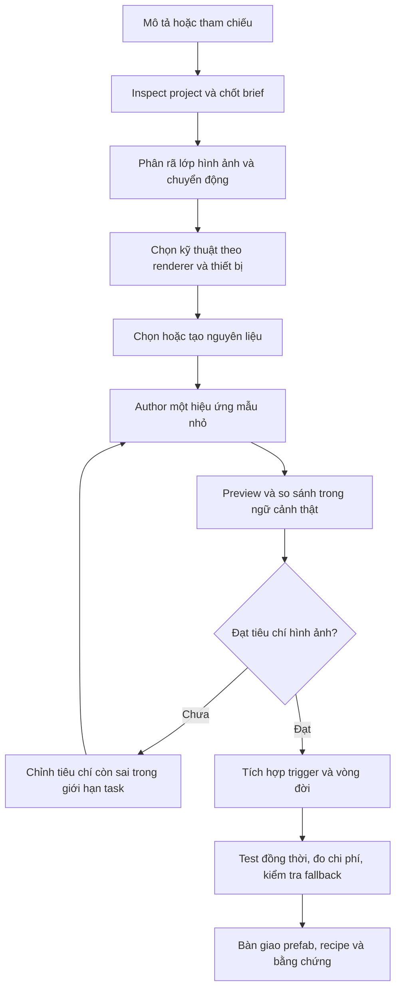

# Kế hoạch skill tạo VFX 2D/3D cho Unity

Ngày lập: 2026-11-02. Trạng thái: **đã triển khai skill experimental; đã chạy pilot Built-in, còn giới hạn graph/device**.

Mục tiêu: tạo skill `$unity-vfx-authoring` giúp đi từ mô tả, ảnh/video tham chiếu hoặc asset có sẵn đến hiệu ứng Unity có prefab chỉnh sửa được, tích hợp vào ngữ cảnh thật và có bằng chứng hình ảnh, vòng đời, hiệu năng phù hợp phạm vi. Skill phải làm tốt cả VFX 2D và 3D; kỹ thuật được chọn theo hiệu ứng và project, không suy ra từ tên gọi “VFX”.

Plan ban đầu chỉ đề xuất workflow; người dùng đã đồng ý triển khai trong cùng phiên. Skill, registry/module, docs, catalog và installer coverage đã được tạo. Pilot chạy trong lab riêng ở `.dreamy/labs/vfx-authoring-20261102`, không sửa project `block-out-clone` đang mở. Không sinh ảnh bằng AI, đổi pipeline/package project người dùng hoặc cài skill vào global.

Checkpoint triển khai: P0–P3 hoàn tất; P4 có ba prefab mẫu Built-in được lưu/nạp lại và capture; P5 có ba PlayMode case đạt nhưng graph, device/performance và integration vào gameplay thật chưa chạy. P6 hoàn tất phần tài liệu/receipt; chưa chọn target cài đặt thực. Xem [receipt](../evidence/unity-vfx-authoring-validation.json) và [hướng dẫn sử dụng](../unity-vfx-authoring.vi.md). Không coi pilot này là bảo đảm hình ảnh production, mọi pipeline hay mọi thiết bị.

## 1. Căn cứ và phần còn chưa biết

### Sự thật đã kiểm tra

- Baseline repo: commit `76be46ee73add115281ea5ee313150b65028c731`; working tree sạch khi bắt đầu lập plan.
- [toolkit.json](../../toolkit.json) ghi phiên bản `0.1.0-alpha.4`, trạng thái `alpha`, trỏ tới catalog skill, module, preset và compatibility.
- Đã có [unity-vfx](../../skills/unity-vfx/SKILL.md), [unity-particles](../../skills/unity-particles/SKILL.md), [unity-shader](../../skills/unity-shader/SKILL.md), [unity-material](../../skills/unity-material/SKILL.md). Nội dung hiện tại chủ yếu là ownership, vòng đời, bảo toàn asset và chi phí rendering; chưa có chuỗi thiết kế hình ảnh, tạo nguyên liệu, authoring và đối chiếu chuyển động đầy đủ.
- Các skill trên thuộc [unity-rendering](../../modules/unity-rendering/module.json). Preset `unity-full` và `dreamy-full` chứa module này; `dreamy-project`, `dreamy-production`, `unity-production` hiện không chứa nó.
- Đã có `dreamy-feedback`, `gameplay-pooling`, `unity-mcp`, `unity-scene-prefab`, `unity-profiling`, `unity-testing` và workflow asset trong `game-vibe-workflow` để dùng khi phù hợp. Chúng không thay thế quy trình sáng tác hiệu ứng.
- Repo toolkit không có `Packages/manifest.json` và `Packages/packages-lock.json` ở root. Cặp manifest/lock của fixture `tests/fixtures/unity/vertical-slice/Packages/` đã được đọc: có Test Framework, không cung cấp bằng chứng package VFX Graph, URP hay Dreamy Feedback cho một project đích.
- [compatibility/unity.json](../../compatibility/unity.json) có fixture `6000.4.12f1` ở trạng thái `fixture-ready-not-tested`; danh sách `tested` đang rỗng. Không coi fixture này là lab rendering đã chạy thành công.
- [Harness hiện có](../harness.md) hỗ trợ inspect, compile, Console và test; chưa có operation chuẩn để capture VFX hoặc đo GPU. Plan không giả định các operation đó đã tồn tại.

### Hợp đồng đề xuất

- Thêm một workflow sáng tác riêng `unity-vfx-authoring`, profile `compact-workflow`, maturity ban đầu `experimental`.
- Entry point có `Scope`, `Decisions`, `Verification`, `References`, tối đa 5.000 byte theo [quy ước authoring](../skill-authoring.md). Chi tiết có điều kiện nằm trong reference.
- Đặt skill ở `skills/unity-vfx-authoring/`, phân phối qua module `unity-core`. Lý do: nhu cầu tạo hiệu ứng cơ bản nên dùng được ở project thông thường mà không phải kéo toàn bộ nhóm rendering chuyên sâu. Không thêm module hay preset mới chỉ cho workflow này.
- Các skill chuyên sâu trong `unity-rendering` là tài liệu bổ sung khi được cài; workflow cơ bản phải tự đủ dùng. Không tạo link tương đối bắt buộc tới sibling chỉ tồn tại trong preset full.
- Giữ tên và trách nhiệm của `unity-vfx`/`unity-particles`; thêm routing hẹp khi cần. Không biến skill authoring thành một bản sao các skill đó.

### Giả thuyết và câu hỏi cần xác minh khi thực thi

- Particle System kết hợp sprite/mesh/trail có thể giải quyết phần lớn hiệu ứng gameplay 2D/3D quy mô nhỏ; cần pilot để đánh giá chất lượng, công sức và giới hạn.
- Chưa biết Unity version, renderer, thiết bị và art direction của project sẽ dùng skill. Vì vậy chưa thể chốt shader, số particle, texture size, mức GPU hay nhánh VFX Graph.
- Chưa có bằng chứng Unity MCP đang kết nối, có API authoring graph phù hợp hay có GPU capture trên máy thực thi. Phải phát hiện capability thực tế.
- Chưa biết asset AI có cần thiết hay không. Không biến sinh ảnh thành bước mặc định cho một hiệu ứng có thể tạo tốt bằng nguyên liệu sẵn có hoặc công cụ Unity.

## 2. Phạm vi và ranh giới trách nhiệm

| Thành phần | Sở hữu |
|---|---|
| `unity-vfx-authoring` | Brief, phân rã hiệu ứng, chọn kỹ thuật, tạo/chọn nguyên liệu, authoring, preview và bàn giao |
| `unity-vfx` / `unity-particles` | Kiến thức chuyên sâu về hệ thống, vòng đời, particle modules và chi phí |
| `unity-shader` / `unity-material` | Shader/material theo đúng pipeline, transparency, variants, instance overrides |
| `dreamy-feedback` khi package được xác minh | Kết nối hiệu ứng với yêu cầu feedback và owner hiện có |
| `gameplay-pooling` / owner project | Spawn, giới hạn đồng thời, reset, release và xử lý quá tải |
| `unity-mcp` / `unity-scene-prefab` | Thao tác Editor và asset serialization an toàn |
| `unity-profiling` / mobile skills | Thu bằng chứng và đánh giá ngân sách trên cấu hình đích |
| Gameplay/domain owner | Damage, reward, cooldown, trạng thái, hit detection có thẩm quyền |

Kích hoạt khi tạo mới, tái tạo theo tham chiếu hoặc chỉnh rõ rệt một hiệu ứng: hit, slash, fire, smoke, explosion, aura, shield, heal, dissolve, projectile trail, ambient particles hay celebration. Đầu vào có thể là mô tả chữ; không bắt người dùng cung cấp reference cho mọi task.

Yêu cầu chỉ sửa lỗi pooling, chỉ tối ưu shader, chỉ đổi prefab UI, chỉ tạo một ảnh hoặc chỉ điều tra gameplay đi về skill hẹp tương ứng. Chế độ plan-only dừng ở thiết kế và kế hoạch, không author asset. VFX trong UI phải xác định render mode/masking trước; không mặc định ParticleSystemRenderer tham gia Canvas như một UI Graphic.

## 3. Quy trình sử dụng skill



### Bước 1 — Inspect project và lập brief vừa đủ

Đọc instruction, git status, `ProjectVersion.txt`, manifest/lock, render pipeline và renderer thực sự được camera sử dụng, quality overrides, color space, camera, material/shader và hiệu ứng gần nhất. Không chỉ nhìn thấy package URP rồi suy ra đang dùng Universal Renderer 3D; phải phân biệt 2D Renderer.

Brief ghi các trường ảnh hưởng quyết định:

- Mục đích, style và vai trò gameplay; reference là mục tiêu giống hay chỉ gợi ý.
- Không gian 2D/2.5D/3D/UI; camera, khoảng cách, kích thước trên màn hình, đơn vị và mặt phẳng chuyển động.
- One-shot/loop, duration dự kiến, nhịp anticipation → impact → sustain → dissipate theo nhu cầu; trigger, cancel, pause và slow motion.
- Palette, silhouette, độ sáng, opacity, hướng và điểm nhấn; vùng không được che như nhân vật, mục tiêu hoặc UI.
- Platform/device tier, graphics API, số instance đồng thời, FPS mục tiêu; ngân sách chưa có thì ghi là tạm ước lượng.
- Đầu ra: prefab, nguyên liệu, mã integration nếu cần, preview và phạm vi build/profile. Giữ yêu cầu no-build/no-AI/no-package-change từ người dùng.

Tận dụng dữ liệu project trước khi hỏi. Thiếu thông tin không chặn việc độc lập thì ghi giả định có thể sửa; chỉ hỏi phần làm đổi hướng thực hiện đáng kể.

### Bước 2 — Phân rã hiệu ứng thành lớp có chức năng

Tạo recipe theo lớp, thay vì bắt đầu bằng tăng số particle. Mỗi lớp có vai trò, asset/material, renderer, shape, timeline, size/color/opacity curve, simulation space, sorting/depth, lifetime và cleanup owner.

Ví dụ explosion: flash tạo điểm nhấn, shockwave mô tả lực, sparks/debris mô tả hướng, smoke mô tả dư âm. Với slash 2D, các lớp có thể chỉ cần cung sáng chính, highlight và vài spark; không bắt mọi hiệu ứng có cùng số lớp hoặc cùng timeline.

Ưu tiên silhouette và timing ở góc camera thật. Chi tiết noise, distortion, light và secondary motion chỉ thêm khi cải thiện mục tiêu. So sánh reference động qua nhiều thời điểm; một ảnh tĩnh không xác định được đầy đủ chuyển động.

### Bước 3 — Chọn nhánh kỹ thuật

| Nhu cầu | Nhánh khởi đầu đề xuất | Điều phải kiểm tra |
|---|---|---|
| Hit, dust, spark, heal, celebration 2D | Particle System với billboard/sprite; sprite animation nếu phù hợp | Sorting layer/order, camera alignment, alpha, masking/lighting cần dùng |
| Slash hoặc hiệu ứng vẽ tay có hình dạng đặc trưng | Sprite/flipbook kết hợp ít particle | Pivot và frame ổn định, nhịp animation, hướng, loop nếu có |
| Fire, smoke, explosion, aura 3D thông thường | Particle System, mesh particles và lớp mesh/trail khi cần | World/local simulation, depth, soft particles nếu renderer hỗ trợ, bounds |
| Beam, laser, đường đạn hoặc vệt kiếm | Line/Trail hoặc mesh kết hợp particle | Trail reset, texture tiling, camera-facing, điểm đầu/cuối và pooling |
| Shield, dissolve, shockwave dạng bề mặt | Mesh + material; Shader Graph hoặc shader code theo pipeline | Shader support, blending, depth, dữ liệu điều khiển và instance ownership |
| Hiệu ứng GPU mật độ cao hoặc tác giả yêu cầu graph | VFX Graph sau capability check | Package/version, renderer, graphics API, compute/buffer support, platform và nhánh thay thế |
| UI overlay, icon burst, reward fly | Route UI/feedback hiện có; chọn bridge/camera/UI-native phù hợp | Canvas render mode, clipping, mask, sorting và owner của animation |

Particle System hỗ trợ nhiều pipeline; VFX Graph là một lựa chọn khác với yêu cầu riêng, không phải tên chung cho mọi VFX. Bảng chọn trên là chính sách đề xuất của skill, dựa trên [Unity: Choosing your particle system](https://docs.unity3d.com/6000.0/Documentation/Manual/ChoosingYourParticleSystem.html).

Riêng tài liệu **VFX Graph 17.0.4** nêu yêu cầu compute shaders/SSBO, hạn chế mobile và OpenGL ES. Đây là mốc đã đọc, không phải lời hứa cho mọi phiên bản. Khi triển khai phải đọc tài liệu đúng package của project; một cờ hỗ trợ compute không đủ chứng minh toàn bộ hiệu ứng chạy được. Xem [Requirements and compatibility](https://docs.unity3d.com/Packages/com.unity.visualeffectgraph@17.0/manual/System-Requirements.html).

Không tự đổi render pipeline, graphics API hay nâng package để phù hợp một recipe. Nếu người dùng yêu cầu đúng VFX Graph mà môi trường thiếu, nêu gap và chuẩn bị phần độc lập; chỉ thay bằng kỹ thuật khác khi vẫn đáp ứng phạm vi đã chọn.

### Bước 4 — Chọn hoặc tạo nguyên liệu

Thứ tự cân nhắc: asset project phù hợp → nguyên liệu procedural đơn giản → nguồn asset được phép sử dụng → AI khi có lợi cho hình dạng/style. Đây là tiêu chí lựa chọn, không ép chạy hết mọi route.

- Nguyên liệu thường cần: soft dot, ring, streak, spark, smoke, noise/mask, gradient, flipbook; mesh có thể là quad, ring, cone hoặc mesh có sẵn.
- Lưu source và runtime output riêng khi có processing; ghi nguồn, hash, quyền sử dụng cần thiết và asset đích. Không vendor asset bên thứ ba vào toolkit chỉ để minh họa.
- Nếu dùng image generation, dùng skill/tool tương ứng khi có; xác định kích thước, nền/alpha, silhouette, palette và mục đích texture. Không gọi dịch vụ khi user đã chọn no-AI. Không mặc định một ảnh concept là texture sẵn sàng import.
- Flipbook phải có frame order, grid, pivot/bounds, padding và continuity được xem thực tế. Atlas AI không mặc nhiên có chuyển động liên tục; có thể thay bằng sprite đơn + animation procedural. Texture Sheet Animation là một nhánh hỗ trợ được Unity mô tả trong [module reference](https://docs.unity3d.com/6000.0/Documentation/Manual/PartSysTexSheetAnimModule.html).
- Phân biệt color texture với data/noise mask để đặt sRGB, alpha, filter, wrap, compression và mipmap phù hợp. Kiểm tra edge halo trên nền sáng/tối và ở độ phân giải gameplay.
- Không sinh bản mới khi chỉ cần tải lại output đã hoàn thành. Ghi giới hạn thử theo task; sau giới hạn báo tiêu chí còn sai và dùng phương án phù hợp phạm vi, không retry vô hạn.

### Bước 5 — Author prefab bằng công cụ đã xác minh

1. Tạo/chỉnh trong phạm vi asset rõ ràng. Ưu tiên prefab/material hiện có khi đúng owner; giữ GUID và references.
2. Dựng một phiên bản tối thiểu đủ đánh giá silhouette/timing. Với Particle System, chọn các module cần thiết: Main, Emission, Shape, Size/Color over Lifetime, velocity/noise, texture sheet, renderer, trail/sub-emitter khi hiệu ứng cần.
3. Dùng API/Editor serialization theo phiên bản thực tế. Có thể dùng Unity MCP, tool project có sẵn hoặc helper Editor nhỏ khi cần lặp lại. Không giả định MCP có API sửa mọi property hay tạo node graph.
4. Không tự ghép YAML của prefab/scene hay đoán định dạng `.vfx`/`.shadergraph`. Graph authoring dùng công cụ Editor hoặc API được xác minh. Nếu không có đường author graph đáng tin cậy, ghi giới hạn và giữ output đúng trạng thái.
5. Static effect setup nên được lưu thành prefab và tài nguyên chỉnh sửa được. Runtime code chỉ lo tham số, trigger và vòng đời cần thiết; tránh dựng lại toàn bộ effect tree mỗi lần spawn.
6. Expose ít tham số có ích như color, scale, intensity, duration/speed khi có ý nghĩa. Không tạo framework preset hoặc service mới cho một hiệu ứng đơn lẻ.
7. Helper Editor nằm trong assembly/folder Editor; reusable cross-game runtime capability thuộc package/shared module khi thực sự cần, glue của game nằm trong `Assets/_Project`.

Nếu không có Editor, có thể chuẩn bị recipe, texture hoặc code authoring phù hợp yêu cầu, nhưng trạng thái import/compile/render vẫn là not-run. Script được viết xong không chứng minh prefab đã được tạo hay render đúng.

### Bước 6 — Preview, đối chiếu và chỉnh có mục tiêu

- Dùng scene preview nhỏ trong project lab hoặc scene kiểm chứng đang có; không bắt tạo một scene riêng cho mọi chỉnh sửa nhỏ. Sau preview phải xem trong gameplay camera/context thật.
- Giữ camera, độ phân giải, background, lighting/exposure và mốc thời gian nhất quán giữa các lần capture. Seed cố định khi hệ thống hỗ trợ giúp so sánh; không khẳng định GPU simulation deterministic trên mọi thiết bị.
- Capture các mốc onset, peak và tail kèm clip/sequence khi cần đánh giá chuyển động. Đánh giá silhouette, timing, palette, opacity, hướng, readability, clipping, loop seam, vị trí gắn và interaction với background.
- 2D: kiểm tra sorting, pixel density, trục billboard, foreground/background và masking nếu dùng. URP 2D lighting cần cấu hình shader/graph phù hợp theo phiên bản; xem [Unity: 2D lighting compatibility](https://docs.unity.com/en-us/engine/6000.0/manual/unity2d/2d-urp/2d-index/prep-shader).
- 3D: xem thêm góc camera liên quan, occlusion, bounds/culling, scale và chuyển động của emitter. Không chỉ chụp trên nền đen để kết luận hiệu ứng đọc tốt trong game.
- Mỗi vòng sửa tiêu chí còn sai và giữ phần đã đạt. Điểm số ảnh hoặc screenshot đẹp không thay thế đánh giá animation, integration và performance. Nếu hết phạm vi thời gian/thử của task, ghi gap cụ thể.

### Bước 7 — Tích hợp trigger và vòng đời

- Gameplay xác nhận sự kiện rồi yêu cầu feedback; hiệu ứng không tự grant reward, áp damage hoặc quyết định hit/cooldown. Timing hình ảnh cần khớp gameplay event đang có.
- Root/controller/presenter cấp dependency rõ ràng; leaf VFX không tìm service toàn cục. Chỉ gọi API Dreamy khi manifest/lock và compatibility hoặc source commit chứng minh API đó.
- Ghi owner của spawn, load handle, cancel, stop và release. Với one-shot, thời điểm hoàn tất phải tính cả child systems, sub-emitters, trails và phần dư; không chỉ chờ duration root. Loop có stop/cancel rõ ràng.
- Pool reset gồm particle/trail, transform, material/property override, event subscription, callback và async work. Completion cũ không được release nhầm instance đã tái sử dụng. Chỉ dùng Destroy hoặc return-to-pool theo đúng owner.
- Kiểm tra spawn liên tiếp, stop giữa chừng, scene unload, object destruction, timeScale/pause và đổi tham số trên hai instance. Xác định simulation space, parent scale và follow target có chủ ý.
- Ưu tiên service/pool sẵn có. Với tần suất thấp có thể instantiate/release đơn giản nếu đáp ứng yêu cầu; không bắt mọi task xây pool framework.

### Bước 8 — Đo chi phí và bàn giao

Ngân sách phải theo target, không có con số particle/draw call “chuẩn cho mọi mobile”. Ghi baseline và hiệu ứng ở số lượng đồng thời đại diện, gồm trường hợp peak theo brief. Đo CPU/GPU frame time khi có công cụ, allocations sau warmup, material instances, texture memory, draw calls/batches và overdraw/bandwidth khi có bằng chứng phù hợp.

Đánh đổi theo bottleneck: giảm diện tích transparent/lớp chồng, shader samples/lights, collision/sub-emitter, capacity/spawn rate hoặc texture cost; giữ điểm nhấn quan trọng. Quality tier/fallback phải có cách chọn rõ ràng và được thử ở cấu hình tương ứng. Editor FPS không chứng minh hiệu năng trên điện thoại.

Bàn giao prefab và dependencies; recipe/tham số; hướng dẫn trigger/stop; nguồn asset; preview/capture; kết quả test/profile, gap và điểm resume. Không bắt tạo player build khi task chỉ author prefab hoặc user yêu cầu no-build; khi task có claim về target player thì build/device check là gate riêng cần thực hiện hoặc ghi chưa chạy.

## 4. Cấu trúc skill dự kiến

```text
skills/unity-vfx-authoring/
  SKILL.md
  agents/openai.yaml
  references/
    technique-routing.md
    art-and-textures.md
    authoring-2d-3d.md
    integration-and-verification.md
  assets/
    effect-brief.md
    effect-recipe.json
```

- `SKILL.md`: trigger, scope, quyết định kỹ thuật, vòng lặp author/preview và điều kiện bàn giao; không nhét toàn bộ tutorial.
- `technique-routing.md`: bảng chọn kỹ thuật, capability/version check, world/UI và các nhánh thiếu tool.
- `art-and-textures.md`: decomposition, asset source, procedural/AI, alpha và flipbook QC.
- `authoring-2d-3d.md`: recipe, thao tác Editor an toàn, khác biệt sorting/depth/camera và ví dụ 2D/3D tối thiểu.
- `integration-and-verification.md`: owner, pooling/reset/cancel, capture, measurement và claim boundaries.
- `effect-brief.md`: template ngắn cho task đủ lớn; không bắt điền biểu mẫu cho chỉnh sửa vài tham số.
- `effect-recipe.json`: template cho layer, nguồn asset, tham số, binding và kết quả. Phân biệt `observed`, `intended`, `unknown`; `null` cho số đo chưa có và dùng đơn vị rõ ràng. Chỉ thêm schema/helper nếu thực sự có consumer cần kiểm tra máy đọc.
- `agents/openai.yaml`: tên/mô tả hiển thị và prompt ví dụ có `$unity-vfx-authoring`, theo convention repo; giữ automatic discovery mặc định. Không gắn dependency MCP cố định hay model/provider mặc định.

Chưa tạo `scripts/` hoặc template C# generative graph trước pilot. Nếu phát hiện thao tác lặp ổn định, thêm helper Editor có target path, ownership, báo cáo asset tạo/chỉnh và tính lặp lại an toàn; kiểm thử hành vi thực bằng Unity trước khi dùng làm bằng chứng authoring tự động.

## 5. File cần sửa khi triển khai

| Đường dẫn | Thay đổi |
|---|---|
| `skills/unity-vfx-authoring/` | Tạo entrypoint, reference, metadata và hai template |
| `skills/index.json` | Thêm tên, category `unity`, priority `P1`, depth `D3`, `compact-workflow`, maturity `experimental`; owners `dreamy_skill_author`, `dreamy_unity_developer`, `dreamy_unity_editor`, `dreamy_tester`; required evidence và eval IDs |
| `modules/unity-core/module.json` | Thêm folder skill; kiểm tra ảnh hưởng preset và context budget |
| `skills/unity-vfx/SKILL.md`, `skills/unity-particles/SKILL.md` | Routing ngắn khi task là sáng tác hiệu ứng; giữ trách nhiệm kỹ thuật hiện có |
| `skills/gameplay/game-vibe-workflow/references/asset-routing.md` | Chỉ dẫn workflow mới cho engine VFX khi skill khả dụng |
| `docs/research/source-ledger.json` | Nguồn Unity theo version, ngày truy cập, scope và giới hạn; code nguồn nếu dùng API nội bộ phải có commit đã xác minh |
| `evals/catalog.json` | Positive, near-miss negative, conflict và degraded scenarios ở phần dưới |
| `tests/unit/installer-lifecycle.test.mjs` | Install/update/uninstall skill, templates và links theo layout installed |
| `docs/unity-vfx-authoring.vi.md`, `README.md`, `CHANGELOG.md` | Hướng dẫn gọi skill, ví dụ ngắn, trạng thái experimental và giới hạn pilot |
| `docs/evidence/unity-vfx-authoring-validation.json` | Receipt authoring/validation và pilot thực tế; không ghi pass cho bước chưa chạy |

Không sửa version, phase hoặc maturity toàn toolkit chỉ vì có plan/skill mới. Không sửa `compatibility/unity.json.tested` bằng suy luận từ tài liệu hoặc fixture chưa chạy. Không tự cập nhật report release như một phần kiểm tra thông thường.

## 6. Trình tự triển khai và cổng nghiệm thu

| Mốc | Công việc và đầu ra | Điều kiện qua |
|---|---|---|
| P0 — Chốt hợp đồng | Kiểm tra lại baseline, scope, capability và nguồn đúng version; chọn lab có thể dùng | Facts/contract/unknown riêng; có danh sách task bắt đầu được và đường xử lý thiếu Editor |
| P1 — Viết skill | Entry, bốn reference, metadata và templates theo cấu trúc trên | Entry dưới 5.000 byte, links hợp lệ, ví dụ cả 2D/3D, không bắt tool/provider không có |
| P2 — Nối toolkit | Registry/module, routing, docs, source ledger và installer coverage | Skill resolve ở core preset, hoạt động khi không có `unity-rendering`, install/update/uninstall giữ file người dùng |
| P3 — Kiểm tra cấu trúc | Validation, test installer, catalog specifications và `npm test` | Check pass; phân biệt catalog validation với semantic/Unity evidence |
| P4 — Pilot authoring | Thực hiện các recipe đại diện trong lab, lưu asset và capture thật | Prefab import/save/reopen, compile/Console, render và lifecycle có kết quả cho từng pilot |
| P5 — Kiểm tra hành vi và chi phí | Chạy scenarios thực, xem artifacts và đo branch có claim performance | Không có lỗi nghiêm trọng về scope, ownership, serialization; kết quả hình ảnh/lifecycle/profile ghi riêng |
| P6 — Hoàn thiện và phân phối | Sửa từ lỗi quan sát được, cập nhật receipt/docs; kiểm tra diff | Trạng thái phản ánh đúng nhánh đã chứng minh; cài/update vào target cụ thể khi task triển khai yêu cầu |

Không cần gọi model nền hay giao agent tự động để hoàn tất các mốc. Evaluation bằng model/provider ngoài chỉ thực hiện khi nằm trong phạm vi được phép; kiểm tra deterministic tự nó không chứng minh quyết định sáng tác tốt.

P0–P3 có thể hoàn thành trước khi có Unity lab. Nếu P4–P5 chưa chạy, chỉ kết luận “skill authoring và packaging đã kiểm tra”, chưa kết luận “đã tạo VFX 2D/3D thành công”. Maturity vẫn experimental và các nhánh chưa pilot ghi rõ. Một pilot không chứng minh mọi Unity version/platform.

## 7. Ma trận pilot và tiêu chí quan sát

| Pilot | Thiết lập đề xuất | Bằng chứng cần có |
|---|---|---|
| A — Hit/slash 2D | Orthographic; Particle System + sprite/flipbook tối thiểu | Sorting trước/sau nhân vật đúng, alpha không viền lỗi, silhouette rõ ở kích thước thật, onset/peak/tail và replay đúng |
| B — Explosion 3D | Camera gameplay; flash, ring, sparks, smoke với Particle System/mesh | Depth/occlusion và bounds đúng; các lớp kết thúc đầy đủ; không mất tail khi return pool |
| C — Trail + aura loop | Emitter di chuyển, bật/tắt, tái sử dụng | Không nối trail giữa hai lần spawn; stop/cancel/scene unload dọn sạch; đổi tham số không rò sang instance khác |
| D — VFX Graph có điều kiện | Chỉ khi lab có đúng package, renderer và graphics capability | Graph mở/import/compile/render thật, event và bounds kiểm chứng; fallback được test nếu phạm vi cần |
| E — Target device có điều kiện | Device/API/tier theo brief, số lượng VFX peak đại diện | Số đo gắn cấu hình, baseline và capture; không dùng Editor FPS thay thế |

Lab được chọn ở P0; không tự chuyển renderer của fixture vertical-slice hoặc project người dùng để chạy các pilot. Ưu tiên project lab tách biệt; ghi exact Editor revision, package lock hash, renderer và hardware. Tài nguyên demo nên tự tạo hoặc có nguồn phân phối rõ ràng, không copy output game clone sang toolkit.

Recipe A–C là bộ chứng minh tối thiểu đề xuất cho phạm vi authoring 2D/3D và vòng đời. D/E là gate khi muốn công bố các claim tương ứng. Trường hợp target chỉ có Built-in hoặc không có graph vẫn hoàn thành được nhánh Particle System; không báo graph pass.

## 8. Ma trận eval hành vi dự kiến

| ID đề xuất | Tình huống | Hành vi cần quan sát |
|---|---|---|
| `vfx-create-2d-hit` | Tạo hit nhỏ trong game 2D, không có reference | Tận dụng project style, chọn nhánh phù hợp, brief ngắn và preview đúng camera |
| `vfx-create-3d-explosion` | Tạo explosion 3D mobile với nhiều instance | Phân lớp, giới hạn đồng thời, cleanup cả tail và đo theo brief |
| `vfx-reference-motion` | Tái tạo slash từ clip | Ghi timeline, shape và các mốc so sánh; không kết luận giống từ một ảnh |
| `vfx-graph-required-missing` | User yêu cầu VFX Graph nhưng package/API thiếu | Không tự nâng pipeline/package; nêu gap và giữ yêu cầu kỹ thuật chưa đạt |
| `vfx-mobile-gles` | Target API không phù hợp graph đã chọn | Đối chiếu đúng version và target, chọn fallback khi được scope cho phép |
| `vfx-2d-lighting` | URP 2D Renderer cần VFX chịu Light2D | Kiểm tra shader/renderer compatibility thực tế, không suy ra từ việc có URP |
| `vfx-pool-reuse-trail` | Tái sử dụng khi callback cũ chưa xong | Không release nhầm instance, không trail cũ hay shared material leakage |
| `vfx-ui-overlay` | Effect phải theo UI mask trong overlay Canvas | Kiểm tra đường render/mask; không chỉ đổi sorting layer của particle world |
| `vfx-no-editor` | Có filesystem, thiếu Unity Editor/MCP | Chuẩn bị phần được yêu cầu và ghi import/render/test not-run |
| `vfx-ai-flipbook-qc` | Có atlas AI nhưng các frame lệch và nhảy hình | Xem alpha/pivot/continuity, sửa hoặc chọn route khác; không coi output tool là animation đạt |
| `vfx-negative-pool-bug` | Chỉ sửa một lỗi return-to-pool | Dùng workflow lifecycle hẹp, không tự thiết kế lại art hoặc thêm texture |
| `vfx-negative-single-image` | Chỉ cần ảnh minh họa explosion | Route image workflow; không tạo prefab/project Unity |
| `vfx-conflict-no-ai-no-build` | Tạo effect nhưng cấm AI và build | Dùng asset/procedural phù hợp, kiểm tra Editor trong scope; không gọi AI/build |
| `vfx-plan-only` | Chỉ yêu cầu plan hiệu ứng | Giao thiết kế/recipe/acceptance, không mutate project |

Catalog chỉ lưu expectation; semantic pass phải dựa trên quyết định và artifact thực được xem. Khi đánh giá, phân biệt lỗi routing/ownership, lỗi kỹ thuật, chất lượng hình ảnh và thiếu công cụ; không cho “file tồn tại” hoặc keyword match thay mọi tiêu chí.

## 9. Lệnh kiểm tra và evidence

Trong toolkit, sau khi triển khai:

```powershell
npm run validate
node --test tests/unit/installer-lifecycle.test.mjs
npm test
git diff --check
git status --short
```

Chỉ mở rộng test khi có thay đổi/failure cần thêm bằng chứng. Dùng `quick_validate.py` của skill-creator khi công cụ đó sẵn có; ghi chính xác đường dẫn và dependency thiếu thay vì giả định script thuộc repo toolkit.

Với project lab đã chọn, thay `<LAB_PROJECT>` bằng absolute path và cấu hình `DREAMY_UNITY_PATH` khi dùng batchmode:

```powershell
node harness/dreamy-harness project-inspect <LAB_PROJECT>
node harness/dreamy-harness compile <LAB_PROJECT>
node harness/dreamy-harness console <LAB_PROJECT>
node harness/dreamy-harness test-editmode <LAB_PROJECT>
node harness/dreamy-harness test-playmode <LAB_PROJECT>
```

Chọn test layer thật sự chứng minh thay đổi: EditMode cho asset binding/authoring helper nếu có; PlayMode cho stop/reset/reuse/destruction có fixture tương ứng. Không coi test runner chạy mà không có case liên quan là xác nhận lifecycle. Khi Editor đang mở project, dùng bridge/test runner đang có, tránh batchmode tranh project lock.

Capture/profile dùng tool thực tế phát hiện ở lab hoặc thao tác Editor có ghi nhận; chưa có lệnh harness sẵn cho hai việc này. Receipt lưu source revision/hash, Editor/package/renderer/target, command hoặc thao tác, trạng thái, log/test artifact, ảnh/clip và metric kèm đơn vị. Gate nội bộ dùng `pass/fail/not-run`; khi đưa kết quả harness vào phải giữ nguyên trạng thái `degraded` cùng nguyên nhân.

Các kết luận độc lập cần giữ: cấu trúc skill hợp lệ; installer đúng; asset import/compile được; effect nhìn đúng; vòng đời đúng; hiệu năng đạt target; player build/device đã chạy. Chỉ công bố kết luận có bằng chứng tương ứng.

## 10. Rủi ro và checkpoint tiếp theo

| Rủi ro | Cách xử lý trong workflow |
|---|---|
| Tên skill mới trùng trách nhiệm cũ | Giữ authoring từ brief đến preview là phần riêng; sửa routing thay vì nhân đôi manual |
| Preset core không cài skill rendering chuyên sâu | Entry/reference tự đủ cho nhánh cơ bản; link sang specialist là tùy khả dụng và có installer coverage |
| Graph serialization/API thay đổi | Kiểm tra đúng phiên bản; dùng Editor/tool được xác minh; không đoán YAML hoặc API nội bộ |
| Hình đẹp trong demo nhưng sai gameplay | Capture ở camera, background, kích thước và state thật; test motion, sorting và occlusion |
| Pool cắt tail, rò material hoặc callback | Completion theo toàn hiệu ứng, reset/cancel có owner và scenario tái sử dụng |
| Hiệu ứng quá đắt trên mobile | Peak concurrency theo brief, đo đúng target và giảm bottleneck; ghi giới hạn chưa đo |
| Scope phát sinh thành framework VFX lớn | Pilot trước; chỉ thêm helper/module/schema khi có nhu cầu lặp cụ thể |

Checkpoint hiện tại: entrypoint 4.249 byte, bốn reference, hai template, metadata, registry/module và routing đã triển khai. Catalog có 14 scenario mới; validation/catalog không đồng nghĩa semantic evaluation. Unity 6000.4.12f1 chạy lab riêng Built-in/Direct3D12, đã author/save/reload ba prefab, render preview và pass ba PlayMode case. Bước tiếp theo cho một task sử dụng skill là chọn project/brief thật rồi kiểm tra capability, visual context và target budget tương ứng; graph/mobile chưa có bằng chứng.

Kiểm tra cho lần lập plan: `npm run validate` pass (86 skill hiện có, 8 size advisories); toàn bộ Markdown link tới file local trong plan tồn tại, không có trailing whitespace. Chỉ thêm tài liệu kế hoạch; không chạy Unity hoặc semantic evaluation và không đánh dấu mốc triển khai skill hoàn tất.

Kiểm tra khi triển khai được ghi riêng trong [receipt](../evidence/unity-vfx-authoring-validation.json): 87 skill, catalog 150 case, installer lifecycle và unit suite; validator skill-creator chạy bằng `uv --with PyYAML` vì Python mặc định thiếu yaml. Không sửa compatibility registry của fixture vertical-slice dựa trên lab mới.

## Nguồn đã đọc khi lập plan

Đối chiếu ngày 2026-11-02. Đây là nguồn hướng dẫn, không phải runtime compatibility receipts của project đích:

- [Unity 6.0 — Choosing your particle system](https://docs.unity3d.com/6000.0/Documentation/Manual/ChoosingYourParticleSystem.html): hai giải pháp và khác biệt pipeline/authoring.
- [VFX Graph 17.0.4 — Requirements and compatibility](https://docs.unity3d.com/Packages/com.unity.visualeffectgraph@17.0/manual/System-Requirements.html): yêu cầu và giới hạn của mốc package đã đọc; cần đối chiếu lại với resolved package thực tế.
- [Unity 6.0 — Texture Sheet Animation](https://docs.unity3d.com/6000.0/Documentation/Manual/PartSysTexSheetAnimModule.html): nhánh texture grid/sprite cho animation particle.
- [Unity 6.0 — Make a GameObject compatible with 2D lights](https://docs.unity.com/en-us/engine/6000.0/manual/unity2d/2d-urp/2d-index/prep-shader): shader/VFX configuration cho 2D lighting.
- Quy ước repo: [Skill authoring](../skill-authoring.md), [Harness](../harness.md), [Toolkit evolution](../toolkit-evolution.md), cùng các file nguồn đã liên kết ở phần hiện trạng.
